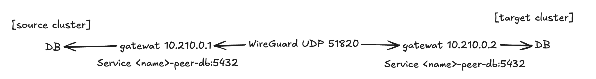
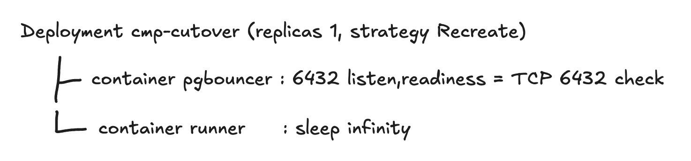

import GitHubRepoCard from "@/components/GitHubRepoCard.astro";
import MermaidDiagram from "@/components/MermaidDiagram.astro";
import dataMigrationDemo from "./assets/data-migration-demo.gif?url";

이번에 소프트뱅크 해커톤에서 클라우드 마이그레이션 플랫폼을 개발하였다.  
그 중 데이터 이전 과정에 대해 딥다이브 해보려한다.

<GitHubRepoCard
  repo="SoftBank-Hackathon-2026-Team-Jackal/cloud-migration-platform"
  title="Cloud Migration Platform"
  description="소프트뱅크 해커톤 결선에서 개발한 클라우드 마이그레이션 플랫폼"
  previewImage="https://opengraph.githubassets.com/83b609258d2f81f8121b37bef3e2b91ad3f4f0a049cf878a7a73eba5de4afdff/SoftBank-Hackathon-2026-Team-Jackal/cloud-migration-platform"
/>

> [!info] 클라우드 마이그레이션 플랫폼 시리즈
>
> **1편 · 데이터 이전 과정**
>
> **2편 · DB 전환 과정 (예정)**


<MermaidDiagram
  label="데이터 이전부터 DB 전환까지의 전체 흐름"
  chart={`flowchart LR
  SRC[(source DB)] -->|logical replication| GW[standing gateway · NLB<br/>on the source side]
  GW -->|WireGuard data tunnel| TGT[(target DB)]
  TGT --> ST[catch up on changes]
  ST --> SH[shadow rehearsal<br/>mirror real GETs · compare]
  SH --> AP{DB cutover approval}
  AP --> PB[hold writes briefly in PgBouncer<br/>sync sequences · verify row counts and checksums]
  PB --> SW[target becomes the writer]
  SW --> RV[reverse replication<br/>target → source, for rollback]`}
/>

환경은 AWS EKS -> On-Prem k3s 환경으로의 이전을 대상으로 하였다.

## 데이터 이전 
데이터 이전의 경우 아래 플로우를 따라 실행된다.
```text
복제경로 구축
-> 네트워크 Preflight
-> DB 사전 점검
-> PgBouncer 설치 
-> 준비
-> 스키마 복사
-> 구독 생성
-> 동기화 감시
-> 섀도 리허설(옵션)
-> PgBouncer 설치 완료 대기
-> 감시와 전환 승인 요청
```

### 복제경로 구축
개발 당시 On-Prem 의 정의는 사용자 로컬에서(노트북 포함) 돌아가는 환경이였기에 NAT뒤에 위치한걸 고려해야했다.

해당 문제를 해결하기 위해 역방향 연결을 선택하였고 원본에서 대상으로 접속하지 않고 대상에서 원본으로 접속하였다.

이때 DB를 인터넷에 노출하지 않아야했기에 원본과 대상사이에 WireGuard 터널을 두고 터널 안쪽에서만 DB식별 가능하도록 구성했다.
> **WireGuard** : 신뢰할 수 없는 인터넷망을 통해 안전하게 통신할 수 있도록 두 기기 사이에 암호화된 가상 사설망(VPN) 터널을 만들어주는 차세대 오픈소스 VPN 프로토콜




### 생성 시간 최적화 
데모시연시 시간을 줄이기 위해 약간의 최적화를 거쳤다  
**문제 사항**
1. NLB를 만드는데 2~3분이 걸렸다.
2. 게이트웨이 Pod를 매번 새로 만들면 NLB가 Pod IP를 등록하고 헬스 판정시까지 약 30초동안 handshake UDP를 버렸다.

해결하기 위해서 "실행할 때마다 만들던 원본 쪽 자원을 미리 만들어 두고 계속 살려두는 방식" 을 택하였다.

바꾸기 전에는 이전 시작 -> 원본 NLB생성 -> 원본 게이트웨이 Pod생성 -> NLB가 새 Pod IP 등록 -> 헬스체크 -> 대상 게이트웨이 접속 -> handshake
과정을 거쳤지만 변경하여 
- NLB
- 원본 게이트웨이  

위 두개를 만들어두고 재사용 하는 방식으로 변경하여 
1. NLB의 허용 IP를 이번 이전과정에서 구축된 온프레미스 IP로 변경
2. 이미 떠 있는 원본 게이트웨이에 `kubectl exec`로 파일 한줄을 쓰는데 이번 상대의 공개키와 연결할 원본 DB주소를 작성하였다 이를 통해 게이트웨이가 1초마다 파일을 읽다가 바뀌면 WireGuard peer만 갈아끼웠다.
3. 온프레미스 쪽 게이트웨이만 새로 띄워서 NLB로 접속

> **peer** : 통신 상대 라는 뜻으로 WireGuard에서는 터널로 연결되는 반대편 끝을 peer라고 부른다

### 네트워크 Preflight
기존에는 데이터 이전을 바로 실시하였지만 개발 과정에서 데이터 경로 안정성을 보강 하기 위해서 추가하였다.

1. 대역 충돌 검사
2. 라우트 검사
3. 단계별 접속 확인
4. 대량 데이터 테스트 

#### 대역 충돌 검사 
세 그룹으로 짝지어 비교한다 
- AWS VPC 대역
- 온프레미스에서 실제로 라우팅되는 대역 
- 터널 대역 

원본 DB와 온프레미스 Pod 대역이 겹칠 경우 온프레미스에서 원본 DB로 패킷을 보낼때 자신의 클러스터 안에서 길을 찾아 헤맬 가능성이 있다.

#### 라우트 검사 
1. 목적지 IP확인
2. 노드의 라우팅 결정 확인 

DB주소를 실제 IP로 풀어본다 -> 해당 IP가 허용된 사설 대역 안에 있는지 확인하며 벗어났다면 터널을 타지 않는다고 판단하여 실패 처리한다.  
그 후 노드에서 `ip route get <DB IP>` 를 실행하여 리눅스 커널이 어떤 인터페이스,어떤 게이트웨이,어떤 출발지IP를 쓸지 알아낸다.  
해당 값과 기대한 터널 인터페이스·게이트웨이와 같은지 비교하여 다르다면 실패 처리한다.

#### 단계별 접속 확인 
단계별로 접속을 확인하고 아래 순서대로 실행된다.
1. DNS
2. TCP
3. TLS,인증,쿼리

DB에 안붙는다 라는 이유만으로는 원인을 알수없어 단계별로 나누어 어떤 문제가 발생하는지 파악한다.

#### 대량 데이터 테스트
DB에 4MiB 짜리 문자열을 만들어 달라하여 받는다.
읽기 전용이라 DB에 쓰이는것은 없다.

앞선 단계에서 `SELECT 1`은 패킷 몇개면 끝나기에 큰건 끊기는 문제를 확인하지 못한다.
- MTU문제 : WireGuard 터널은 헤더 때문에 MTU가 1420으로 아주작다. 그렇기에 큰패킷을 쪼개야 한다는 ICMP신호가 중간에서 막히면 큰 패킷은 유실될수 있다.
- 비대칭 경로와 상태 저장 방화벽 : 가는 길과 오는 길이 다르면 방화벽이 ACK를 추적하지 못해 약 64KiB 근처(TCP 윈도우 하나 분량)에서 연결이 끊기는 사례가 있다.

> 정리하자면 대역 계산 -> 커널 라우팅 결정 -> 단계별 접속 -> 대용량 실전송 순으로 좁혀 들어갔다.

### PgBouncer 설치 
DB전환의 핵심은 아주 짧게! 쓰기를 멈춘 뒤, 앱이 바라보는 DB를 바꾸는 것인데 앱이 원본 DB에 직접 붙어있으면 DB를 바꿀때 앱을 아예 재시작을 해야하고 그렇게 되면 다운타임이 초단위로 늘어나게 된다.  
그래서 앱과 DB사이에 PgBouncer라는 커넥션 풀러를 끼우도록 한다.
> **커넥션 풀러** : DB와의 연결을 미리 생성해 풀에 보관 -> 애플리케이션 요청이 들어올 때마다 이를 빌려주고 반납하는 방식으로 관리하는 미들웨어 or 소프트웨어 컴포넌트

실행시점은 DB 사전 점검 직후에 병렬로 설치하게 된다(뒤에 나오는 작업들과 동시 진행).

| 명령 | 동작 |
|---|---|
| `PAUSE` | 새로운 쿼리 수신을 중단하고, 진행 중인 트랜잭션은 완료될 때까지 기다린다. 이후 들어오는 쿼리는 에러를 반환하지 않고 대기열에 적재되며, 최대 대기 시간은 `query_wait_timeout`(기본 60초)이다. |
| `RELOAD` | 설정 파일(`databases.ini`)을 다시 읽어 연결 대상 DB를 변경. |
| `RESUME` | 대기 중인 쿼리의 처리를 재개하고, 변경된 설정에 따라 새 DB로 전달. |

설치과정은 아래와 같다.
1. 원본 DB로그인 정보 확보
2. 앱 Secret에서 원래 `DATABASE_URL`읽기
3. 상태 Secret `cmp-cutover`생성
4. Deployment 와 Service를 `kubectl apply --server-side`로 적용
5. `rollout status` 로 Ready 까지 대기 

#### 띄우는 Pod 구성 


### 복제 준비 
섹션 진행에 앞서 아래 내용에서 나오는 용어는 아래와 같다. 
- 발행자(publisher) = 원본 DB
- 구독자(subscriber) = 대상 DB

#### 원본 : PK없는 테이블에 `REPLICA IDENTITY FULL`
논리 복제는 SQL이 아닌 "어떤 행이 어떻게 바뀌었는지" 변경 내역을 WAL에서 꺼내 보낸다

논리복제시에 UPDATE·DELETE 를 옮기려면 대상 DB가 어느 행을 고칠지 찾을수 있어야하는데 
- PK가 있는 테이블 : WAL에 PK값만 실어 보내면 대상이 그 키로 행 찾기 가능
- PK가 없는 테이블 : 행을 특정할 값이 없어서 PostgreSQL이 원본의 UPDATE·DELETE 를 에러처리함

그래서 사전 점검에서 찾아 둔 PK 가 없는 테이블에만 `REPLICA IDENTITY FULL` 을 걸어 옛 행의 모든 열값을 WAL에 실어 보낸다

#### 원본 : marker 테이블을 생성한다
지금 당장은 쓰지 않고 DB전환시에 사용하는 도구인데 전환시에 쓰기를 PAUSE한 뒤 원본에 marker 행을 하나 INSERT한다.  
그 행이 대상에 도착하면 "앞의 변경은 전부 도착했구나"라고 확신 가능하다.

#### 대상 : `wal_level = logical`로 바꾼뒤 재시작

| `wal_level` | 기록하는 내용 | 지원 기능 |
|---|---|---|
| `minimal` | 장애 복구에 필요한 최소한의 정보 | 크래시 복구 |
| `replica` (기본값) | `minimal` + 물리 복제에 필요한 정보 | 크래시 복구, 물리 복제 |
| `logical` | `replica` + 테이블의 행 단위 변경 정보 (INSERT, UPDATE, DELETE 등) | 크래시 복구, 물리 복제, 논리 복제 |

WAL에 얼마나 자세히 기록할지를 정하는 `wal_level`은 기본값이 replica여서 디스크 블록을 어떻게 고쳤는지 정도만 남는다 logical로 변경하게 되면 기록을 "어느 테이블의 어느 행이 어떻게 바뀌었는지" 까지 풀어낼수 있어 정보가 더해지고 논리 복제는 이걸 다른 DB로 보낸다.  

> `왜 대상 DB를 변경?` : 원본만 변경하면 될것 같지만 롤백용 역방향 복제를 해야할 경우 대상이 발행자가 되기 때문에 준비 단계에서 미리 바꾸어준다.

### 스키마 복사 
논리 복제는 데이터만 옮기고 DDL은 옮겨주지 않는다.  
그렇기에 대상에 같은 모양의 빈 테이블이 먼저 있어야 구독이 데이터를 넣을수 있다.

### 구독 생성
1. 전용 복제 계정 `cmp_repl` : 읽기 권한만 갖고있는(복제에 필요한 권한만) 계정 생성
2. 원본 publication 생성 : 내보낼 목록을 정해두기
3. 대상 subscription 생성 : 대상 DB가 터널을 통해 원본에 붙는다.

위에 과정이 수행되면 아래와같이 순차적으로 일어난다.
```
1.원본에 논리 복제 슬롯 생성 -- 이 순간의 LSN을 출발점으로 고정
2.테이블마다 tablesync worker 가 COPY --슬롯 생성 시점 스냅샷 기준(초기 복사)
3.복사가 끝난 테이블부터 apply worker가 출발점 이후 WAL 변경을 받아 적용 -- CDC
```

> LSN(Log Sequence Number) : WAL안의 위치 번호  
복제 슬롯 : PostgreSQL은 기본적으로 오래된 WAL을 삭제하는데 이때 대상 DB가 아직 가져가지 못한 WAL을 삭제하지 못하도록 책갈피 역할   
CDC(Change Data Capture) : 변경분만 계속 잡아 보내기
