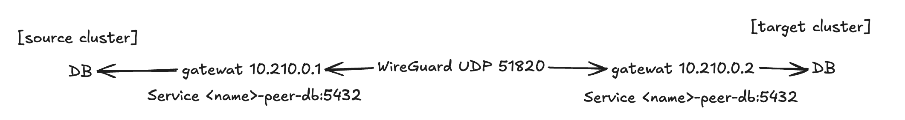
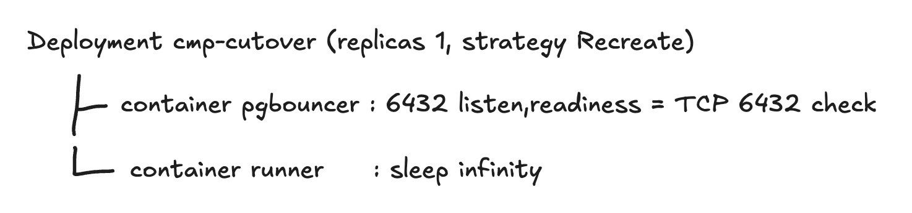

import GitHubRepoCard from "@/components/GitHubRepoCard.astro";
import MermaidDiagram from "@/components/MermaidDiagram.astro";
import dataMigrationDemo from "../../cloud-migration/assets/data-migration-demo.gif?url";

This time, I developed a cloud migration platform at the SoftBank Hackathon.  
Of that, I want to do a deep dive into the data migration process.

<GitHubRepoCard
  repo="SoftBank-Hackathon-2026-Team-Jackal/cloud-migration-platform"
  title="Cloud Migration Platform"
  description="A cloud migration platform developed at the SoftBank Hackathon finals"
  previewImage="https://opengraph.githubassets.com/83b609258d2f81f8121b37bef3e2b91ad3f4f0a049cf878a7a73eba5de4afdff/SoftBank-Hackathon-2026-Team-Jackal/cloud-migration-platform"
/>

> [!info] Cloud Migration Platform Series
>
> **Part 1 · Zero-Downtime Data Migration with PostgreSQL Logical Replication**
>
> **[Part 2 · Preparing the DB Cutover with Sync Monitoring and a Shadow Rehearsal](/en/posts/cloud-migration/cloud-migration-2/)**
>
> **Part 3 · The DB Cutover Process (coming soon)**


<MermaidDiagram
  label="The overall flow from data migration to DB cutover"
  chart={`flowchart LR
  SRC[(source DB)] -->|logical replication| GW[standing gateway · NLB<br/>on the source side]
  GW -->|WireGuard data tunnel| TGT[(target DB)]
  TGT --> ST[catch up on changes]
  ST --> SH[shadow rehearsal<br/>mirror real GETs · compare]
  SH --> AP{DB cutover approval}
  AP --> PB[hold writes briefly in PgBouncer<br/>sync sequences · verify row counts and checksums]
  PB --> SW[target becomes the writer]
  SW --> RV[reverse replication<br/>target → source, for rollback]`}
/>

The target environment was a migration from AWS EKS -> On-Prem k3s.

---

## Data Migration

Data migration runs along the flow below.
```text
Build the replication path
-> Network preflight
-> DB precheck
-> Install PgBouncer
-> Prepare
-> Copy the schema
-> Create the subscription
-> Monitor the sync
-> Shadow rehearsal (optional)
-> Wait for the PgBouncer install to finish
-> Monitor and request cutover approval
```

---

### Building the Replication Path

At the time of development, On-Prem was defined as an environment running on the user's local machine (including laptops), so I had to account for it sitting behind NAT.

To solve this, I chose a reverse connection: instead of connecting from the source to the target, the target connects to the source.

Since the DB must not be exposed to the internet, I placed a WireGuard tunnel between the source and the target and set it up so the DB can only be reached from inside the tunnel.

> **WireGuard** : A next-generation open-source VPN protocol that creates an encrypted virtual private network (VPN) tunnel between two devices so they can communicate securely over an untrusted internet network



#### Optimizing Creation Time

I did a bit of optimization to cut down the time during the demo

**Problems**

1. Creating the NLB took 2–3 minutes.
2. If the gateway Pod was created fresh every time, the NLB dropped handshake UDP for about 30 seconds until it registered the Pod IP and judged it healthy.

To solve this, I chose "creating the source-side resources that used to be made on every run in advance and keeping them alive."

**Before the change**, it went through

```text
Start the migration
-> Create the source NLB
-> Create the source gateway Pod
-> NLB registers the new Pod IP
-> Health check
-> Target gateway connects
-> handshake
```

this process, but **I changed it** so that

- NLB
- Source gateway

these two are created in advance and reused, so that

1. The NLB's allowed IP is changed to the on-premises IP set up for this migration
2. A single line is written to a file in the already-running source gateway with `kubectl exec`, containing this run's peer public key and the source DB address to connect to. Through this, the gateway reads the file every second and, when it changes, swaps out only the WireGuard peer.
3. Only the on-premises gateway is newly started and connects through the NLB

> **peer** : Means "communication partner"; in WireGuard, the other end connected through the tunnel is called the peer

---

### Network Preflight

Originally, data migration ran right away, but I added this during development to reinforce the stability of the data path.

1. Range conflict check
2. Route check
3. Step-by-step connection check
4. Bulk data test

#### 1) Range Conflict Check

It compares three groups in pairs

- AWS VPC range
- Ranges actually routed on-premises
- Tunnel range

If the source DB and the on-premises Pod range overlap, when on-premises sends packets to the source DB, they may wander around looking for a path inside their own cluster.

#### 2) Route Check

1. Check the destination IP
2. Check the node's routing decision

It resolves the DB address to its actual IP -> checks whether that IP is within the allowed private range, and if it falls outside, it judges that the traffic won't go through the tunnel and fails.  
After that, it runs `ip route get <DB IP>` on the node to find out which interface, which gateway, and which source IP the Linux kernel will use.  
It compares those values with the expected tunnel interface and gateway, and fails if they differ.

#### 3) Step-by-Step Connection Check

It checks the connection step by step, running in the order below.

1. DNS
2. TCP
3. TLS, authentication, query

"It won't connect to the DB" alone doesn't tell you the cause, so it splits the check into steps to figure out which problem is occurring.

#### 4) Bulk Data Test

It asks the DB to generate a 4MiB string and receives it.  
Since it's read-only, nothing is written to the DB.

In the earlier steps, `SELECT 1` finishes in a few packets, so it can't catch problems where large transfers get cut off.

- MTU problem : The WireGuard tunnel has a very small MTU of 1420 because of its header. So if the ICMP signal saying a large packet needs to be fragmented is blocked along the way, large packets can be lost.
- Asymmetric paths and stateful firewalls : If the outbound and return paths differ, the firewall can't track the ACKs, and there are cases where the connection drops around 64KiB (one TCP window's worth).

> To sum up, I narrowed it down in the order of range calculation -> kernel routing decision -> step-by-step connection -> real bulk transfer.

---

### Installing PgBouncer

The key to the DB cutover is to stop writes very briefly! and then change the DB the app looks at, but if the app is connected directly to the source DB, you have to restart the app entirely when switching the DB, and then the downtime grows to seconds.  
So I put a connection pooler called PgBouncer between the app and the DB.

> **Connection pooler** : Middleware or a software component that creates connections to the DB in advance and keeps them in a pool -> lends one out whenever an application request comes in and takes it back when it's returned

It is installed in parallel right after the DB precheck (running at the same time as the tasks that come after).

| Command | Behavior |
|---|---|
| `PAUSE` | Stops accepting new queries and waits for in-progress transactions to complete. Queries that come in afterward are queued without returning an error, and the maximum wait time is `query_wait_timeout` (default 60 seconds). |
| `RELOAD` | Re-reads the config file (`databases.ini`) and changes the target DB to connect to. |
| `RESUME` | Resumes processing the waiting queries and forwards them to the new DB according to the changed config. |

The installation process is as follows.

1. Obtain the source DB login information
2. Read the original `DATABASE_URL` from the app Secret
3. Create the state Secret `cmp-cutover`
4. Apply the Deployment and Service with `kubectl apply --server-side`
5. Wait until Ready with `rollout status`

#### The Pod Configuration Being Deployed



---

### Preparing for Replication

Before going through this section, the terms that appear below are as follows.

- Publisher = source DB
- Subscriber = target DB

#### Source : `REPLICA IDENTITY FULL` on Tables Without a PK

Logical replication doesn't send SQL; it pulls the change history of "which row changed and how" out of the WAL and sends it

To carry over UPDATE·DELETE during logical replication, the target DB has to be able to find which row to modify

- Tables with a PK : Sending just the PK value in the WAL lets the target find the row by that key
- Tables without a PK : There's no value to identify the row, so PostgreSQL throws an error on the source's UPDATE·DELETE

So only on the tables without a PK found during the precheck, I set `REPLICA IDENTITY FULL` to send all the column values of the old row in the WAL

#### Source : Create the Marker Table

It's not used right now but is a tool used during the DB cutover; during the cutover, after writes are PAUSEd, one marker row is INSERTed into the source.  
When that row arrives at the target, you can be sure that "all the earlier changes have arrived."

#### Target : Change to `wal_level = logical` and Restart

| `wal_level` | What it records | Supported features |
|---|---|---|
| `minimal` | The minimum information needed for failure recovery | Crash recovery |
| `replica` (default) | `minimal` + information needed for physical replication | Crash recovery, physical replication |
| `logical` | `replica` + row-level change information for tables (INSERT, UPDATE, DELETE, etc.) | Crash recovery, physical replication, logical replication |

`wal_level`, which decides how much detail to record in the WAL, defaults to replica, so it only keeps roughly how disk blocks were modified. Changing it to logical adds information so the record can be decoded down to "which row of which table changed and how", and logical replication sends this to another DB.

> `Why change the target DB?` : It might seem enough to change only the source, but if reverse replication for rollback is needed, the target becomes the publisher, so I change it in advance during the prepare step.

---

### Copying the Schema

Logical replication only moves data and doesn't carry over DDL.  
So the target has to have empty tables of the same shape first for the subscription to insert data.

---

### Creating the Subscription

1. Dedicated replication account `cmp_repl` : Create an account that only has read permission (only the permissions needed for replication)
2. Create a publication on the source : Define the list to publish
3. Create a subscription on the target : The target DB connects to the source through the tunnel.

Once the process above runs, the following happens in sequence.

```text
1. Create a logical replication slot on the source -- fixes the LSN at this moment as the starting point
2. A tablesync worker COPYs each table -- based on the snapshot at slot creation (initial copy)
3. Starting with the tables whose copy is done, the apply worker receives and applies WAL changes after the starting point -- CDC
```

> **LSN (Log Sequence Number)** : A position number within the WAL
>
> **Replication slot** : PostgreSQL deletes old WAL by default, and this acts as a bookmark so it can't delete WAL the target DB hasn't fetched yet
>
> **CDC (Change Data Capture)** : Continuously capturing and sending only the changes
