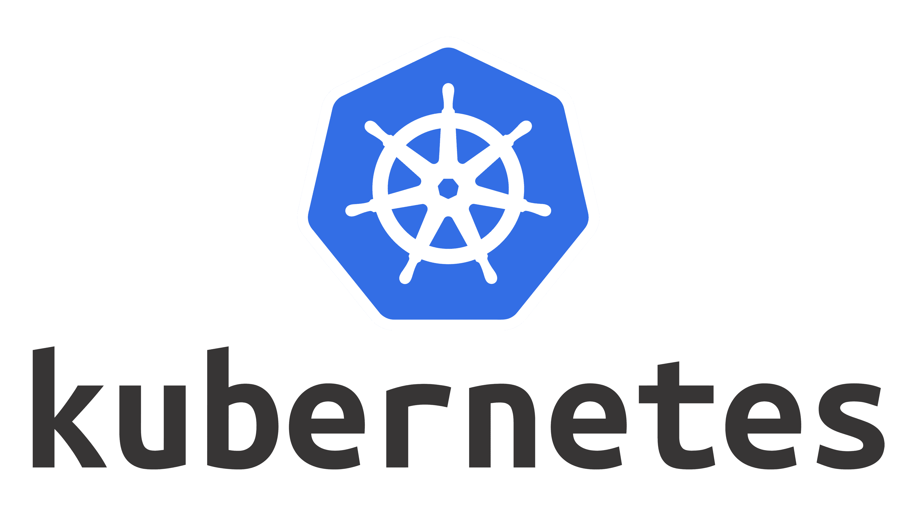

## Getting to Know the Basic Structure of Kubernetes

This time, I decided to pursue the CKA (Certified Kubernetes Administrator) certification to strengthen my cloud and infrastructure skills!
This post is a record of what I learned about the basic structure of Kubernetes and the roles of its core components while preparing for the CKA.

> I am still studying toward the CKA certification, so there may be technical errors!
> Please keep that in mind as you read, and I would really appreciate it if you pointed out any errors you find 🙇‍♂️

---
## What Is Kubernetes?
Kubernetes (also called K8s for short) is an open-source container orchestration platform that automatically deploys, scales, and manages many containerized applications.


---
## Getting to Know the Components
### Kubernetes Cluster
> A logical unit that makes up the entire execution environment managed by Kubernetes

Kubernetes components are, first of all, under the Cluster, which is the logical boundary of the entire system that makes up the whole execution environment. The structure is as follows.

```text
Kubernetes Cluster
├── Control Plane (control area)
│   ├── API Server
│   ├── etcd
│   ├── Scheduler
│   └── Controller Manager
│
└── Worker Nodes (execution area)
    ├── Node 1
    │   ├── kubelet
    │   ├── kube-proxy
    │   └── Pods
    └── Node 2
        ├── kubelet
        ├── kube-proxy
        └── Pods
```

### Worker Nodes
> They are responsible for the cluster's execution area.
```
Worker Nodes (execution area)
    ├── Node 1
    │   ├── kubelet
    │   ├── kube-proxy
    │   └── Pods
    └── Node 2
        ├── kubelet
        ├── kube-proxy
        └── Pods
```
#### Node
A Node is a physical machine or VM that actually runs workloads within the cluster.
```
Node 1
  ├── kubelet
  ├── kube-proxy
  └── Pods
```
#### Pod
A Pod is a Kubernetes resource that contains one or more containers.
Usually, it contains just one container, but containers that need to cooperate closely may be placed together in one Pod (e.g., a Spring application and a log collector for that application).

If a Pod has multiple containers, they have the following characteristics.

| Item | Shared? |
|---|---|
| Pod IP | Shared |
| Network Namespace | Shared |
| localhost communication | Possible |
| Volume | Shared if they mount the same Volume |
| Worker Node | Necessarily the same |
| Container processes | Each runs independently |
| Container restart | Each can be restarted |

At first, I might wonder whether horizontal scaling means running several containers inside a Pod.
But the usual approach is to increase the number of Pods for horizontal scaling, because this allows independent scheduling (deciding which Node should run a Pod and placing it there) and management.
#### kube-proxy
It exists on a Node and configures kernel network rules so that traffic entering through a Service's ClusterIP can be handled.
> What is a Service here? It is a Kubernetes resource that provides a stable network address for accessing a particular set of Pods.
#### kubelet
It is the component that actually runs the Pods assigned to it and keeps them in a healthy state.
- Register the Node
- Run Pods
- Manage status
- Report status

### Control Plane
> It is responsible for the cluster's control area.

```text
Control Plane (control area)
  ├── API Server
  ├── etcd
  ├── Scheduler
  └── Controller Manager
```

#### API Server
It would not be far off to call it the component that orchestrates all operations in the cluster.

All components go through the API Server when performing operations. The reason for using the API Server is that, otherwise, each component might modify data in a different way or fail to go through common authentication, authorization, and validation.
#### etcd
It is a highly available key-value store that holds various metadata used in the Kubernetes environment.
#### Scheduler
It is the component that decides which Worker Node a newly created Pod should be placed on.
> The kubelet on that node handles the actual execution.

```
User
  │
  ▼
kube-apiserver
  │ Create Pod object
  ▼
etcd
  │ Observe status through API Server
  ▼
kube-scheduler
  │ Filtering → Scoring
  │ Request node assignment
  ▼
kube-apiserver
  │ Save assignment information
  ▼
Worker Node's kubelet
  │ Request execution from container runtime
  ▼
containerd
  ▼
Run container
```
#### Controller Manager
A controller continuously observes the state of a particular resource -> and adjusts it so that the current state matches the desired state.
It works based on declaratively written instructions. For example, suppose we request that `3 Pods always remain running`. If only 2 Pods remain, the controller detects that -> and creates a new Pod.

> The process above is called a `Reconciliation Loop (state reconciliation loop)`.
##### Representative Controllers
- **Node Controller**: A controller that monitors the status of Worker Nodes registered in the cluster
- **ReplicaSet Controller**: A controller that manages the desired number of Pods so they are maintained
##### How the Controller Manager Works with the API Server
Controllers do not access etcd directly. If the ReplicaSet controller finds that one Pod is missing, it sends a request to the API Server to create a new Pod.
