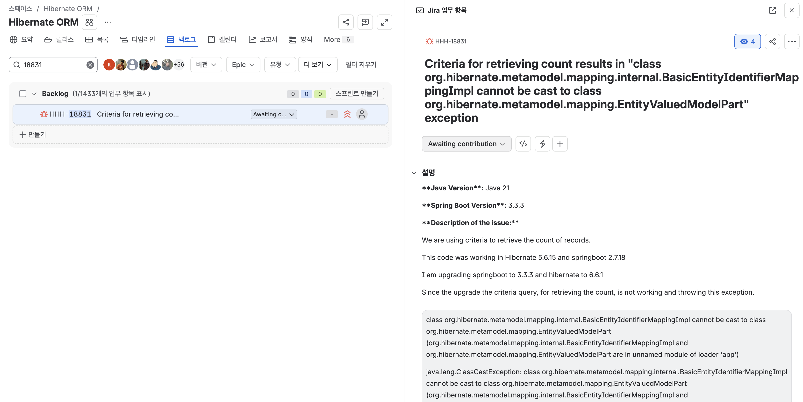
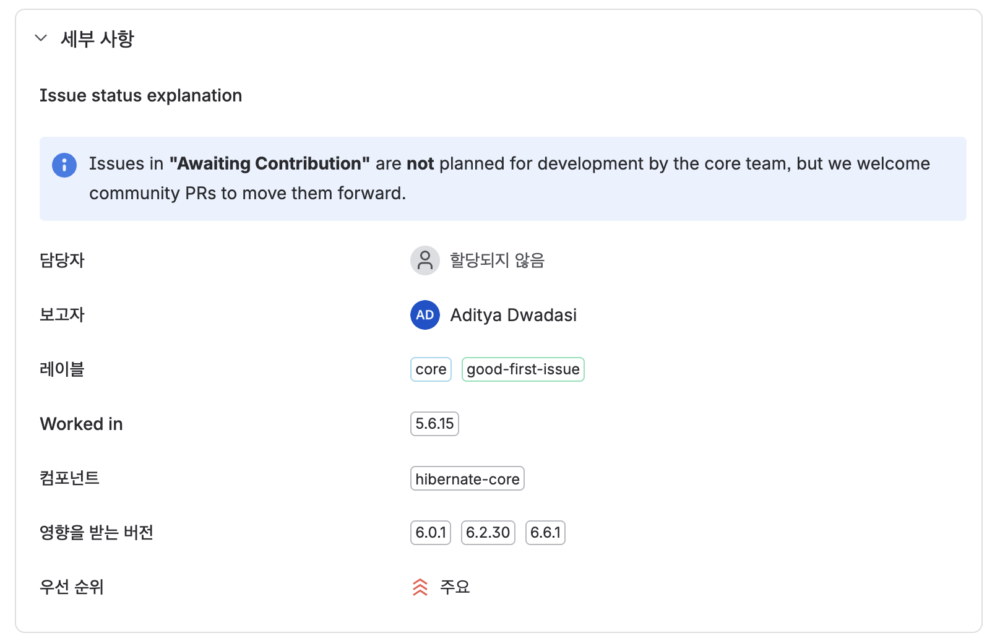
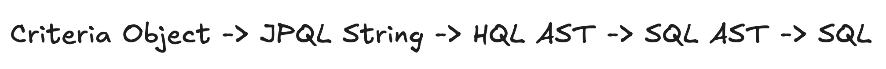
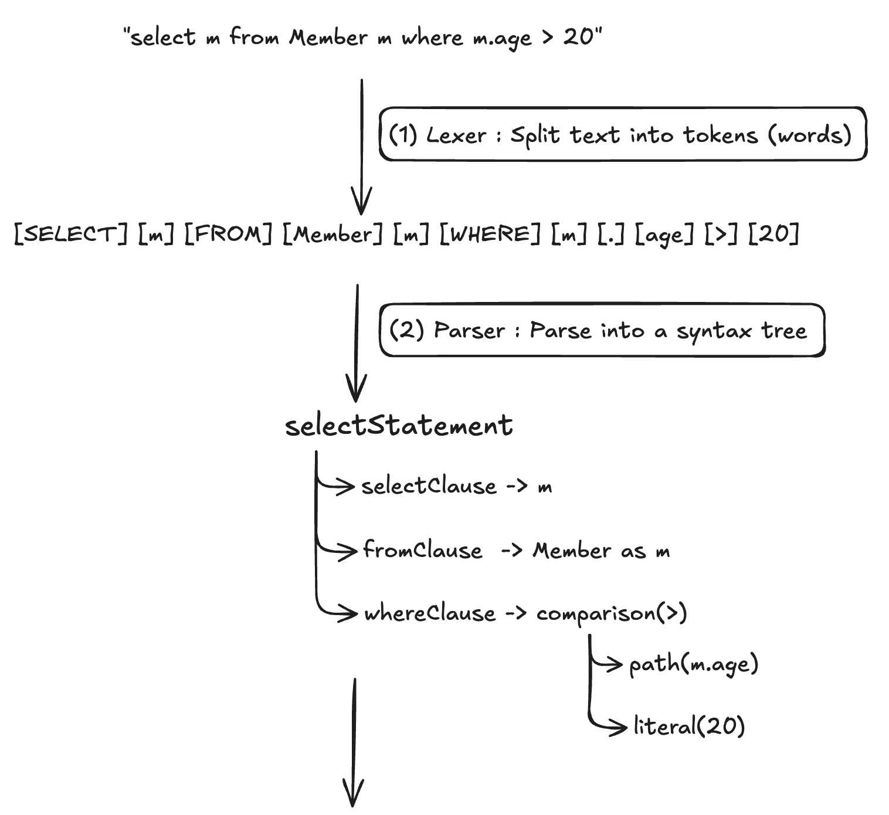
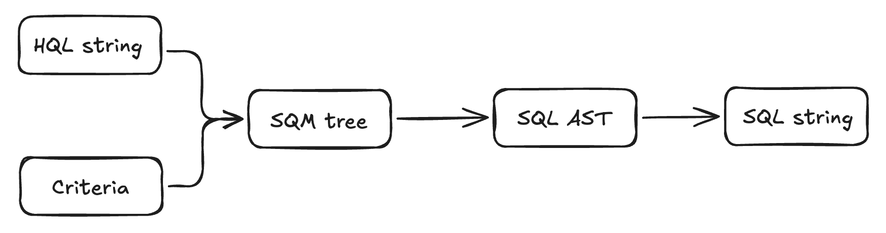
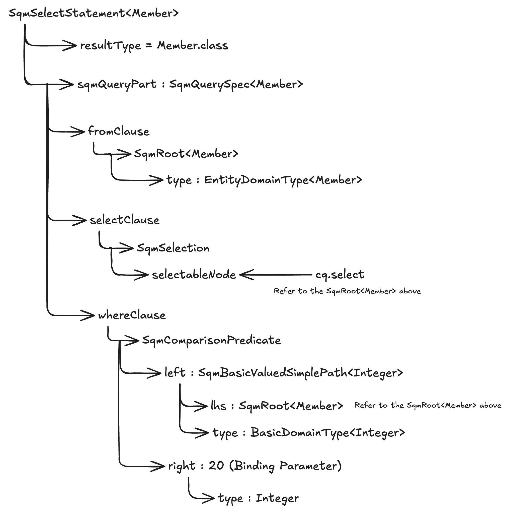
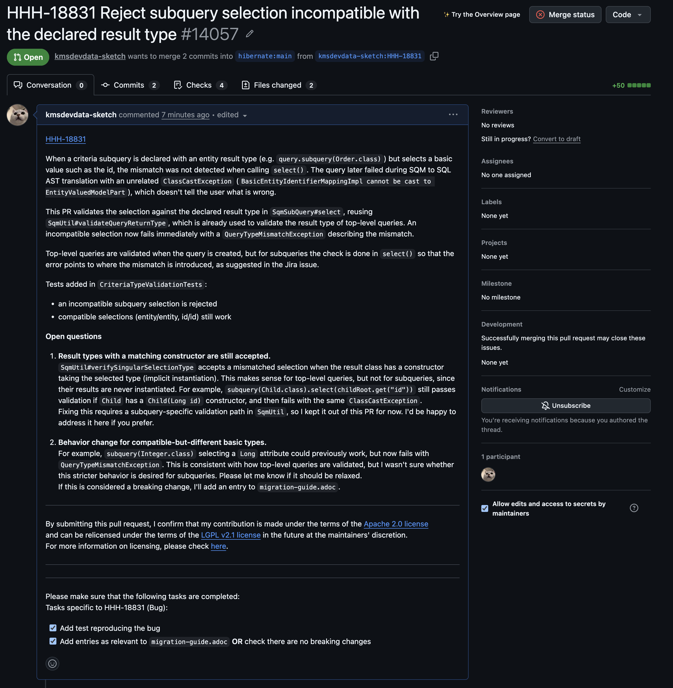

import GitHubRepoCard from "@/components/GitHubRepoCard.astro";

This time I went looking for an issue so I could contribute to Hibernate ORM among open source projects

I already felt weak on the DB side and wanted to study it, and while doing my JUnit contribution (its PR is currently in review), I felt that contributing really makes you learn and understand the technology. So I looked around Spring Data JPA and Hibernate ORM, and JPA had no assignable issues while Hibernate had a few, so that's how I got started.

<GitHubRepoCard
  repo="hibernate/hibernate-orm"
  title="Hibernate ORM"
  description="The leading JPA implementation and ORM framework in the Java world"
  previewImage="https://opengraph.githubassets.com/1/hibernate/hibernate-orm"
/>

> [!info] Contributing to Hibernate ORM Series
>
> **Part 1 · Analyzing the ClassCastException Caused by a Criteria Subquery Type Mismatch and Opening a PR**

---

## Picking an Issue on Jira: HHH-18831

Looking around at open source projects, there are plenty that are run on GitHub, but I noticed a few that use a separate issue tracking tool, and Hibernate uses Jira!

To get an issue assigned, I signed up for Jira, and from the few options I had looked at before

1. HHH-18831 : ClassCastException in a Criteria subquery count
2. HHH-20056 : Detect casecade support depending on the TiDB version
3. HHH-13846 : The PatternRenderer constructor doesn't validate the index

I picked 18831. The reason is that a maintainer had attached `good-first-review` to it, and it even came with reproduction code and guidance on how to fix it.





> "Issues in "Awaiting Contribution" are not planned for development by the core team, but we welcome community PRs to move them forward."

Actually, since the issue was in the `Awaiting contribution` state, I didn't strictly need to ask for permission in a comment, but I left a comment anyway to confirm the initial direction + avoid duplicate work.

---

## Understanding the Problem

I knew Hibernate is used as the JPA implementation, but I had never actually taken apart how it works in detail, so to understand the problem in this issue precisely, I needed a fair amount of theory study

### The Core of the Problem: The Declared Type Doesn't Match the Actual Select Type

The core of it is a problem that occurs when the user declares a subquery as "returning an entity" but actually selects the id (a basic type) => In Hibernate 5, Criteria was handled by turning it into a JPQL string, so it happened to work, but from Hibernate 6 onward the type isn't validated at `select()` time, and the SQL conversion step casts while assuming the type matches, so it blows up with a `ClassCastException` at a point unrelated to the cause

Looking at it, you might think "isn't that just a user mistake?", but the problem is that the exception that's thrown doesn't explain the actual cause at all. Looking only at a `ClassCastException` + Hibernate internal class names, the user can't figure out what went wrong at all.

### Reproduction Conditions

Next I checked how the problem is reproduced, and there were a few complicated conditions and peculiarities.

1. You have to use the Criteria API directly. In most cases people use Spring Data method-name queries, `@Query` JPQL , QueryDSL and so on, so writing Criteria directly only happens in special cases like dynamic search.

<details>
<summary>What is the `Criteria API`</summary>

The `Criteria API` is an API included in the JPA standard that assembles queries with Java code instead of strings

```java
// JPQL: written as a string
em.createQuery("select m from Member m where m.age > 20", Member.class);

// Criteria API: assembled from objects
CriteriaBuilder cb = em.getCriteriaBuilder();
CriteriaQuery<Member> cq = cb.createQuery(Member.class);
Root<Member> m = cq.from(Member.class);          // from Member m
cq.select(m).where(cb.gt(m.get("age"), 20));     // select m where m.age > 20
em.createQuery(cq);
```

As you can see, the code is long and hard to read, and it's usually used for reasons like dynamic queries (adding a where clause only when there's a search condition),catching syntax errors at compile time

It's often used wrapped in something else

- Spring Data JPA's `Specification` : If you've used it, just seeing the above might have made you think "ah, so this is what the internal implementation was". `Specification` uses the `Criteria API` internally
- QueryDSL : A separate library with a similar purpose that offers a more readable syntax

</details>

2. Three conditions have to be met at the same time
    - The subquery is declared with an entity type
    - It actually has to select the id
    - Its result is compared with an entity

<details>
<summary>Declaring a subquery with an entity type?</summary>

Since I had only used JPQL, I needed to understand what declaring something with an entity type even meant

For example, in SQL/JPQL the subquery's result type is automatically determined by what you write in the select, as below.

```sql
-- a subquery returning an entity
select m from Member m where m in (select m2 from Member m2 where ...)

-- a subquery returning the id
select m from Member m where m.id in (select m2.id from Member m2 where ...)
```

But in Criteria, since you assemble it with Java code as explained above, you have to write down "this subquery is of this type" in advance for the Java compiler, which you can see below

```java
Subquery<Member> sub = query.subquery(Member.class);
Subquery<Long>   sub = query.subquery(Long.class);  
```

After that, the actual content is set with `select()`, so it's a structure where the declaration and the actual content can be specified separately, which means the two can diverge

</details>

3. JPQL doesn't have this kind of "false declaration". Since JPQL is used like a string to begin with, it doesn't declare a subquery type separately and determines the type from the actual select content.

### The Problematic Code

```java
this.subQuery = query.subquery(TaskResource.class);   // ① result type: TaskResource (entity)
subQuery.select(subRoot.get("id")).distinct(true);     // ② actual select: id (a basic type like UUID/Long)
builder.in(root).value(subQuery);                      // ③ root (entity) IN (subquery)
```

---

## Why Does It Work in Hibernate 5 but Not After That

To figure this out, I looked into how Hibernate processes queries

### Query Processing in Hibernate 5



<details>
<summary>A closer look at the Hibernate 5 query processing steps</summary>

#### 1. Rendering the Criteria Objects into a JPQL String

The objects built with Criteria are linked in memory in the shape of a tree.

```text
CriteriaQuery
 ├ select: Root(Member, alias=m)
 └ where:  GreaterThan
            ├ Path(m.age)
            └ Literal(20)
```

When running a query, Hibernate 5 called, for each node in this tree -> the `render()` method that expresses that node in JPQL, and concatenated the strings

```text
"select m from Member m where m.age > :param0"
```

It turned Criteria into a string to reuse the pipeline, so it could make use of the HQL parser that already worked

> The implementation was simple, but it created a round trip of object -> string -> parse again, which is inefficient  
> +Because of this structure, there was nowhere (in the string) to hold Java type information => the reason the bug above didn't blow up in Hibernate5

#### 2. Converting into an HQL AST Through the HQL Parser

A program that takes a string and turns it into a tree with a grammatical structure

<details>
<summary>What is HQL</summary>

**HQL** (Hibernate Query Language).  
: Hibernate's object-oriented query language. It looks similar to SQL, but it's written against entities and fields rather than tables,columns

```sql
-- SQL: tables and columns
select * from member where age > 20

-- HQL/JPQL: entities and fields
select m from Member m where m.age > 20
```

What's the relationship with JPQL?

- HQL came first
- When the JPA standard was created, only the standard parts were extracted based on HQL -> and chosen as JPQL
- HQL is a superset of JPQL => every JPQL query is valid HQL, and there are more Hibernate-specific features

Inside Hibernate, even JPQL is treated as HQL and processed by the same parser

</details>

##### The Parsing Steps



- Up to (2), only the grammar is checked => even if there's a typo in the middle, everything passes as long as it's grammatically correct

#### 3. Converting into an SQL AST Through HqlSqlWalker

The HQL AST the parser builds is still based on entities and fields.  
`HqlSqlWalker` traverses that tree and does two things at once

1. **Semantic analysis** : whether `Member` is an actual entity , whether the `age` field actually exists => if the entity doesn't exist, an error is thrown here
2. **Analysis into SQL structure** : entity -> table , field -> column

#### 4. Generating the SQL String Through SqlGenerator

It traverses the finished SQL AST and outputs the actual SQL string to send to the DB

</details>

That's how Hibernate5 works so far, and now let's look at 6 onward

### Query Processing in Hibernate 6



<details>
<summary>A closer look at the Hibernate 6 query processing steps</summary>

#### 1. Two Entry Points: HQL Strings, Criteria

- HQL/JPQL strings : the HQL parser builds a syntax tree, and `SemanticQueryBuilder` does semantic analysis and **turns it into an SQM tree**
- Criteria : no separate conversion (in Hibernate6 a Criteria object is itself an SQM node)

#### 2. The SQM Tree

Whether it comes in as HQL or as Criteria, everything gathers into the same SQM tree

```text
SqmSelectStatement
 └ SqmQuerySpec
    ├ SqmSelectClause → SqmRoot(Member, alias=m)
    ├ SqmFromClause   → SqmRoot(Member)
    └ SqmWhereClause  → SqmComparisonPredicate(>)
                         ├ SqmBasicValuedSimplePath(m.age)  type: Integer
                         └ SqmLiteral(20)                    type: Integer
```

- Type checking happens at this step

<details>
<summary>What is SQM</summary>

SQM(Semantic Query Model)  
A tree introduced in Hibernate6 that expresses the meaning of a query in domain terms (not SQL yet)  
It only expresses "which field of which entity under which condition"

- Each node carries its own type information.(`SqmBindableType`)
- Because HQL and Criteria gather into the same SQM, the subsequent validation,conversion,caching logic is shared as one

</details>

#### 3. Converting into an SQL AST Through BaseSqmToSqlAstConverter

It outputs the finished SQL AST as an SQL string suited to the DB (even for the same SQL, it's output to match the DB (Ex.MySQL,PostgreSQL))

</details>

### Hibernate 5 vs 6 at a Glance

| Step | Hibernate 5 | Hibernate 6 and later |
|---|---|---|
| Criteria handling | Rendered to a JPQL string, then re-parsed | Itself an SQM node |
| Semantic analysis | `HqlSqlWalker` (together with SQL conversion) | When the SQM is created (`SemanticQueryBuilder`, `TypecheckUtil`) |
| SQL tree conversion | `HqlSqlWalker` | `BaseSqmToSqlAstConverter` |
| SQL string generation | `SqlGenerator` | `SqlAstTranslator` (per Dialect) |
| Java type information | Lost when rendering | Kept to the end |

### In Conclusion, Why the Problem Appeared from 6 Onward

To sum up, Hibernate 5 turned Criteria into a JPQL string and then parsed it again to build SQL, so the moment it became a string, the Java type information disappeared. So the mismatch between the declared type and the actual select type was erased along with it, and the problem never surfaced

Hibernate 6 and later, on the other hand, turn the Criteria object directly into an SQM node, and each node carries its own type information all the way through. At that point the subquery keeps both its declared type and its actual select type (id), so the type checking step looks at the declared type and lets it pass, while the SQL AST conversion step looks at the actual select type and casts it, and a `ClassCastException` is thrown

---

## Writing a Reproduction Test

Before starting the work, I first checked with an actual test whether a `ClassCastException` is thrown when the declared type and the actual select type differ

```java
public class CriteriaTypeValidationTests {

	//...

	@Test // test for the expected behavior after the fix 
	@JiraKey("HHH-18831")
	public void testSubquerySelectionIncompatibleWithResultType(SessionFactoryScope scope) {
		scope.inTransaction(
				session -> {
					final HibernateCriteriaBuilder cb = session.getCriteriaBuilder();
					final CriteriaQuery<Parent> cq = cb.createQuery( Parent.class );

					// subquery declared to return the entity, but selecting its id
					final Subquery<Parent> subquery = cq.subquery( Parent.class );
					final Root<Parent> subRoot = subquery.from( Parent.class );
					assertThrows(
							IllegalArgumentException.class,
							() -> subquery.select( subRoot.get( "id" ) )
					);
				}
		);
	}

	@Test // two usages with the types matched correctly 
	@JiraKey("HHH-18831")
	public void testSubquerySelectionCompatibleWithResultType(SessionFactoryScope scope) {
		scope.inTransaction(
				session -> {
					final HibernateCriteriaBuilder cb = session.getCriteriaBuilder();

					// entity compared to a subquery selecting the entity
					final CriteriaQuery<Parent> entityQuery = cb.createQuery( Parent.class );
					final Root<Parent> entityRoot = entityQuery.from( Parent.class );
					final Subquery<Parent> entitySubquery = entityQuery.subquery( Parent.class );
					entitySubquery.select( entitySubquery.from( Parent.class ) );
					entityQuery.where( cb.in( entityRoot ).value( entitySubquery ) );
					session.createQuery( entityQuery ).getResultList();

					// id compared to a subquery selecting the id
					final CriteriaQuery<Parent> idQuery = cb.createQuery( Parent.class );
					final Root<Parent> idRoot = idQuery.from( Parent.class );
					final Subquery<Long> idSubquery = idQuery.subquery( Long.class );
					idSubquery.select( idSubquery.from( Parent.class ).get( "id" ) );
					idQuery.where( cb.in( idRoot.<Long>get( "id" ) ).value( idSubquery ) );
					session.createQuery( idQuery ).getResultList();
				}
		);
	}

	@Entity(name = "Parent")
	public static class Parent {
		@Id
		private Long id;

		private String name;
		private Double price;

		@OneToMany(mappedBy = "parent", fetch = FetchType.EAGER, cascade = CascadeType.ALL, orphanRemoval = true)
		private Set<Child> children = new HashSet<>();
	}

	@Entity(name = "Child")
	public static class Child {
		@Id
		private Long id;

		@ManyToOne
		private Parent parent;

		public Child() {
		}

		public Child(Long id) {
			this.id = id;
		}
	}
}
```

A test file called `CriteriaTypeValidationTests`, along with the entities inside it, was already in place, so I used it as is, and the tests I wrote use the custom annotation `@JiraKey`

For the tests overall, I used Claude Code because I'm not familiar with how to use Criteria

<details>
<summary>Background knowledge for reading the test code</summary>

**SessionFactoryScope** : A test-only tool in Hibernate that checks the `@DomainModel` and `@SessionFactory` on the class and puts those entities into the `SessionFactory`

**HibernateCriteriaBuilder** : An interface where Hibernate extends the JPA-standard `CriteriaBuilder`, with Hibernate-specific functions added on top of the standard features

**CriteriaQuery\<Parent>** : Creates the query's blueprint, and `<Parent>` means the query's result is Parent (internally it's `SqmSelectStatement`, the top of the SQM tree (see A closer look at the Hibernate 6 query processing steps - The SQM Tree))

**subquery()** : Builds the query that goes inside the parentheses below

```sql
select p from Parent p where p in ( select p2 from Parent p2 )
                                    ------- this part --------
```

**Root** : The entity in the `FROM` clause ex. the `p` in `from parent p`

</details>

---

## Finding Where to Make the Fix

There were only a few places in the actual code to fix, but to pinpoint the exact location, whatever else I didn't know, I had to know the SQM structure precisely. Since it's the central structure every query goes through from Hibernate 6 onward, I did a deeper dive into it, partly as study.

<details>
<summary>SQM deep dive</summary>



#### 1. What Is SQM

SQM(Semantic Query Model)  
: A tree introduced in Hibernate 6 that expresses the meaning of a query in terms of entities and fields

#### 2. Overall Structure

```text
① Query layer        SqmSelectStatement / SqmSubQuery          one query + its declared result type
      │
② Query part layer   SqmQuerySpec / SqmQueryGroup              one select-from-where chunk (Group for a union)
      │
③ Clause layer       SqmSelectClause / SqmFromClause / SqmWhereClause
      │
④ Node layer         SqmRoot, SqmPath, SqmLiteral, SqmPredicate ...
      │
⑥ Type information   SqmBindableType → JavaType → Class      (attached to every node)
      │
      ▼         BaseSqmToSqlAstConverter
⑤ SQL AST       TableGroup, ColumnReference, ComparisonPredicate ...
      ▼         SqlAstTranslator (per Dialect)
   SQL string
```

Example : looking up members older than 20

```java
CriteriaBuilder cb = em.getCriteriaBuilder();
CriteriaQuery<Member> cq = cb.createQuery( Member.class );  
Root<Member> m = cq.from( Member.class );                   
Path<Integer> age = m.get( "age" );                         
cq.select( m )                                              
  .where( cb.gt( age, 20 ) );                               
em.createQuery( cq ).getResultList();  
```

##### `cb.createQuery( Member.class )`

```text
SqmSelectStatement<Member>
 ├ resultType = Member.class          ← the declared result type (the label)
 └ sqmQueryPart: SqmQuerySpec         ← still empty
     ├ fromClause:   (empty)
     ├ selectClause: (empty)
     └ whereClause:  null
```

It creates the **query layer** and the **query part layer**

- Query layer : represents the whole query and remembers what type the result should be
- Query part layer : a container that holds clauses such as select , from , where

##### `cq.from ( Member.class )`

```text
fromClause
 └ SqmRoot<Member>  (alias m)
     └ type: EntityDomainType<Member>   ← "this is the entity Member"
```

It adds a root node to the from clause

- SqmRoot : the from-clause entity and the starting point of every path such as `m.age`, `m.team`
- At this point it immediately checks whether `Member` is an actual entity, and throws an error if not

##### `m.get( "age" )`

```text
SqmBasicValuedSimplePath<Integer>  (m.age)
 ├ lhs: SqmRoot<Member>               ← where the path starts from
 └ type: BasicDomainType<Integer>     ← "this is an Integer basic value"
```

A path node points to an attribute of an entity, and the kind of node differs depending on the kind of attribute

- Basic value(`m.age` , `m.id`) -> `SqmBasicValuedSimplePath`
- Entity(`m.team`) -> `SqmEntityValuedSimplePath`

> Regardless of generics, the node knows the attribute's actual type

##### `cq.select( m )`

```text
selectClause
 └ SqmSelection
     └ selectableNode: SqmRoot<Member>   ← what was actually selected (the contents)
```

The select clause holds what is output as the result, and one characteristic is that the query layer's `resultType` and the contents of the select clause are stored separately

##### `cb.gt( age,20 )`

```text
whereClause
 └ SqmComparisonPredicate (>)
     ├ left:  SqmBasicValuedSimplePath<Integer>  (m.age)
     └ right: 20  (handled as a bind parameter by default)
```

A predicate node contains the comparison operation

> When it's created, it checks whether the types on both sides can be compared

##### `em.createQuery( cq )`

It validates the result type

- It compares the label (`Member.class`) and the contents (of type `SqmRoot<Member>`)

> The top-level query has this validation but the subquery doesn't, and that's the core of this issue

After that, it's converted into an SQL AST, and that SQL AST is output as a string suited to the DB

</details>

### Summarizing the Problem Again

To summarize the problem situation once more  
In Criteria, both the top-level query and subqueries declare a result type, but the validation that compares the declared type with the select content (`validateQueryReturnType`) was only applied to the top-level query

Since a subquery's result isn't returned to Java, the validation was left out, but from Hibernate 6 onward the subquery's declared type is used for the outer query's type checking and SQL conversion, so if the declaration is wrong, a `ClassCastException` is thrown in an unrelated place => So apply the same validation as the top-level query at the subquery's `select()` time, and immediately throw a `QueryTypeMismatchException` if the declared type and the select content differ.

### Checking the SqmSubQuery.select() Code

```java
public class SqmSubQuery<T> extends AbstractSqmSelectQuery<T>{
    // ...
    @Nonnull
	@Override
	public SqmSubQuery<T> select(@Nonnull Expression<T> expression) {
		//noinspection unchecked
		getQuerySpec().setSelection( (JpaSelection<T>) expression );
       // applyInferableType( (Class<T>) querySpec.getSelection().getJavaType() );
		return this;
	}
    // ...
}
```

- `getQuerySpec()` : can be seen as a chunk that holds from,where,group by all together
- `.setSelection()` : puts something into the select clause of that chunk, inserting the node it received as an argument
- `expression?` :  the type of the contents (SQM node) the user passed to `select()` is inside that node

Looking at the current query's select time, it simply takes the value and puts it in without going through any validation => if the user declares the type as an entity and then actually selects the id, later when the query runs, it blows up while converting the SQM into an SQL AST and casting the actual contents to an entity mapping

> Doesn't the opposite case (declaring id - selecting the entity) blow up? : This part is a bit ambiguous. The original problem was also in a branch that runs when the default is an entity, so if an id goes in, it most likely won't blow up, and on top of that, the validation logic I'm reusing has a rule that allows selecting an entity and then declaring that entity's id type, so it's something to check in a later PR

### How to Fix It: When Should the Exception Be Thrown

There were two ways to solve this problem

1. Throw the exception at `select()` time - the maintainer's suggestion
2. Throw the exception at `createQuery()` time - validate it together in the top-level query's validation flow. The consistency is nice, but you'd have to find and traverse every subquery => put on hold

### Reusing an Existing Utility Method: validateQueryReturnType

```java
	/**
	 * Used to validate that the specified query return type is valid (i.e. the user
	 * did not pass {@code Integer.class} when the selection is an entity)
	 */
	public static void validateQueryReturnType(SqmQueryPart<?> queryPart, @Nullable Class<?> expectedResultType) {
		if ( expectedResultType != null && !isResultTypeAlwaysAllowed( expectedResultType ) ) {
			// the result-class is always safe to use (Object, ...)
			checkQueryReturnType( queryPart, expectedResultType );
		}
	}
```

When I checked, `SqmUtil` already had **a utility method that checks whether the specified query return type matches the actual select content**  
The top-level query validates its result type with this method at `createQuery()` time, so let's reuse the same method for subqueries too!

---

## Opening the PR



The changes weren't that big, so I opened the PR right away. There were a few edge cases, so I put them in the PR and asked for the maintainers' opinion

1. It still passes if there's a constructor matching the result type: because the utility method I used allows the select even when the types don't match, if the result class has a constructor that takes the selected type

   > The top-level query returns its result as a Java object, so if there's a constructor, it can build the object with `new ResultType(value)`, so there's no problem. But a subquery doesn't turn its result into an object; its purpose is only to be used as a condition value of the outer query inside SQL, so this rule doesn't fit

2. A behavior change for compatible but different basic types : `subquery(Integer.class)` selecting a Long attribute used to work, but now it was changed to fail. It's the same as how the top-level query is validated, but I wonder whether subqueries should behave this strictly too

Now let's wait for the review!

- PR: [hibernate-orm#14057](https://github.com/hibernate/hibernate-orm/pull/14057): HHH-18831 Reject subquery selection incompatible with the declared result type
- Issue: [HHH-18831](https://hibernate.atlassian.net/browse/HHH-18831): Criteria for retrieving count results in "class org.hibernate.metamodel.mapping.internal.BasicEntityIdentifierMappingImpl cannot be cast to class org.hibernate.metamodel.mapping.EntityValuedModelPart" exception
