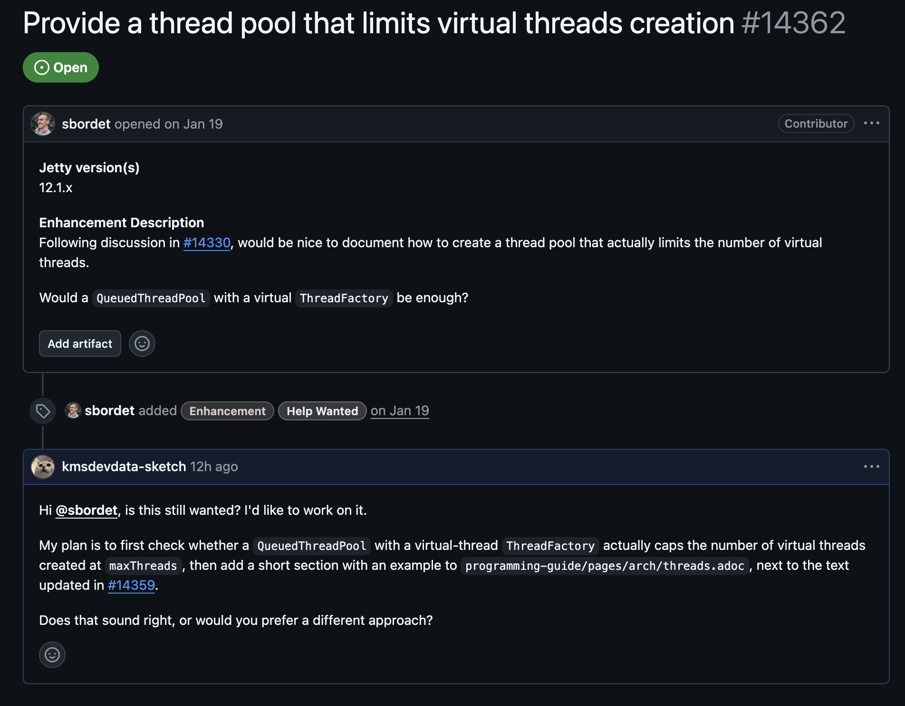
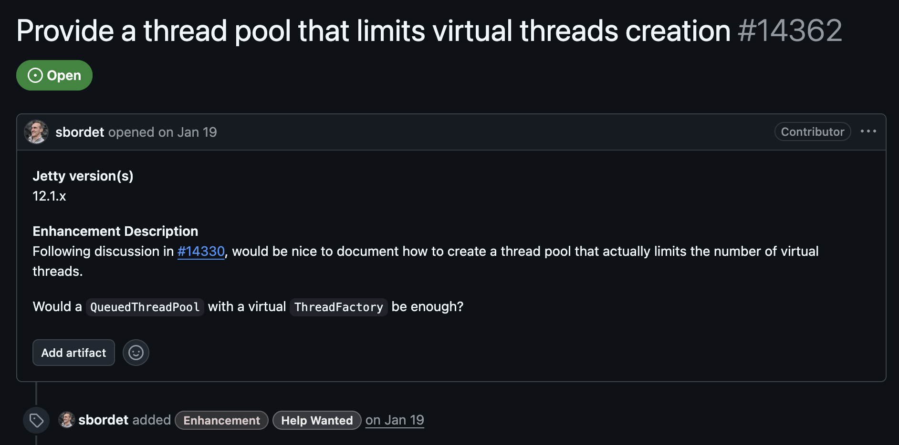
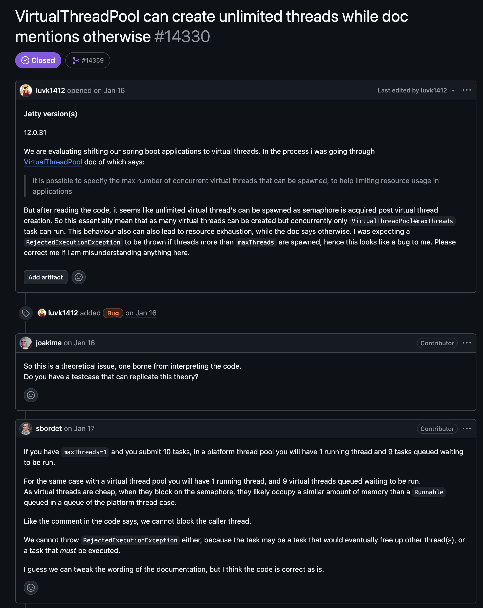
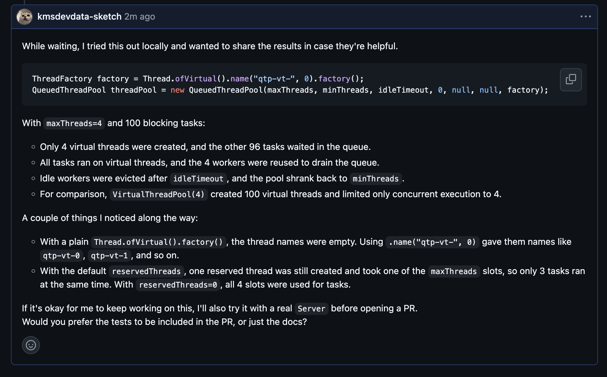

import GitHubRepoCard from "@/components/GitHubRepoCard.astro";

I wanted to take on the challenge of contributing to open source this time, so I'm leaving a journal of my journey toward an open source contribution.

Ideally, it would be nice to contribute after feeling some inconvenience or room for improvement in an open source project I was using, but for me it started from a relatively personal ~~desire?~~ to try contributing to open source


<GitHubRepoCard
  repo="jetty/jetty.project"
  title="Eclipse Jetty"
  description="A Java-based web server and servlet container"
  previewImage="https://opengraph.githubassets.com/1/jetty/jetty.project"
/>

> [!info] Contributing to Jetty Series
>
> **Part 1 · Exploring and Verifying the Virtual Thread Creation Limit Issue**
>
> **Part 2 · Server Tests and the PR (coming soon)**

---

## Looking Around

First I had to find a starting point, but there are so many open source projects in the world that I searched with a few constraints.

1. Look through what's posted in the issues : I judged that finding problems myself by exploring code or testing would be too hard
2. Overlap with the language and framework I mainly use : They say there are over 500 million open source projects on GitHub (wow) and I thought picking just anything from them was impossible, so I limit it to things related to Java and Spring Boot.
3. An issue that isn't too big : If you split typos/minor docs ~ large-scale refactoring into about 5 levels, I only searched up to about level 2 since it's my first time, looking without being greedy

> I learned this time that open source projects usually put a `good first issue` label on issues, so issues that are good for first-time contributors to take on are pointed out too (probably about levels 1~3 of the levels I split above?)

To keep this from getting too long, based on the points above I searched with Claude and found a suitable issue!

[jetty - issue on a thread pool that limits virtual threads](https://github.com/jetty/jetty.project/issues/14362)  
Looking over it roughly, it turned out to be an issue asking to "document how to keep threads from being created without limit while still using virtual threads", and it also seemed right for the difficulty I had in mind.

> **What is jetty?** : Like Tomcat, it's a Java web server, and you can choose it as the embedded server in Spring Boot. Tomcat = the Spring Boot default, while Jetty is lighter and modular and is good for embedding.

---

## Learning About Open Source Culture

In some YouTube videos I watched recently, I saw the problem of reckless open source PRs being posted using AI.  
Using AI itself doesn't seem to be the problem, but contributing after understanding open source culture and following its conventions seemed like the right direction, so I looked into open source culture a bit more.

- [How a beginner developer can contribute to open source, by kshired (Korean)](https://velog.io/@kshired/%EC%98%A4%ED%94%88%EC%86%8C%EC%8A%A4%EC%97%90-%EC%B4%88%EB%B3%B4-%EA%B0%9C%EB%B0%9C%EC%9E%90%EA%B0%80-%EA%B8%B0%EC%97%AC%ED%95%98%EB%8A%94-%EB%B0%A9%EB%B2%95)
- [GitHub Docs guide](https://docs.github.com/en/enterprise-server@3.17/get-started/exploring-projects-on-github/contributing-to-open-source)
- [The guide for jetty, which I hope to contribute to this time](https://jetty.org/docs/contribution-guide/index.html)

> Like number 3, the project you contribute to often has an official guide!



> They say it's good manners to ask whether you can take the issue!

---

## Digging Into the Issue



> Description of the improvement  
> As discussed in #14330, it would be good to state in the documentation how to create a thread pool that actually limits the number of virtual threads.  
> Would a QueuedThreadPool with a virtual ThreadFactory be enough?

Looking at the content above, the starting point of the problem seems to be #14330! I went there to try to figure out exactly what the problem was.



[Issue #14330](https://github.com/jetty/jetty.project/issues/14330)

### Understanding the Original Issue

Summarizing the content

**Raising the problem**

luvk1412 : I tried to move a Spring Boot app to virtual threads, and the docs say the maximum count can be limited, but looking at the code it creates the thread first and then -> acquires the semaphore, so threads get created infinitely, isn't that a bug? Then shouldn't it throw an exception when the maximum thread count is exceeded?

> **Semaphore** : A tool that limits the number of things running concurrently to N

In other words, isn't the number of concurrent executions limited but not the number created itself?

**First reactions**

joakime (maintainer) : Is there a reproduction test?  
sbordet (maintainer) : One waiting virtual thread uses about the same memory as one Runnable queued up, so they're effectively the same -> since it can neither block the calling thread nor reject the task, the code is correct and we'll fix the docs

**Reproduction test**

Putting 10,000 tasks in with maxThreads=200 created 10,000 virtual threads, with 200 running concurrently. => memory blows up  
At their company, they used to give QueueThreadPool a size-limited queue so that under overload requests would fast fail and the server would recover, but the concern is that this doesn't work with virtual threads

**Key points**

- Limiting the thread pool queue is the wrong approach.
- Thinking 1 task = 1 HTTP request is simplistic
- Example : The request headers arrived but the body hasn't, so the thread waits -> the body arrives -> the task that wakes the thread has to be put in the queue -> the queue is full so it's rejected -> the whole server stops
- The right way : Keep the thread pool generous and the queue unbounded + limit the number of concurrently executing requests separately with QoSHandler 

**Wrap-up**

The person who raised it was convinced and closed the issue -> but let's still document how to limit the number created! => [the current issue](https://github.com/jetty/jetty.project/issues/14362)

#### Takeaways From This

- The example should keep the queue unbounded
- If you want to limit requests, point people to `QoSHandler` 
- Prepare reproduction code : The maintainer immediately asked for a reproduction when the issue was raised

---

## Getting Started

### Preparation

- Sign the ECA

> **ECA (Eclipse Contributor Agreement)** is an online agreement where you agree that "the code I send was written by me, and the project may use it under an open source license."

### Setting the Goal

Find a way to put a virtual thread ThreadFactory into QueuedThreadPool (constructor or setter)

Organizing the current situation a bit more

1. There are users who want to limit the number of virtual threads created itself.
2. `VirtualThreadPool` can't do it ㅠㅠ (it creates the thread first and then blocks with a semaphore)
3. But `QueueThreadPool` already limits the number created.
4. There's only one reason `QueueThreadPool` uses platform threads, which is that the part that creates threads creates platform threads => but that part is open to being swapped out with a `ThreadFactory`.
5. Then! If I swap only the factory for a virtual thread one, couldn't I keep the container (`QueueThreadPool`) as is and switch only the workers inside it to virtual threads? 

The work proceeds based on the above.

And my goal is to verify the above and document whether it works or not, the caveats if it does, and the reasons if it doesn't!

### Checking the Code

```java

    public QueuedThreadPool(@Name("maxThreads") int maxThreads, @Name("minThreads") int minThreads,
                            @Name("idleTimeout") int idleTimeout, @Name("reservedThreads") int reservedThreads,
                            @Name("queue") BlockingQueue<Runnable> queue, @Name("threadGroup") ThreadGroup threadGroup,
                            @Name("threadFactory") ThreadFactory threadFactory)
    {
        if (maxThreads < minThreads)
            throw new IllegalArgumentException("max threads (" + maxThreads + ") less than min threads (" + minThreads + ")");
        setMinThreads(minThreads);
        setMaxThreads(maxThreads);
        setIdleTimeout(idleTimeout);
        setStopTimeout(5000);
        setReservedThreads(reservedThreads);
        if (queue == null)
        {
            int capacity = Math.max(_minThreads, 8) * 1024;
            queue = BlockingArrayQueue.newInstance(capacity, Integer.MAX_VALUE);
        }
        if (queue.remainingCapacity() != Integer.MAX_VALUE)
        {
            LOG.warn("Detected thread pool queue {} bounded at {} entries, which can lead to unexpected behavior. Use an unbounded queue instead.", queue.getClass(), queue.remainingCapacity());
            _capacity = queue.remainingCapacity();
        }
        else
        {
            _capacity = -1;
        }
        _jobs = queue;
        _threadGroup = threadGroup;
        setThreadPoolBudget(new ThreadPoolBudget(this));
        _threadFactory = threadFactory == null ? this : threadFactory;
    }
```

**The part to focus on**

```java
_threadFactory = threadFactory == null ? this : threadFactory;
```
Since it (QueuedThreadPool) is itself a ThreadFactory implementation anyway, if a thread pool was passed in at construction it uses that, and if not, it uses itself

```java
protected void startThread()
    {
        boolean started = false;
        try
        {
            Thread thread = _threadFactory.newThread(_runnable);
            if (LOG.isDebugEnabled())
                LOG.debug("Starting {}", thread);
            _threads.add(thread);
            // Update the evict threshold to prevent thrashing of newly started threads.
            _evictThreshold.set(NanoTime.now() + TimeUnit.MILLISECONDS.toNanos(_idleTimeout));
            thread.start();
            started = true;
        }
        finally
        {
            if (!started)
                addCounts(-1, -1); // threads, idle
        }
    }
```
As shown above, you can see it actually being used when a thread is created

### Defining the Test Scope

I first narrowed the tests down to 3 groups.

1. Core (required)
    - A1. Creation count limit 
    - A2. Checking it's really a virtual thread
    - A3. Whether everything runs without loss
    - A4. Comparison group
2. Caveats (for noting in the docs)
    - B1. Thread names
    - B2. Idle cleanup 
    - B3.reserved threads
3. Checking actual server behavior (to be decided after discussing with the maintainer)
    - C1. Server behavior
    - C2. Connectors constantly occupying threads
    - C3.planning

#### Writing the Tests 

##### A1. Creation Count Limit

```java

    @Test
    public void testThreadCreationIsCappedAtMaxThreads() throws Exception
    {
        // maxThreads=4, minThreads=1, idleTimeout=60s, reservedThreads=0, queue=null(default unbounded), threadGroup=null
        QueuedThreadPool qtp = new QueuedThreadPool(MAX_THREADS, 1, 60_000, 0, null, null, virtualThreadFactory());
        qtp.start();

        // Latch that keeps every task blocked until it is released
        CountDownLatch release = new CountDownLatch(1);

        try
        {
            for (int i = 0; i < TASKS; i++)
            {
                qtp.execute(() ->
                {
                    try
                    {
                        release.await();
                    }
                    catch (InterruptedException e)
                    {
                        Thread.currentThread().interrupt();
                    }
                });
            }

            // Wait until all 4 workers are busy.
            await().atMost(5, TimeUnit.SECONDS).until(qtp::getBusyThreads,is(MAX_THREADS));

            // No more than 4 threads must have been created.
            assertThat("created threads", qtp.getThreads(), is(MAX_THREADS));

            // The remaining 96 tasks must be queued, not rejected.
            assertThat("queued tasks", qtp.getQueueSize(), is(TASKS - MAX_THREADS));
        }
        finally
        {
            // Release blocked tasks before stopping the pool, otherwise stop() hangs until its timeout.
            release.countDown();
            qtp.stop();
        }
    }
```
: I held 100 tasks with a latch and counted whether, at that moment, it was "4 threads created / 96 in the queue" - the result was a pass

##### A2. Checking It's Really a Virtual Thread

```java
// Tasks actually run on virtual threads, i.e. the ThreadFactory is really used.
    @Test
    public void testTasksRunOnVirtualThreads() throws Exception
    {
        QueuedThreadPool qtp = new QueuedThreadPool(MAX_THREADS, 1, 60_000, 0, null, null, virtualThreadFactory());
        qtp.start();

        // Latch counting down once per finished task, to wait for all of them.
        CountDownLatch completed = new CountDownLatch(TASKS);

        // Number of tasks that ran on a non-virtual thread.
        AtomicInteger nonVirtual = new AtomicInteger();

        try
        {
            for (int i = 0; i < TASKS; i++)
            {
                qtp.execute(() ->
                {
                    // Check whether the thread running this task is virtual.
                    if (!VirtualThreads.isVirtualThread())
                        nonVirtual.incrementAndGet();
                    completed.countDown();
                });
            }

            // Wait up to 10 seconds for all 100 tasks to finish.
            assertTrue(completed.await(10, TimeUnit.SECONDS), "not all tasks completed");

            // No task may have run on a non-virtual thread.
            assertThat("tasks run on non-virtual threads", nonVirtual.get(), is(0));
        }
        finally
        {
            qtp.stop();
        }
    }
```
: Inside each task, I asked "is the thread running me right now a virtual thread?" with `VirtualThreads.isVirtualThread()`, and counted the cases where it wasn't. The result was 0 = pass

+ A1 only counted the number, so it could have passed even if the factory had been ignored and platform threads created, which is why I checked this

##### A3,A4

To keep it short, A3 checks that everything runs without loss, and A4 compares against the existing `VirtualThreadPool` (no limit on the maximum number of threads created), comparing the number of threads created and the number of concurrent executions; all tests passed as intended, completing the verification of the hypothesis!

##### B1,2,3

The core (required) tests were all done, so next I did additional tests

 - B1. Thread names : Normally, using `QueueTreadPool`'s default factory gives threads a name, but switching to a virtual factory can leave the name as an empty string => this makes it hard to tell Jetty threads apart in thread dumps or logs, so I check whether the name is empty + whether the name is attached as intended when using the builder method
 - B2. Idle cleanup : `QueueTreadPool` normally cleans up threads that sit idle for `idleTimeout` to bring them down to the minimum, and I check whether this works properly with virtual threads too
 - B3. reserved threads : In the earlier tests I set it to 0 to get exact numbers, but in practice many people will use the default value (-1, automatic), so I check that there's no unexpected behavior caused by reserved threads.

> **Reserved threads** : A Jetty-specific optimization that keeps threads waiting to take over directly from a selector thread

In the end they all succeeded, and a somewhat useful finding came from the B3 test: the reserved threads default becomes -1 only when using `setVirtualThreadsExecutor`, so creating it the way above turns on 1 reserved thread   
=> it takes up 1 of the maximum threads, so only 3 regular tasks run at the same time   
=> the justification for explicitly setting reserved threads to 0 when using a virtual factory!

---

### Summary + Sharing

I still hadn't heard back from the maintainer, so I shared the test results and asked whether I could continue working on it!



Now I wait for a reply, and if I can take it on, I just need to continue through the server tests and then open the PR! (Please say yes ㅠㅠ 😂)
