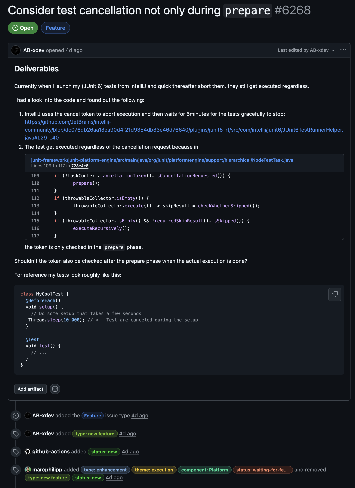
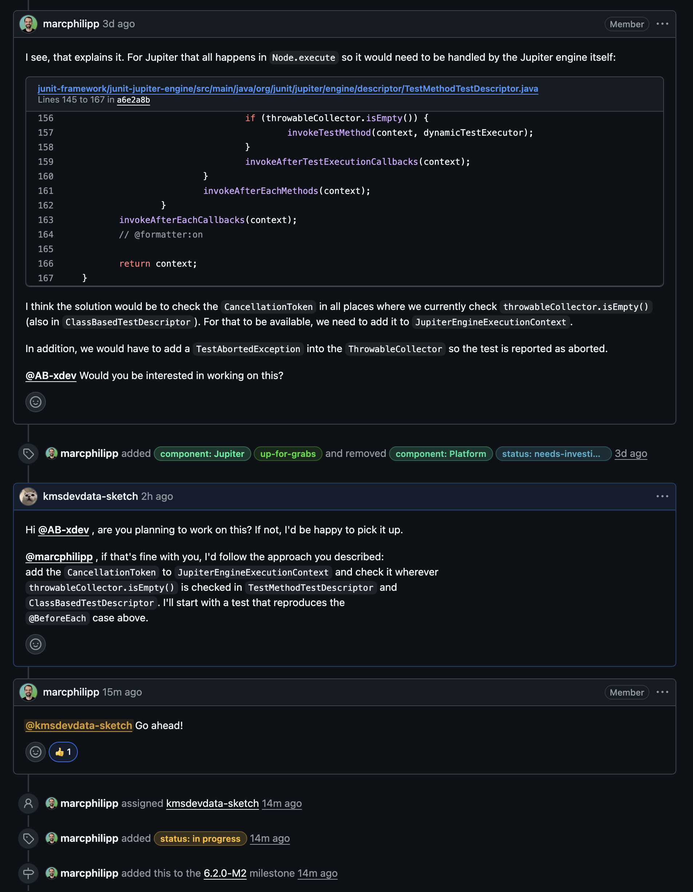

import GitHubRepoCard from "@/components/GitHubRepoCard.astro";

My open source contribution journey ! This time it's JUnit

While I was waiting for the maintainer's reply after sharing my draft and intermediate results for the earlier Jetty contribution, I took a look at JUnit this time

> **What is JUnit?** : The leading testing framework that supports unit testing of programs written in the Java language

<GitHubRepoCard
  repo="junit-team/junit-framework"
  title="JUnit"
  description="The leading testing framework for Java unit tests"
  previewImage="https://opengraph.githubassets.com/1/junit-team/junit-framework"
/>

> [!info] Contributing to JUnit Series
>
> **Part 1 · Analyzing Why Test Cancellation Is Ignored While @BeforeEach Runs**
>
> **[Part 2 · Adding Cancellation Checks to the Jupiter Lifecycle and Opening a PR](/en/posts/oss/junit-contribution-2/)**
>
> **[Part 3 · Addressing the First Review and Structuring Cancellation Checks with shouldContinue](/en/posts/oss/junit-contribution-3/)**

---

## Finding an up-for-grabs Issue and Asking to Take It

Then I found! an issue in JUnit with the `up-for-grabs` label.

- [junit-framework#6268](https://github.com/junit-team/junit-framework/issues/6268): Consider test cancellation not only during `prepare`



Roughly, the issue was that when you run a test in IntelliJ and press the stop button, if `@BeforEach` is running, it doesn't stop right away, and after `@BeforeEach` finishes, the test itself runs to completion too.  

Conveniently, the maintainer (marcphilipp) had kindly shared even a way to fix the problem and then asked the issue reporter (AB-xdev) whether they'd be willing to take it on.

After checking, I waited about one more day since they might take it on themselves, and since there still seemed to be no reply on the 3rd day after the offer, I politely asked whether I could take it on, got permission, and decided to start working on it!



---

## Analyzing the Problem

### The Reported Reproduction

Let's figure out more precisely what happened, based on the information the reporter shared.

In short, the situation was that they ran a test in IntelliJ and immediately pressed the stop button (while BeforeEach was running), but the test didn't stop and ran all the way to the end

Below is the output of the reporter's example in time order

```text
BeforeEach START  <- @BeforEach starts 
**SHUTDOWN**      <- stop button pressed here -> cancellation requested
BeforeEach DONE   <- sleep runs all the way to the end 
Test              <- cancelled, yet even the test runs <- the problem
```

The expected result is that after `BeforeEach DONE`, TEST doesn't run and it ends as aborted

### Cancellation Isn't a Forced Kill: Cooperative Cancellation

When you cancel a test, it seems like it would `force-kill` it, but that's not how it actually behaves.  
JUnit6 has a `CancellationToken` that cancels execution, and when you press the stop button, IntelliJ requests cancellation on this token and waits until the test stops on its own  
Key point = running code is not force-killed x 

- It just records "cancellation requested"
- The executing code has to have points (checkpoints) where it checks "was cancellation requested?" along the way for it to stop
- So @BeforEach isn't cut off midway either

> This approach is called **cooperative cancellation**

**Interface**

```java
@API(status = EXPERIMENTAL, since = "6.0")
public sealed interface CancellationToken permits DisabledCancellationToken, RegularCancellationToken {

	/**
	 * Create a new, uncancelled cancellation token.
	 */
	static CancellationToken create() {
		return new RegularCancellationToken();
	}

	/**
	 * Get a new cancellation token that cannot be cancelled.
	 *
	 * <p>This is only useful for cases when a cancellation token is required
	 * but is not supported or irrelevant, for example, in tests.
	 */
	static CancellationToken disabled() {
		return DisabledCancellationToken.INSTANCE;
	}

	/**
	 * {@return whether cancellation has been requested}
	 *
	 * <p>Once this method returns {@code true}, it will never return
	 * {@code false} in a subsequent call.
	 */
	boolean isCancellationRequested();

	/**
	 * Request cancellation.
	 *
	 * <p>This will call subsequent calls to {@link #isCancellationRequested()}
	 * to return {@code true}.
	 */
	void cancel();

}
```

**Implementation**

```java
/**
 * @since 6.0
 */
final class RegularCancellationToken implements CancellationToken {

	private final AtomicBoolean cancelled = new AtomicBoolean();

	@Override
	public boolean isCancellationRequested() {
		return cancelled.get();
	}

	@Override
	public void cancel() {
		cancelled.set(true);
	}
}
```

The `AtomicBoolean cancelled ` you see above is what records "cancellation requested" 

### JUnit's Execution Structure and Cancellation Checkpoints

JUnit builds tests into a tree and runs them from the top.

```text
JUnit Platform (Launcher)
 └ JupiterTestEngine
    └ JupiterEngineDescriptor (root)
       └ ClassTestDescriptor (class node)
          └ TestMethodTestDescriptor (method node)
```

Each Descriptor implements the Node interface.(methods like prepare,before,execute,after,cleanUp)

Each node is run by `NodeTestTask`, so let's look at the checkpoints

`NodeTestTask`: the "executor" that fixes the order prepare -> check whether to skip -> before -> execute -> run children -> after -> cleanUp

What actually happens here is decided by the node implementation (polymorphism)

- Class node : runs @BeforeAll in before, and @AfterAll in after
- Method node : handles all of `@BeforeEach -> test -> @AfterEach` inside execute()

<details>
<summary>How JUnit actually builds the tree, in detail</summary>

Looking at the actual structure that gets built, based on the test class below

```java
class UserTest {
    @BeforeEach void setUp() { ... }
    @Test void create() { ... }
    @Test void delete() { ... }
}
```

**Step 1 · Building the Tree**

```text
JupiterEngineDescriptor   [engine:junit-jupiter]
 └ ClassTestDescriptor    [class:com.x.UserTest]
    ├ TestMethodTestDescriptor  [method:create()]
    └ TestMethodTestDescriptor  [method:delete()]
```

- `ClassSelectorResolver` looks at UserTest and creates a ClassTestDescriptor : it contains Class\<?> testClass = UserTest.class
- `MethodSelectorResolver` creates a TestMethodTestDescriptor for each method annotated with `@Test` : it contains testClass and Method testMethod
- `setup()`, which is the `@BeforeEach`, doesn't become a node; after the class information is collected, it's called when the method node runs

**Step 2 · Execution, a NodeTestTask for Each Node**

- Class node : runs `@BeforeAll` in `before()` -> runs `@AfterAll` in `after()`
- Method node :
    - creates a new UserTest instance in `prepare()` 
    - in `execute()`, calls `setUp()` -> `create()` -> `@AfterEach` in that order through reflection

> **Through reflection?** : Instead of writing the method name directly in the code, it reads the class information at runtime to find and call the method

</details>

```java
class NodeTestTask<C extends EngineExecutionContext> implements TestTask {
    // omitted
	@Override
	public void execute() {
		try {
			throwableCollector = taskContext.throwableCollectorFactory().create();
			if (!taskContext.cancellationToken().isCancellationRequested()) { //  checked here
				prepare();
			}
			if (throwableCollector.isEmpty()) {
				throwableCollector.execute(() -> skipResult = checkWhetherSkipped());
			}
			if (throwableCollector.isEmpty() && !requiredSkipResult().isSkipped()) {
				executeRecursively(); // where the method node actually runs
			}
			if (context != null) {
				cleanUp();
			}
			reportCompletion();
		}
		finally {
			// Ensure that the 'interrupted status' flag for the current thread
			// is cleared for reuse of the thread in subsequent task executions.
			// See https://github.com/junit-team/junit-framework/issues/1688
			if (Thread.interrupted()) {
				logger.debug(() -> """
						Execution of TestDescriptor with display name [%s] \
						and unique ID [%s] failed to clear the 'interrupted status' flag for the \
						current thread. JUnit has cleared the flag, but you may wish to investigate \
						why the flag was not cleared by user code.""".formatted(this.testDescriptor.getDisplayName(),
					this.testDescriptor.getUniqueId()));
			}
			finalizer.run();
		}

		// Clear reference to context to allow it to be garbage collected.
		// See https://github.com/junit-team/junit-framework/issues/1578
		context = null;
	}
    // omitted
    private SkipResult checkWhetherSkipped() throws Exception { // returns CANCELLED_SKIP_RESULT here if cancellation is detected
		return taskContext.cancellationToken().isCancellationRequested() //
				? CANCELLED_SKIP_RESULT //
				: node.shouldBeSkipped(requiredContext());
	}
    // omitted
}
```

As you can see from the comments above, there are two checkpoints in total, and both turn out to be before a node starts.

### The Problem Spot: TestMethodTestDescriptor.execute()

```java
public class TestMethodTestDescriptor extends MethodBasedTestDescriptor {
    // omitted
    @Override
	public JupiterEngineExecutionContext execute(JupiterEngineExecutionContext context,
			DynamicTestExecutor dynamicTestExecutor) {
		ThrowableCollector throwableCollector = context.getThrowableCollector();

		// @formatter:off
		invokeBeforeEachCallbacks(context);
			if (throwableCollector.isEmpty()) {
				invokeBeforeEachMethods(context);
				if (throwableCollector.isEmpty()) {
					invokeBeforeTestExecutionCallbacks(context);
					if (throwableCollector.isEmpty()) {
						invokeTestMethod(context, dynamicTestExecutor);
					}
					invokeAfterTestExecutionCallbacks(context);
				}
				invokeAfterEachMethods(context);
			}
		invokeAfterEachCallbacks(context);
		// @formatter:on

		return context;
	}
    // omitted
}
```

The goal of this work is to add a cancellation check right here at `throwableCollector.isEmpty()` above!

> **What is throwableCollector?** : A collector that gathers the exceptions raised while running tests instead of throwing them right away 

---

## The Fix Direction

### Why the CancellationToken Has to Be Passed into the Jupiter Context

As we saw above, JUnit is split into a platform layer and a Jupiter layer, and if you check the path the token currently travels   

1. An execution tool like an IDE creates a CancellationToken and passes it to the Launcher
2. When the Launcher runs the engine, it puts the token in the ExecutionRequest -> it can be taken out with `request.getCancellationToken()`
3. The platform's HierarchicalTestExecutor passes this token to the NodeTestTask side -> checked at the node entrance 

As you can tell, all of this happens only in the platform layer, so it has to go into JupiterEngineExecutionContext, and the reason is 

> Structure: `Node<JupiterEngineExecutionContext>` (interface)  
>   ← `JupiterTestDescriptor` (implements)  
>   ← `MethodBasedTestDescriptor` (extends)  
>   ← `TestMethodTestDescriptor` (extends)

- Methods of a Jupiter node like `execute()` only take `JupiterEngineExecutionContext` as an argument (see the problem spot above)
- Inside `TestMethodTestDescriptor.execute()`, you can't access the ExecutionRequest either - the token is in the platform, but the execution logic is inside the Jupiter node 
- => The natural approach is to carry the token in the context the node already receives 

### Work Plan

#### 0. Reproduce

- [ ] Write a test that reproduces the test running when cancelled during `@BeforeEach` execution (confirm it fails)

#### 1. Pass the CancellationToken

- [ ] Add a `CancellationToken` field to `JupiterEngineExecutionContext` (its internal `State`)
- [ ] Add a getter and check that it's copied to the child context on `extend()`
- [ ] Inject the token from the `ExecutionRequest` into the root context in `JupiterTestEngine.createExecutionContext()`

#### 2. Abort on Cancellation

- [ ] Write a helper that checks for cancellation and then adds a `TestAbortedException` to the `ThrowableCollector`

#### 3. Add Checkpoints

- [ ] Call the helper at each `isEmpty()` checkpoint in `TestMethodTestDescriptor.execute()`
- [ ] Call the helper at each `isEmpty()` checkpoint in `ClassBasedTestDescriptor` (after `@BeforeAll`, etc.)
- [ ] Search the other places that use `throwableCollector.isEmpty()` and check nothing is missed

---

> In the next post, I'll cover the actual work and the PR process!
