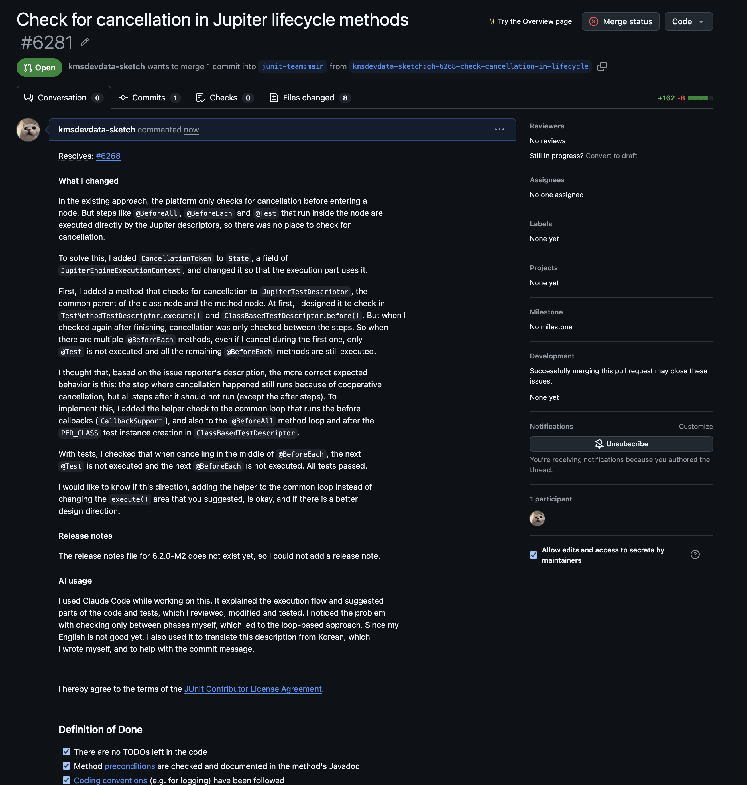

import GitHubRepoCard from "@/components/GitHubRepoCard.astro";

Last time I looked at the actual problem and how to fix it, and this time it's the actual fixing process! 

<GitHubRepoCard
  repo="junit-team/junit-framework"
  title="JUnit"
  description="The leading testing framework for Java unit tests"
  previewImage="https://opengraph.githubassets.com/1/junit-team/junit-framework"
/>

> [!info] Contributing to JUnit Series
>
> **[Part 1 · Analyzing Why Test Cancellation Is Ignored While @BeforeEach Runs](/en/posts/oss/junit-contribution-1/)**
>
> **Part 2 · Adding Cancellation Checks to the Jupiter Lifecycle and Opening a PR**

<details>
<summary>Task list</summary>

**0. Reproduce**

- [ ] Write a test that reproduces the test running when cancelled during `@BeforeEach` execution (confirm it fails)

**1. Pass the CancellationToken**

- [ ] Add a `CancellationToken` field to `JupiterEngineExecutionContext` (its internal `State`)
- [ ] Add a getter and check that it's copied to the child context on `extend()`
- [ ] Inject the token from the `ExecutionRequest` into the root context in `JupiterTestEngine.createExecutionContext()`

**2. Abort on Cancellation**

- [ ] Write a helper that checks for cancellation and then adds a `TestAbortedException` to the `ThrowableCollector`

**3. Add Checkpoints**

- [ ] Call the helper at each `isEmpty()` checkpoint in `TestMethodTestDescriptor.execute()`
- [ ] Call the helper at each `isEmpty()` checkpoint in `ClassBasedTestDescriptor` (after `@BeforeAll`, etc.)
- [ ] Search the other places that use `throwableCollector.isEmpty()` and check nothing is missed

</details>

---

## 0. Writing the Reproduction Test

First, I write a test that reproduces the failure during `@BeforeEach`!  
There was already an `ExecutionCancellationTests`, so I added to it

```java
	// The test class the inner engine runs (1 class node + 1 method node)
	static class CancelledInBeforeEachTestCase extends TestCase {

		// Runs inside the method node right before @Test → request cancellation here
		@BeforeEach
		void beforeEach() {
			requiredCancellationToken().cancel();
		}

		// Cancelled, so it must not run; if it runs, fail marks it as failed
		@Test
		void testMethod() {
			fail("should not be called");
		}

		// The cleanup step must run even when cancelled; record whether it ran as a reportEntry
		@AfterEach
		void afterEach(TestReporter reporter) {
			reporter.publishEntry("afterEach", "called");
		}
	}
```

> **reporter?** : An object JUnit passes in as a parameter; calling `publishEntry()` fires an event saying this record came from that test -> the outer test can't check whether the inner method ran, so it leaves a record like this, and if the record is there = it decides "`@AfterEach` ran!"

```java
	// Reproduction test: if cancelled while @BeforeEach runs,
	// the @Test body must not run, @AfterEach must run, and the result must be aborted
	@Test
	void abortsTestWhenCancelledDuringBeforeEachMethod() {
		// The test class the inner engine will run
		var testClass = CancelledInBeforeEachTestCase.class;

		// Run one more Jupiter engine inside the test (imitating the IDE's role)
		var results = jupiterTestEngine() //
				.selectors(selectClass(testClass)) // target: this class
				.cancellationToken(TestCase.requiredCancellationToken()) // pass the cancellation token
				.execute(); // run it and get the event record

		// Verify the test node event counts: started 1, aborted 1, failed 0
		results.testEvents().assertStatistics(stats -> stats.started(1).aborted(1).failed(0));

		// Verify that all events happened in exactly this order
		results.allEvents().assertEventsMatchExactly( //
			event(engine(), started()), // engine started
			event(container(testClass), started()), // class node started
			event(test("testMethod"), started()), // method node started
			event(test("testMethod"), reportEntry(Map.of("afterEach", "called"))), // @AfterEach ran
			event(test("testMethod"), abortedWithReason(instanceOf(TestAbortedException.class))), // ended as aborted
			event(container(testClass), finishedSuccessfully()), // class node finished normally
			event(engine(), finishedSuccessfully())); // engine finished normally
	}
```

Just as I'd hypothesized, the test failed = `@Test` ran (it must not run)

---

## 1. Passing the CancellationToken

### Carrying the CancellationToken in JupiterEngineExecutionContext

```java
@API(status = INTERNAL, since = "5.0")
public class JupiterEngineExecutionContext implements EngineExecutionContext {

	private final State state; // <- modified
    
    // ... 

	public JupiterEngineExecutionContext(EngineExecutionListener executionListener, JupiterConfiguration configuration,
			LauncherStoreFacade launcherStoreFacade,CancellationToken cancellationToken) { // parameter added
		this(new State(executionListener, configuration, launcherStoreFacade,cancellationToken));
	}

    // ... 

	public CancellationToken getCancellationToken() { // getter added
		return this.state.cancellationToken;
	}

    // ... 

	private static final class State implements Cloneable {

		final EngineExecutionListener executionListener;
		final JupiterConfiguration configuration;
		final LauncherStoreFacade launcherStoreFacade;
		final CancellationToken cancellationToken; // added 

}
```

`JupiterEngineExecutionContext` keeps the values it needs for execution in the inner class State.  
-> When going down to a child node, it copies with `extend()` and changes only the values it needs to make a new context 

### Testing That the Token Is Passed to the Child Context

```java

class JupiterEngineExecutionContextTests {
    // ... 
    @Test
	void cancellationTokenIsHandedOnWhenContextIsExtended() {
		assertSame(cancellationToken, originalContext.getCancellationToken());
		JupiterEngineExecutionContext newContext = originalContext.extend()
				.withExtensionContext(mock())
				.build();
		assertSame(cancellationToken, newContext.getCancellationToken());
	}
    // ... 
}
```

With a test like the one above, I check that the CancellationToken is passed along as is even when a new child context is created

---

## 2. Adding a Helper That Aborts on Cancellation

```java
public abstract class JupiterTestDescriptor extends AbstractTestDescriptor
		implements Node<JupiterEngineExecutionContext> {
    // ... 

    /**
	 * Abort the current execution if cancellation has been requested and no
	 * exception has been colledted so far.
	 *
	 * @since 6.2
	 */
	static void abortIfCancellationRequested(JupiterEngineExecutionContext context) {
		ThrowableCollector throwableCollector = context.getThrowableCollector();
		if (throwableCollector.isEmpty() && context.getCancellationToken().isCancellationRequested()) {
			throwableCollector.execute(() -> {
				throw new TestAbortedException("Execution cancelled");
			});
		}
	}

    // ... 
}
```

I explained this in the previous post too, but to explain the structure again as a reminder  
In the current approach, the platform (NodeTestTask) only checks for cancellation before entering a node; steps like `@BeforeAll` , `@BeforeEach` , `@Test` that run inside the node are executed directly by Jupiter's Descriptor, so there's no place in between that checks for cancellation!  
So I added a method that checks for cancellation to `JupiterTestDescriptor`, the common parent of the class node and the method node, and if no exception has been collected yet && it's in the cancelled state, that method puts a TestAbortedException into the `ThrowableCollector` (the exception collector) 

> Why check throwableCollector.isEmpty() first: if there's already another exception, that's the more important cause, so it only checks when it's empty 

---

## 3. Adding Checkpoints

### Adding Checks to TestMethodTestDescriptor.execute()

```java
@API(status = INTERNAL, since = "5.0")
public class TestMethodTestDescriptor extends MethodBasedTestDescriptor {
    // ... 
    @Override
	public JupiterEngineExecutionContext execute(JupiterEngineExecutionContext context,
			DynamicTestExecutor dynamicTestExecutor) {
		ThrowableCollector throwableCollector = context.getThrowableCollector();

		// @formatter:off
		invokeBeforeEachCallbacks(context);
		abortIfCancellationRequested(context);
			if (throwableCollector.isEmpty()) {
				invokeBeforeEachMethods(context);
				abortIfCancellationRequested(context);
				if (throwableCollector.isEmpty()) {
					invokeBeforeTestExecutionCallbacks(context);
					abortIfCancellationRequested(context);
					if (throwableCollector.isEmpty()) {
						invokeTestMethod(context, dynamicTestExecutor);
					}
					invokeAfterTestExecutionCallbacks(context);
				}
				invokeAfterEachMethods(context);
			}
		invokeAfterEachCallbacks(context);
		// @formatter:on

		return context;
	}
    // ... 
}
```

How it works : if it's in the cancelled state, the helper puts a TestAbortedException into the collector, and then the next `isEmpty()` becomes false, so the next step is skipped + the after calls are outside the if, so they still run

> Why the after calls have to run : BeforeEach usually opens or creates things like DB connections, temporary files, etc., so they need to be cleaned up + the maintainer also gave feedback that cleanUp should run

### Adding Checks to ClassBasedTestDescriptor.before()

#### Test for Cancelling During a @BeforeAll Callback

```java
class ExecutionCancellationTests extends AbstractJupiterTestEngineTests {
    // ... 
    @Test
	void abortsClassWhenCancelledDuringBeforeAllCallback() {
		var testClass = CancelledInBeforeAllCallbackTestCase.class;

		var results = jupiterTestEngine() //
				.selectors(selectClass(testClass)) //
				.cancellationToken(TestCase.requiredCancellationToken()) //
				.execute();

		results.testEvents().assertStatistics(stats -> stats.started(0));

		results.allEvents().assertEventsMatchExactly( //
				event(engine(),started()), //
				event(container(testClass), started()), //
				event(container(testClass),
						abortedWithReason(instanceOf(TestAbortedException.class))), //
				event(engine(),finishedSuccessfully())
		);
	}
    // ... 
    @ExtendWith(CancellingBeforeAllCallback.class)
	static class CancelledInBeforeAllCallbackTestCase extends TestCase {

		@BeforeAll
		static void beforeAll() {
			fail("should not be called");
		}

		@Test
		void testMethod() {
			fail("should not be called");
		}
	}

	static class CancellingBeforeAllCallback implements BeforeAllCallback {

		@Override
		public void beforeAll(ExtensionContext context) throws Exception {
			TestCase.requiredCancellationToken().cancel();
		}
	}
}
```

BeforeAllCallback is a hook that can step in at the `@BeforeAll` step; if you register an extension that implements this interface, Jupiter calls that extension's `beforeAll()` first, before the `@BeforeAll` methods, in the class node's `before()`.

#### Adding the Checks

```java
@API(status = INTERNAL, since = "5.5")
public abstract class ClassBasedTestDescriptor extends JupiterTestDescriptor
		implements ResourceLockAware, TestClassAware, Validatable {
    // ... 
	@Override
	public final JupiterEngineExecutionContext before(JupiterEngineExecutionContext context) {
		    // ... 

		abortIfCancellationRequested(context); // <- added here : if cancelled while preparing the class, don't even run the callbacks
		if (throwableCollector.isEmpty()) {
			context.beforeAllCallbacksExecuted(true);
			invokeBeforeAllCallbacks(context); // run extension callbacks

			abortIfCancellationRequested(context); // <- added here : cancelled while running callbacks => don't run the user's @BeforeAll
			if (throwableCollector.isEmpty()) {
				context.beforeAllMethodsExecuted(true);
				invokeBeforeAllMethods(context);
			}
		}

		throwableCollector.assertEmpty();

		return context;
	}
    // ... 
}
```

---

## What I Missed: Checking Only Between Steps

I thought, is it all done?! but looking a little closer, I saw a problem with the current approach  
Because cancellation was only checked between steps, when there were multiple `@BeforeEach` methods, even if I cancelled during the first method, only `@Test` didn't run, and all the remaining `@BeforeEach` methods still ran, which was different from the expected behavior

In the codebase I'd looked through so far, I had only searched for the step-by-step checks with `isEmpty()`, so I missed it, and I should have looked for the loops that run the callbacks 

### Fixing It Again !! Adding the Check to the Common Loops

```java
class CallbackSupport {
    static <T extends Extension> void invokeBeforeCallbacks(Class<T> type, JupiterEngineExecutionContext context,
			CallbackInvoker<T> callbackInvoker) {

		ExtensionRegistry registry = context.getExtensionRegistry();
		ExtensionContext extensionContext = context.getExtensionContext();
		ThrowableCollector throwableCollector = context.getThrowableCollector();

		for (T callback : registry.getExtensions(type)) {
			throwableCollector.execute(() -> callbackInvoker.invoke(callback, extensionContext));
            abortIfCancellationRequested(context); // <- added 
			if (throwableCollector.isNotEmpty()) {
				break;
			}
		}
	}
    // ... 
}
```

I add it to the common loop that runs all the before-type callbacks

```java
@API(status = INTERNAL, since = "5.5")
public abstract class ClassBasedTestDescriptor extends JupiterTestDescriptor
		implements ResourceLockAware, TestClassAware, Validatable {
    // ... 
	private void invokeBeforeAllMethods(JupiterEngineExecutionContext context) {
		ExtensionRegistry registry = context.getExtensionRegistry();
		ExtensionContext extensionContext = context.getExtensionContext();
		ThrowableCollector throwableCollector = context.getThrowableCollector();
		Object testInstance = extensionContext.getTestInstance().orElse(null);

		for (Method method : requireLifecycleMethods().beforeAll) {
			throwableCollector.execute(() -> {
				try {
					executableInvoker.invokeVoid(method, testInstance, extensionContext, registry,
						InvocationInterceptor::interceptBeforeAllMethod);
				}
				catch (Throwable throwable) {
					invokeBeforeAllMethodExecutionExceptionHandlers(registry, extensionContext, throwable);
				}
			});
			abortIfCancellationRequested(context); // <- add it here
			if (throwableCollector.isNotEmpty()) {
				break;
			}
		}
	}
    // ... 
}
```

I add it to the loop that runs the @BeforeAll methods one by one 

### Cleaning Up the Old Step-by-Step Checks

Since I added the helper to the common loops, a better structure than before, instead of the step-by-step checks, I remove the old step-by-step checks

#### ClassBasedTestDescriptor

```java
@API(status = INTERNAL, since = "5.5")
public abstract class ClassBasedTestDescriptor extends JupiterTestDescriptor
		implements ResourceLockAware, TestClassAware, Validatable {
    // ... 
	@Override
	public final JupiterEngineExecutionContext before(JupiterEngineExecutionContext context) {
		if (isPerClassLifecycle(context)) {
			// Eagerly load test instance for BeforeAllCallbacks, if necessary,
			// and store the instance in the ExtensionContext.
			ClassExtensionContext extensionContext = (ClassExtensionContext) context.getExtensionContext();
			throwableCollector.execute(() -> {
				TestInstances testInstances = context.getTestInstancesProvider().getTestInstances(context);
				extensionContext.setTestInstances(testInstances);
			});
		}

		abortIfCancellationRequested(context); // <- keep this one 
		if (throwableCollector.isEmpty()) {
			context.beforeAllCallbacksExecuted(true);
			invokeBeforeAllCallbacks(context); // run extension callbacks

			abortIfCancellationRequested(context); // <- remove this one
			if (throwableCollector.isEmpty()) {
				context.beforeAllMethodsExecuted(true);
				invokeBeforeAllMethods(context);
			}
		}

		throwableCollector.assertEmpty();

		return context;
	}
    // ... 
}
```

> The first one is the instance creation process, not a loop, so no check happens after it, so I only put that part in 

### Adding a Test That the Remaining Callbacks Don't Run

```java
class ExecutionCancellationTests extends AbstractJupiterTestEngineTests {
    // ... 
    @Test
	void doesNotInvokeRemainingBeforeEachCallbacksWhenCancelled() {
		var testClass = CancelledInFirstOfTwoBeforeEachCallbacksTestCase.class;

		var results = jupiterTestEngine() //
				.selectors(selectClass(testClass)) //
				.cancellationToken(TestCase.requiredCancellationToken()) //
				.execute();

		results.testEvents().assertStatistics(stats ->
				stats.started(1).aborted(1).failed(0));
	}
    // ... 
    @ExtendWith({ CancellingBeforeEachCallback.class, FailingBeforeEachCallback.class })
	static class CancelledInFirstOfTwoBeforeEachCallbacksTestCase extends TestCase {

		@Test
		void testMethod() {
			fail("should not be called");
		}
	}

	static class CancellingBeforeEachCallback implements BeforeEachCallback {

		@Override
		public void beforeEach(ExtensionContext context) throws Exception {
			TestCase.requiredCancellationToken().cancel();
		}
	}

	static class FailingBeforeEachCallback implements BeforeEachCallback {

		@Override
		public void beforeEach(ExtensionContext context) throws Exception {
			fail("should not be called");
		}
	}
}
```

Even with only the existing tests it passes as such, but the existing tests aimed at step-by-step verification, so they didn't verify, loop-style, that the next BeforeEach doesn't run; so I verified that it cancels in `CancellingBeforeEachCallback` and doesn't run in `FailingBeforeEachCallback`, and it passed

> Take the check logic out of `CallbackSupport` and it fails, put it in and it passes 

---

## Was There Another Design Direction?

All of the overall changes are done!  
What I'd like to sort out a bit is whether there was another approach; first of all, I made the changes following the maintainer's recommendation, but if I think about whether there's a somewhat better approach  

1. Make the token global : multiple runs can happen in the same JVM, and it would affect other tests, so no (the platform design itself has one token per execution request in the first place)
2. Have ThrowableCollector check the token directly : it looks plausible, but "cancellation decisions" would be added on top of the collector's current responsibility of "collecting exceptions", so this is a no too
3. Change the condition to if(isEmpty() && !cancelled) : it doesn't throw an exception, so this ends up being reported as a success, so this is a no too
4. Pass the token through the platform's Node interface : changing the signature would mean modifying every external engine API, which is too much, so this is a no too 

For now, I can't see a better design direction in my head ! The fix seems right, and I even found the expected-behavior bug at the last minute, so all that's left is to run the tests, build tests, and formatting and open the PR!(For some reason I was nervous, so I ran the full test suite and formatting check more than 10 times lol)

---

## Opening the PR



Now all that's left is to wait for reviews and a few rounds of changes!

- PR: [junit-framework#6281](https://github.com/junit-team/junit-framework/pull/6281): Check for cancellation in Jupiter lifecycle methods
- Issue: [junit-framework#6268](https://github.com/junit-team/junit-framework/issues/6268): Consider test cancellation not only during `prepare`
