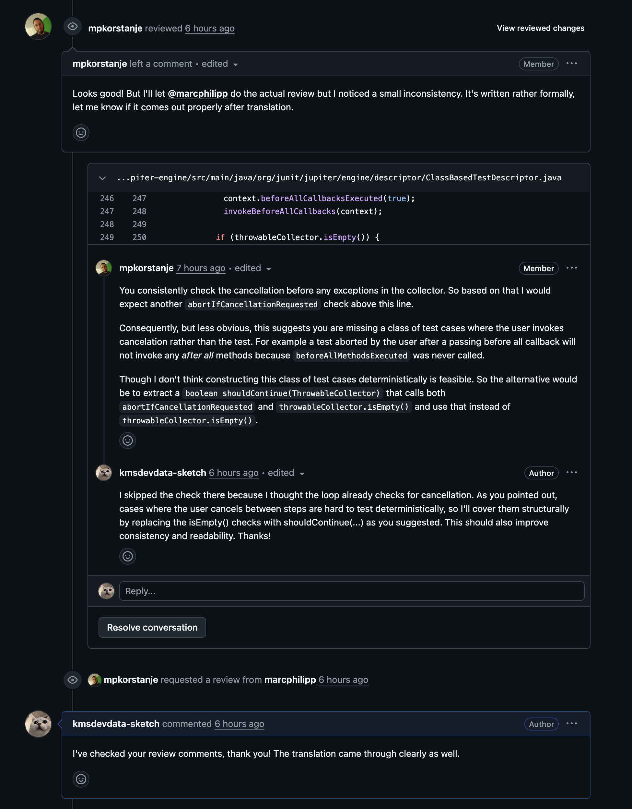
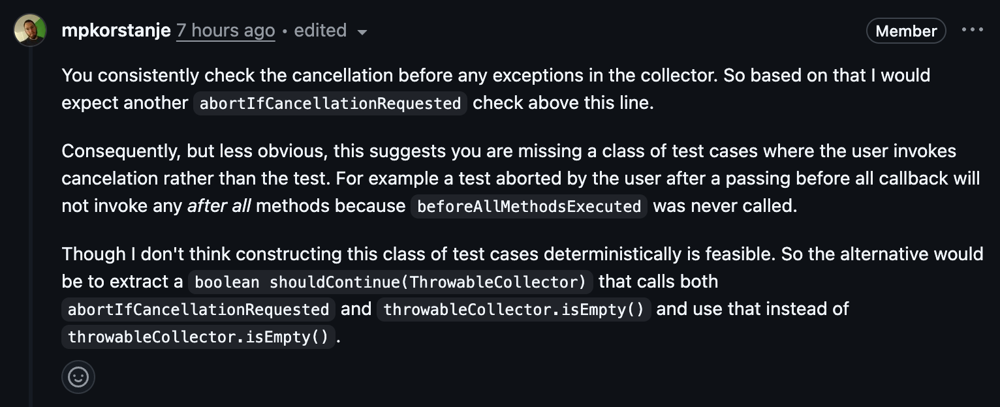
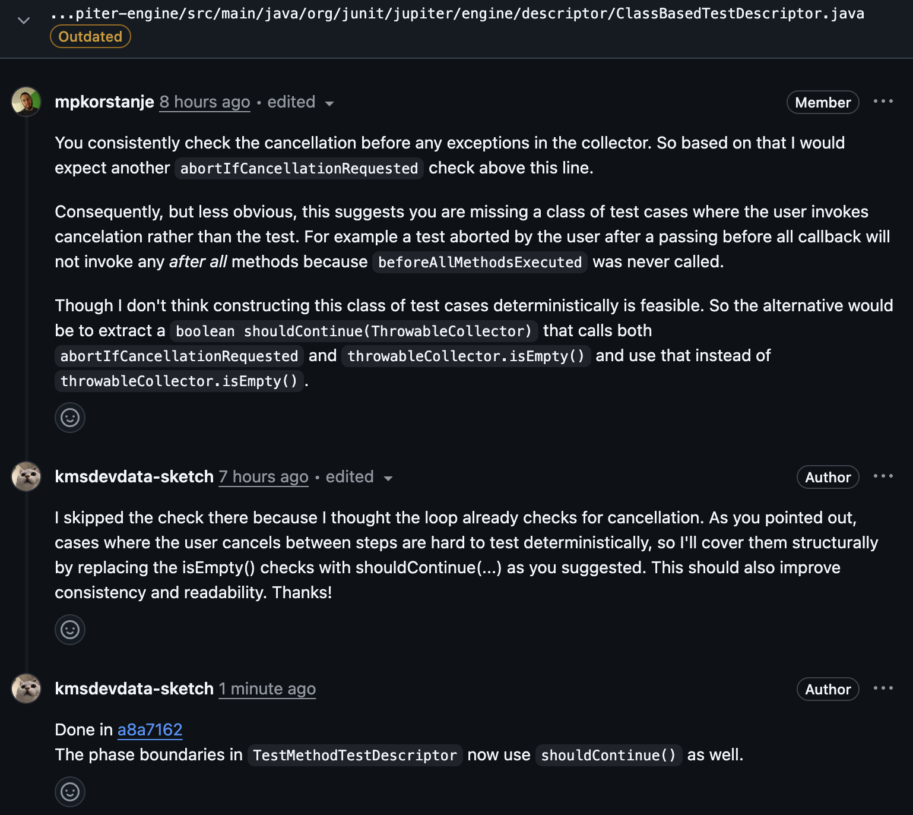
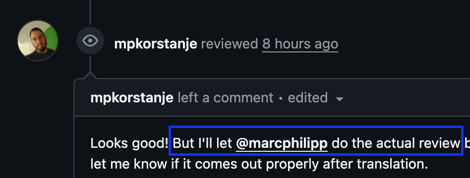

import GitHubRepoCard from "@/components/GitHubRepoCard.astro";

Last time went as far as opening the PR, and this post covers the process of going through rounds of review and revising after opening the PR

<GitHubRepoCard
  repo="junit-team/junit-framework"
  title="JUnit"
  description="The leading testing framework for Java unit tests"
  previewImage="https://opengraph.githubassets.com/1/junit-team/junit-framework"
/>

> [!info] Contributing to JUnit Series
>
> **[Part 1 · Analyzing Why Test Cancellation Is Ignored While @BeforeEach Runs](/en/posts/oss/junit-contribution-1/)**
>
> **[Part 2 · Adding Cancellation Checks to the Jupiter Lifecycle and Opening a PR](/en/posts/oss/junit-contribution-2/)**
>
> **Part 3 · Addressing the First Review and Structuring Cancellation Checks with shouldContinue**

---

## The First Review, Within an Hour

About an hour after I opened the PR last time, a review came in!



Overall it looked fine, and the review pointed out a slight lack of code consistency and an edge case I had missed

---

## Review Comments

### Comment 1: The Missing Cancellation Check Before the @BeforeAll Methods Run

```java
public abstract class ClassBasedTestDescriptor extends JupiterTestDescriptor
		implements ResourceLockAware, TestClassAware, Validatable {
    // ...
	@Override
	public final JupiterEngineExecutionContext before(JupiterEngineExecutionContext context) {
		ThrowableCollector throwableCollector = context.getThrowableCollector();

		if (isPerClassLifecycle(context)) {
			// Eagerly load test instance for BeforeAllCallbacks, if necessary,
			// and store the instance in the ExtensionContext.
			ClassExtensionContext extensionContext = (ClassExtensionContext) context.getExtensionContext();
			throwableCollector.execute(() -> {
				TestInstances testInstances = context.getTestInstancesProvider().getTestInstances(context);
				extensionContext.setTestInstances(testInstances);
			});
		}

		abortIfCancellationRequested(context); // where I added it
		if (throwableCollector.isEmpty()) {
			context.beforeAllCallbacksExecuted(true);
			invokeBeforeAllCallbacks(context);
            
            // ----------------this part---------------------
            // shouldn't there be an abortIfCancellationRequested() check here too?

			if (throwableCollector.isEmpty()) {
				context.beforeAllMethodsExecuted(true);
				invokeBeforeAllMethods(context);
			}
		}

		throwableCollector.assertEmpty();

		return context;
	}
    // ...
}
```

When I first implemented it with step-by-step checks (see Part 2), I had a check in that spot, but I removed it after switching to checking in the loop. The reason was that, as I judged it at the time, cancellation gets checked anyway after the `BeforeAll` callback loop finishes, so checking in that spot would be duplicate code.

Breaking the comment down a bit further

1. If I add it there: check after the `@BeforeAll` callbacks finish -> check right before the `@BeforeAll` methods run -> check at the end of each method run  
   If I don't add it: check after the `@BeforeAll` callbacks finish -> check at the end of each method run  
   I think the difference is small enough that there's practically none
2. It's only safe without a check in that spot because it relies on another file (the part that checks in the loop), so an **implicit dependency** forms. So to a reader it can look like an omission, and it could break if the loop's structure changes

I suspect the reviewer had the implicit dependency in point 2 in mind as the issue, and on top of that, point 1 ties into the next comment

### Comment 2: When the User Cancels Between Steps

Right now all the test code checks this by deliberately calling `cancel()` from inside the test code, and because of that, every cancellation point in the test code happens while some callback or method is running = it always gets caught by the cancellation check in the loop

But in reality, you have to keep in mind that a user can cancel from outside at any time. The reviewer even attached a detailed example scenario for that!



```text
All BeforeAll callbacks pass (last check in the loop: not cancelled)
        ↓
   The user cancels in this gap
        ↓
  BeforeAll method execution
```

But as the maintainer also said above, **"Though I don't think constructing this class of test cases deterministically is feasible."** Because there's a timing problem, reproducing that test perfectly is impossible, so the maintainer suggested blocking it structurally instead

They even kindly explained how to solve it structurally: put the cancellation check in front of the entry conditions so that no spot can be missed in the first place, by creating a `shouldContinue` method that ties the entry condition and the check together so an entry condition without a check simply can't exist

> This is a bit of a tangent, but it's honestly amazing how, less than an hour after I opened the PR, they caught the problem right away and even laid out such a detailed and good solution..😯

---

## The Fix: Tying the Entry Conditions and the Cancellation Check Together with shouldContinue

### Merging abortIfCancellationRequested into shouldContinue

First, I deleted the existing `abortIfCancellationRequested()` entirely and moved its behavior into `shouldContinue`  
The reason: once they're merged, shouldContinue would be the only place calling abortIfCancellationRequested anyway, so I decided there was no need to document it in two places

```java
	/**
	 * Determine whether execution should continue with the next step.
	 *
	 * <p>If cancellation has been requested and no exception has been
	 * collected so far, a {@link TestAbortedException} is added to the
	 * {@link ThrowableCollector} of the supplied context.
	 *
	 * @return {@code true} if no exception has been collected
	 * @since 6.2
	 */
	static boolean shouldContinue(JupiterEngineExecutionContext context) {
		ThrowableCollector throwableCollector = context.getThrowableCollector();
		if (throwableCollector.isEmpty() && context.getCancellationToken().isCancellationRequested()) {
			throwableCollector.execute(() -> {
				throw new TestAbortedException("Execution cancelled");
			});
		}
		return throwableCollector.isEmpty();
	}
```

### Replacing the Existing Check Points with shouldContinue

After creating the method as above, I changed every place that used to do the check, as shown below

```java
    // CallbackSupport
	throwableCollector.execute(() -> callbackInvoker.invoke(callback, extensionContext));
	if (!shouldContinue(context)) { // originally this part checked abortIfCancellationRequested first and then checked isNotEmpty
		break;	
    }

    // ClassBasedTestDescriptor
	if (shouldContinue(context)) {
		context.beforeAllCallbacksExecuted(true);
		invokeBeforeAllCallbacks(context);

	if (shouldContinue(context)) {
		context.beforeAllMethodsExecuted(true);
		invokeBeforeAllMethods(context);
	}
}
        //...
	});
	if (!shouldContinue(context)) {
		break;
	}

    // TestMethodTestDescriptor
	invokeBeforeEachCallbacks(context);
		if (shouldContinue(context)) {
			invokeBeforeEachMethods(context);
			if (shouldContinue(context)) {
				invokeBeforeTestExecutionCallbacks(context);
				if (shouldContinue(context)) {
					invokeTestMethod(context, dynamicTestExecutor);
				}
				invokeAfterTestExecutionCallbacks(context);
			}
			invokeAfterEachMethods(context);
		}
	invokeAfterEachCallbacks(context);
```

---

## Reporting the Changes



I finished the changes and shared the results again  
The somewhat surprising part is that the actual review hasn't even started yet...



If even a light review brings comments this sharp, what will come up in the full review?!  
My guess is naming conventions, some test reinforcement (from what I've seen, JUnit seems to prefer having fewer tests where each single test verifies one behavior all the way through, rather than piling up many test cases), or release notes?!

---

## What I Took Away from This Review

I'm looking forward to what I'll learn in the next review. A few things I felt during this review

1. First of all, the review was really fast! Granted, this was a PR, but on Jetty my progress update posted on the issue had gone unanswered for 3 days, which made me a little sad, so the fast feedback made me feel rewarded
2. It was surprising that there was an improvement from the reader's point of view (I'm not sure it was 100% intended). Because the code isn't consistent and is written to fit a certain flow, a reader might think that part is an omission
3. To be honest, I knew you shouldn't rely on implicit dependencies, but I wasn't conscious of it while writing the code, and I think I'll be more conscious of it from now on
4. Don't just add more tests: this might be specific to this feedback, but what felt like the lesson was that instead of "let's add more tests just in case", it reinforces things structurally because a perfect guarantee isn't possible in the first place

The maintainer's full review comes in the next post!

- PR: [junit-framework#6281](https://github.com/junit-team/junit-framework/pull/6281): Check for cancellation in Jupiter lifecycle methods
- Issue: [junit-framework#6268](https://github.com/junit-team/junit-framework/issues/6268): Consider test cancellation not only during `prepare`
