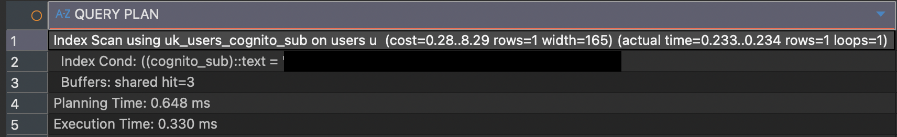
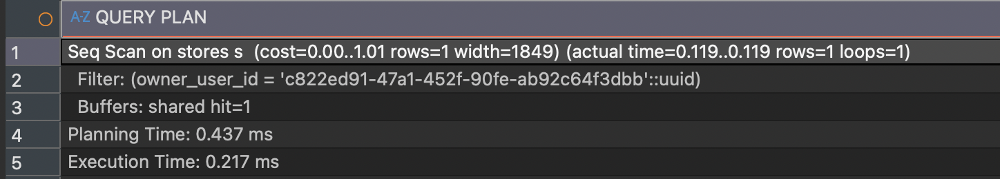
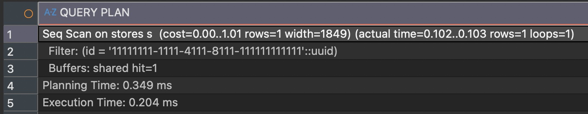
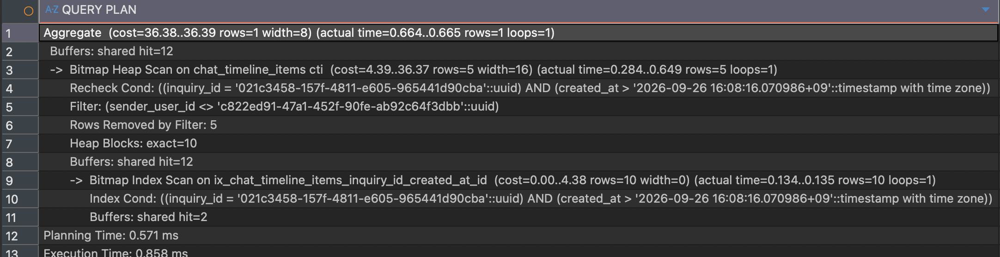
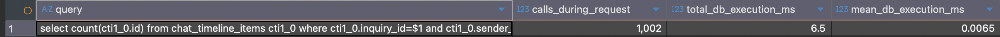

import GitHubRepoCard from "@/components/GitHubRepoCard.astro";

This is the second post in the query optimization series.

<GitHubRepoCard
  repo="kmsdevdata-sketch/wihada-api"
  title="Wihada API"
  description="A backend service that manages consultation, ordering, and payment for custom cake shops in one workflow"
  previewImage="https://opengraph.githubassets.com/36f383c6d65701da09b0d3232d6d309021d2c7699d9e48818247aeaf6904a4a2/kmsdevdata-sketch/wihada-api"
/>

> [!info] Query optimization series
>
> [Part 1 · Choosing APIs and measuring a performance baseline →](/en/posts/query-optimization/query-optimization-1/)
>
> **Part 2 · Analyzing SQL and execution plans**
>
> [Part 3 · Analyzing application code and improving performance →](/en/posts/query-optimization/query-optimization-3/)

> The testing and improvements in this post were carried out against the local application, not the deployed environment!

In the previous post, I selected the target APIs and measured a performance baseline.
This time I wanted to analyze SQL and execution plans, but I had never done this kind of analysis separately before, so I first studied the prerequisite concepts and made a plan.

## Planning the analysis

The process of analyzing SQL and execution plans can be seen as answering the following two questions.

1. **Which SQL statements run for one API request, and how many times does each run?**
2. **How does the database execute the SQL statements among them that take time?**

### Question one: inspect SQL logs

Prerequisite knowledge: I checked the [official Spring Boot logging documentation](https://docs.spring.io/spring-boot/reference/features/logging.html) (the `Log Groups` and `Log Level` sections) to find out how to display SQL in the logs.
For example, if the inquiry API logs look roughly like this:

```
SQL to load the inquiry list                1 execution
SQL to count unread items for one inquiry  1,000 executions
```

I can tell, **"An individual query is being repeated to process 1,000 inquiries!"**
This is to identify the types of SQL and how many times they run, so I can judge `why they were called` and `whether I can reduce the number of repeated calls`.

### Question two: analyze individual SQL statements with execution plans

Prerequisite knowledge: I checked the [PostgreSQL EXPLAIN documentation](https://www.postgresql.org/docs/17/using-explain.html) to understand `EXPLAIN` and `EXPLAIN ANALYZE`.

> An execution plan is the sequence of operations PostgreSQL chooses to process a SQL statement.
> For example, it shows whether PostgreSQL scans a table, uses an index, or joins multiple tables.

I select SQL statements to analyze from those found in step one and check why a single execution of each takes so long.

## SQL analysis

First, I set up SQL logging as follows.

```yaml
logging:
  level:
    sql: debug
```

The configuration above sets the default `sql` log group to `DEBUG`, so Hibernate SQL logs are also displayed.

I analyzed the following three APIs that I used for the previous baseline measurement.

1. `GET /seller/inquiries`: loads all inquiries for a store and separately queries the number of unread items for each inquiry.
2. `GET /seller/dashboard`: queries several aggregates and the number of unread items for each inquiry.
3. `GET /seller/orders`: loads the entire accumulated order list.

### `GET /seller/inquiries`
#### Inquiry list log
```text
2026-10-12T15:37:08.304+0900 [QUIET] [system.out] 2026-10-12T15:37:08.304+09:00 DEBUG 12545 --- [p3-api] [nio-8080-exec-5] org.hibernate.SQL                        : select i1_0.id,i1_0.buyer_deleted_at,i1_0.buyer_last_read_at,i1_0.buyer_purged_at,i1_0.buyer_user_id,i1_0.created_at,i1_0.current_order_form_submission_id,i1_0.seller_deleted_at,i1_0.seller_last_read_at,i1_0.seller_purged_at,i1_0.status,i1_0.store_id from inquiries i1_0 where i1_0.store_id=? order by i1_0.created_at desc
```
#### Inquiry list SQL
```sql
select
    i1_0.id,
    i1_0.buyer_deleted_at,
    i1_0.buyer_last_read_at,
    i1_0.buyer_purged_at,
    i1_0.buyer_user_id,
    i1_0.created_at,
    i1_0.current_order_form_submission_id,
    i1_0.seller_deleted_at,
    i1_0.seller_last_read_at,
    i1_0.seller_purged_at,
    i1_0.status,
    i1_0.store_id
from inquiries i1_0
where i1_0.store_id = ?
order by i1_0.created_at desc;
```
#### Unread-item count log
```text
2026-10-12T15:37:08.398+0900 [QUIET] [system.out] 2026-10-12T15:37:08.399+09:00 DEBUG 12545 --- [p3-api] [nio-8080-exec-5] org.hibernate.SQL                        : select count(cti1_0.id) from chat_timeline_items cti1_0 where cti1_0.inquiry_id=? and cti1_0.sender_user_id<>? and cti1_0.created_at>?
2026-10-12T15:37:08.399+0900 [QUIET] [system.out] 2026-10-12T15:37:08.400+09:00 DEBUG 12545 --- [p3-api] [nio-8080-exec-5] org.hibernate.SQL                        : select count(cti1_0.id) from chat_timeline_items cti1_0 where cti1_0.inquiry_id=? and cti1_0.sender_user_id<>? and cti1_0.created_at>?
2026-10-12T15:37:08.400+0900 [QUIET] [system.out] 2026-10-12T15:37:08.401+09:00 DEBUG 12545 --- [p3-api] [nio-8080-exec-5] org.hibernate.SQL                        : select count(cti1_0.id) from chat_timeline_items cti1_0 where cti1_0.inquiry_id=? and cti1_0.sender_user_id<>? and cti1_0.created_at>?
2026-10-12T15:37:08.400+0900 [QUIET] [system.out] 2026-10-12T15:37:08.401+09:00 DEBUG 12545 --- [p3-api] [nio-8080-exec-5] org.hibernate.SQL                        : select count(cti1_0.id) from chat_timeline_items cti1_0 where cti1_0.inquiry_id=? and cti1_0.sender_user_id<>? and cti1_0.created_at>?
```
#### Unread-item count SQL
```sql
select count(cti1_0.id)
from chat_timeline_items cti1_0
where cti1_0.inquiry_id = ?
  and cti1_0.sender_user_id <> ?
  and cti1_0.created_at > ?;
```
#### Full log summary
| SQL | Executions |
| --------------------------------------------- | ---------- |
| Seller authentication and store checks | 5 |
| **Main inquiry list query against inquiries for the store** | **1** |
| Store, buyer, and recent chat data needed by the list | 5 |
| **Unread-item count per inquiry against chat_timeline_items** | **1,002** |

Looking at them in detail, I can divide the calls into four stages.

1. Request preparation: three user lookups, one seller-onboarding lookup, and one owned-store lookup = five calls.
2. Main list: one query for inquiries belonging to the seller's store, identified from the token.
3. Display data: one store lookup, one batched buyer lookup, and one lookup each for recent chat items, messages, and order forms = five calls.
4. Unread counts: a count query for each inquiry, executed **1,002 times**.

I can see as many as three problems. Some of you may have burst out laughing at the state of things 😂

1. The same seller is loaded three times, apparently by the approval filter, store filter, and controller argument handling. These may be redundant reads.
2. The same store is loaded twice: once during request preparation and once when building the inquiry list.
3. The unread-count query repeats 1,002 times.

However, I have only identified the types of queries and their execution counts, so I do not yet have enough evidence to rank them by their impact on performance.
The issues that catch my eye all seem to come from the application's call flow, but even with fewer reads, one of those reads could itself take 300ms. So I will analyze the execution plans for all three.

## Execution plan analysis

### 1. Seller lookup

```sql
-- 1. Seller lookup

EXPLAIN (ANALYZE, BUFFERS)
SELECT u.id, u.cognito_sub, u.created_at, u.email, u.name,
	   u.payer_id, u.phone_number, u.profile_asset_id, u.role,
	   u.signup_provider, u.status, u.updated_at
FROM users u
WHERE u.cognito_sub = '<seller-cognito-sub>';
```


The meaning of each item is as follows.

| Field | Meaning |
|---|---|
| Index Scan using uk_users_cognito_sub | Finds the user through the cognito_sub index |
| rows=1 | Both the estimated and actual result contain one user |
| actual time=0.233..0.234 | About 0.234ms from index lookup to result |
| loops=1 | This plan executed the SQL once |
| Buffers: shared hit=3 | Three required database pages were already in memory cache |
| Planning Time: 0.648 ms | Time spent planning the query |
| Execution Time: 0.330 ms | Time spent executing this SQL once in the database |

### 2-1. Find the seller's store

```sql
-- 2-1. Find the seller's store

EXPLAIN (ANALYZE, BUFFERS)
SELECT s.id, s.address, s.business_hours, s.cancellation_refund_policy,
	   s.contact, s.contact_visible, s.created_at, s.description,
	   s.detail_address, s.name, s.order_notice, s.owner_user_id,
	   s.pickup_settings, s.profile_asset_id,
	   s.settlement_account_registered_at, s.settlement_account_status,
	   s.slug, s.sns_links, s.status, s.updated_at
FROM stores s
WHERE s.owner_user_id = 'c822ed91-47a1-452f-90fe-ab92c64f3dbb';
```


### 2-2. Load the same store again by ID

```sql
-- 2-2. Load the same store again by ID

EXPLAIN (ANALYZE, BUFFERS)
SELECT s.id, s.address, s.business_hours, s.cancellation_refund_policy,
	   s.contact, s.contact_visible, s.created_at, s.description,
	   s.detail_address, s.name, s.order_notice, s.owner_user_id,
	   s.pickup_settings, s.profile_asset_id,
	   s.settlement_account_registered_at, s.settlement_account_status,
	   s.slug, s.sns_links, s.status, s.updated_at
FROM stores s
WHERE s.id = '11111111-1111-4111-8111-111111111111';
```


### 3. Unread-item count per inquiry

```sql
-- 3. Unread-item count per inquiry: this SQL ran 1,002 times during the API request
EXPLAIN (ANALYZE, BUFFERS)
SELECT count(cti.id)
FROM chat_timeline_items cti
WHERE cti.inquiry_id = '021c3458-157f-4811-e605-965441d90cba'
  AND cti.sender_user_id <> 'c822ed91-47a1-452f-90fe-ab92c64f3dbb'
  AND cti.created_at > TIMESTAMPTZ '2026-09-26 07:08:16.070986+00';
```


The meaning of each item is as follows.

| Field | Meaning |
| ------------------------------------------------------------------ | ---------------------------------------------- |
| Aggregate ... (actual time=0.664..0.665 rows=1 loops=1) | Counts matching items and returns one row |
| Buffers: shared hit=12 | Database pages accessed at this stage were in memory cache |
| Bitmap Heap Scan ... (actual time=0.284..0.649 rows=5 loops=1) | Reads table rows found by the index and retains five |
| Recheck Cond: ... | Rechecks inquiry_id and created_at conditions against table rows |
| `Filter: sender_user_id <> ...` | Excludes items sent by the seller |
| Rows Removed by Filter: 5 | Five rows were excluded by that filter |
| Heap Blocks: exact=10 | Accesses ten table pages |
| Buffers: shared hit=12 | Page accesses at this stage; do not add them to the 12 reported by Aggregate |
| Bitmap Index Scan ... (actual time=0.134..0.135 rows=10 loops=1) | Finds ten candidate rows in the index |
| Index Cond: ... | Index conditions: inquiry ID and timestamps after the last read |
| Buffers: shared hit=2 | Cached pages accessed during the index lookup; included in the 12 above |
| Planning Time: 0.571 ms | Time spent planning the query |
| Execution Time: 0.858 ms | Total time to execute this SQL once |

### Summary of execution plans

| Query | Main plan characteristics | Database execution time |
| ----------------------- | --------------------------------------- | -------- |
| Seller lookup | One row via the cognito_sub index; three cached pages | 0.330ms |
| Store by owner_user_id | Full table scan for one row; one cached page | 0.217ms |
| Store by id | Full table scan for one row; one cached page | 0.204ms |
| Unread-item count | Ten index candidates → five filtered by sender → five counted | 0.858ms |

The inquiry API response time I measured earlier was about `400ms`. Even if I cut the database execution time of queries 1 through 3 in half, that would not have much effect on the API response time, so I judged that improving the execution speed of those SQL statements was a low priority. (Of course, the duplicate calls need to be evaluated separately.)
However, query 4 is actually called 1,002 times, so I judged that I also needed to measure its cumulative cost.

### Measuring the cumulative cost of unread counts

I use `pg_stat_statements` to measure the total execution time of the 1,002 calls.

> `pg_stat_statements` is a PostgreSQL execution statistics extension that records the number of calls and cumulative database execution time for each SQL statement.

**1. Save SQL execution statistics before the API call**

```sql

CREATE TEMP TABLE unread_before AS
SELECT userid, dbid, queryid, calls, total_exec_time
FROM pg_stat_statements
WHERE dbid = (
	SELECT oid FROM pg_database WHERE datname = current_database()
);
```

**2. Call the API with Postman. Response time: 454ms**

**3. Subtract the before-call statistics from the after-call statistics to calculate how often the unread-count query ran and its total database time**

```sql
SELECT
    s.query,
    s.calls - COALESCE(b.calls, 0) AS calls_during_request,
    ROUND(
        (s.total_exec_time - COALESCE(b.total_exec_time, 0))::numeric,
        3
    ) AS total_db_execution_ms,
    ROUND(
        (
            (s.total_exec_time - COALESCE(b.total_exec_time, 0))
            / NULLIF(s.calls - COALESCE(b.calls, 0), 0)
        )::numeric,
        4
    ) AS mean_db_execution_ms
FROM pg_stat_statements s
LEFT JOIN unread_before b
  ON b.userid = s.userid
 AND b.dbid = s.dbid
 AND b.queryid = s.queryid
WHERE s.dbid = (
    SELECT oid FROM pg_database WHERE datname = current_database()
)
  AND s.query ILIKE '%count(%'
  AND s.query ILIKE '%chat_timeline_items%'
  AND s.query ILIKE '%sender_user_id%'
  AND s.query ILIKE '%created_at%'
ORDER BY calls_during_request DESC;
```


| Metric | Result | Meaning |
| ----------- | -------- | ------------------------------ |
| Calls | 1,002 | Confirms one execution per inquiry |
| Cumulative database execution time | 6.500ms | Sum of time spent inside the database for 1,002 SQL executions |
| Mean database execution time | 0.0065ms | Average database time for one SQL execution |

The measurement showed that the total database execution time of the 1,002 calls was 6.5ms. I therefore judged that improving this SQL's execution plan or indexes was also a low priority.
