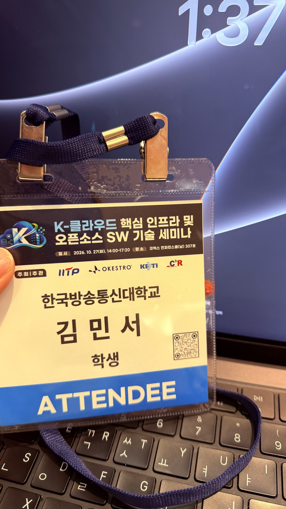

import ResponsiveTable from "@/components/ResponsiveTable.astro";

I wanted to gain a different perspective for the SoftBank hackathon finals, which are coming up soon, so I attended the K-Cloud Core Infrastructure and Open Source Software Technology Seminar this time!

> I am still new to learning this material, so I may not have fully understood the presentations ㅠㅠ Please keep that in mind as you read, and if anything is incorrect or problematic, I will correct it right away!

<ResponsiveTable wide>

| Time | Presentation | Speaker |
| --- | --- | --- |
| 13:30\~14:00 | Registration and networking | - |
| 14:00\~14:30 | Introduction to the Architecture and Technology of a Multimodal Data Platform Based on a High-Speed Parallel File System | Team Lead 박세종 (Mobigen) |
| 14:30\~15:00 | From GPU to Object Storage: The I/O Path Connecting ROCm/S3/DAOS | Principal 김지현 (Gluesys) |
| 15:00\~15:30 | In-Storage Computing Technology That Anyone Can Easily Develop With | Researcher 심훈 (KETI) |
| 15:30\~15:50 | Coffee Break | - |
| 15:50\~16:20 | Elastic Resource Management in Cloud-Native Environments | Professor 유현창 (Korea University) |
| 16:20\~16:50 | Open Source Kubernetes Provisioning and LLM Serving System for Spot Instance-Based AI Infrastructure | Professor 이경용 (Hanyang University) |
| 16:50\~17:20 | LoxiLB-IGW, an Open Source Network Gateway for AI Inference for Everyone | CEO 공성환 (Netlox) |
| 17:20 | Closing | - |

</ResponsiveTable>

That was how the seminar was organized, and the one that interested me most was
- Elastic Resource Management in Cloud-Native Environments

I am currently preparing for the `CKA`, so I was most looking forward to this section because it was the most relevant to me. (To keep the length manageable, I will only cover this section!)

---

## Elastic Resource Management in Cloud-Native Environments

Presenter: Professor 유현창 of Korea University

The overall focus of the presentation was research on dynamically adjusting containers' CPU and memory according to workloads in a K8s environment while minimizing OOM and container restarts caused by resource shortages.

### Elastic Resource Management
In a cloud environment, each workload needs a different amount of CPU and memory, and its resource requirements keep changing while it runs.

So, he said that the following two questions are important for resource scaling.

1. When should resources be scaled up or down?
2. How many resources should be allocated or reclaimed?

Resource scaling in Kubernetes is broadly divided into two types:
- Horizontal Scaling: Increasing the number of Pods  
Because resources are expanded in units of replicas, it is relatively easy to manage.
- Vertical Scaling: Changing the amount of CPU and memory allocated to an existing Pod  
Because multiple workloads share the limited resources of the same node, management is more complex.

He said that most existing academic research uses the `Horizontal` approach (I think..?), while the research he is conducting takes a `Vertical` approach.

As I understood it, the focus was on solving three problems in total.

1. Service interruption when changing a memory allocation
2. OOM when memory runs short
3. Overallocation of memory and inefficient reclamation

I think he said that, even within `Vertical Scaling`, reducing container restarts caused by OOM was the central problem of the presentation.

In the end, the most important thing is:
> To dynamically redistribute a node's limited memory according to workload needs without restarting containers, while minimizing OOM and performance degradation!

### Limitations of Existing Approaches

I learned that Kubernetes can already adjust a Pod's CPU and memory requirements through VPA.

- Recreate: Recreate the Pod to apply new resources — running work may be terminated.
- In-place Resize: Change CPU and memory allocations without recreating the Pod — scaling up is difficult if the node itself does not have enough memory.

### EVMMv1
[Paper](https://pure.korea.ac.kr/en/publications/elastic-vertical-memory-management-for-container-based-stateful-a/?utm_source=chatgpt.com)  

Dynamically adjust memory according to each container's memory demand and priority, and redistribute scarce resources.

### EVMMv2
[Paper](https://www.sciencedirect.com/science/article/abs/pii/S0167739X26000415?utm_source=chatgpt.com)

> Research on monitoring containers' memory requirements in a K8s environment and efficiently redistributing limited memory.

The presentation covered three main points.
1. Priority-Based Memory Allocation: Dynamically adjust memory allocation according to each container's memory demand and task priority.
2. Priority-Aware Suspension & Removal: When the node lacks enough memory to meet every container's requirements, control their running states by priority.  
    - Suspension: Temporarily stop work with `cgroup.freeze` and resume it when resources become available using a scheduler, or recover it from a checkpoint.
    - Removal: Remove a container if necessary to free memory.

3. State Preservation: Use checkpoints to address the loss of execution state when a container is removed.

The key point: When memory runs short, do not simply let OOM terminate the work -> instead, suspend, remove, and recover work according to priority.

**Limitations**  
OOM can occur if memory usage increases while resuming suspended work to create a checkpoint.  
The Suspension and Checkpoint/Recovery processes also have overhead from stopping and recovering work.

### VASUM

`- Currently under review`

Follow-up research aimed at improving how memory shortages are handled.

1. Swap-Aware Memory Management: Move some memory pages to a swap area when physical memory is scarce (reducing reliance on suspending work).
2. Memory protection: Protect a minimum amount of memory.
3. Deciding Scaling Size Based on the PvP Curve: Rather than always increasing or decreasing by a fixed amount -> use the `PvP Curve` to decide on an appropriate memory allocation.

---

## My Thoughts

Overall, this was quite a difficult seminar for me ㅠㅠ😂

In each presentation, I could understand **what the problem was and which approach was chosen to solve it**, but I had trouble following the specific implementation methods and technical details.

Even so, the problems and solutions discussed in each presentation were really interesting.

`[Introduction to the Architecture and Technology of a Multimodal Data Platform Based on a High-Speed Parallel File System]`  
I learned how they infer and update relationships among different types of data while processing hundreds of millions of pieces of enterprise data arriving asynchronously.

`[From GPU to Object Storage: The I/O Path Connecting ROCm/S3/DAOS]`  
I was also impressed by how they are trying to solve the problem of GPUs sitting idle because of bottlenecks in CPU and conventional storage I/O during AI training and inference. Technologies such as `DAOS` and `RDMA`, which I encountered for the first time, were especially interesting. To think that, unlike ordinary ways of transferring data over a network, they write data directly to a remote computer's memory!

Another presentation that left an impression was Professor 이경용 of Hanyang University's **“Open Source Kubernetes Provisioning and LLM Serving System for Spot Instance-Based AI Infrastructure.”**

It surprised me that an approach I had only vaguely imagined — using data such as spot instance prices, interruption histories, and availability to place nodes optimally and cut costs — had actually been implemented in research and a system.

What was especially hard for me even to imagine was that, to overcome EKS's single-region constraint, they implemented a Custom Resource called HyperunJob along with an Operator and Driver Pod to handle it, and designed the Driver Pod to provision EC2 instances in other regions and run workloads on k3s... (~~Honestly, it even took me a long time to understand how they designed it..~~)

It gave me a lot to think about: going beyond simply using cloud services to analyze the limitations of an existing platform and directly design and implement the features needed.

There is still a lot I do not understand about the technical details, but it was a valuable opportunity to see what problems the Kubernetes and cloud infrastructure technologies I usually study are used to solve in actual research!!🔥

