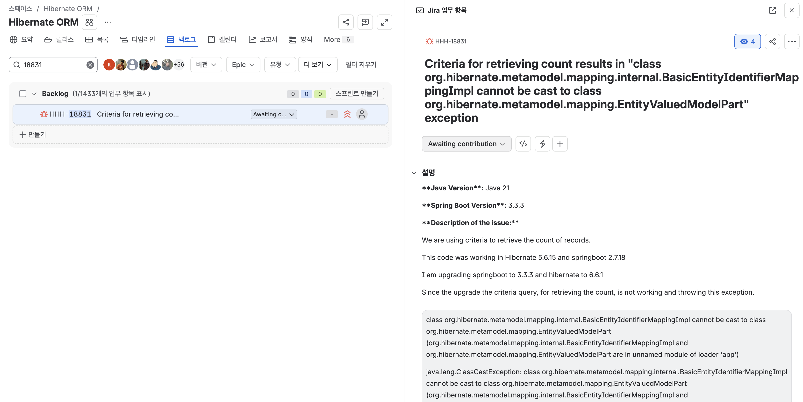
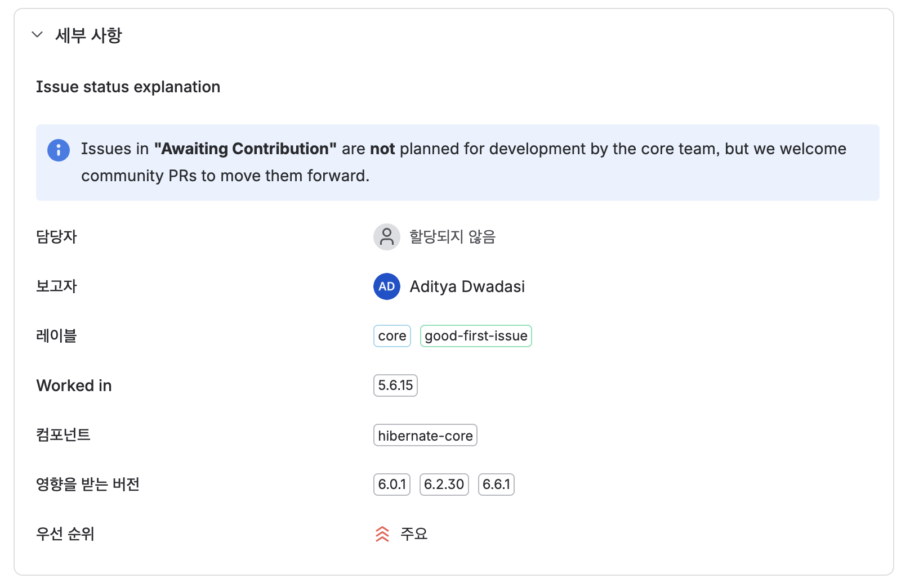
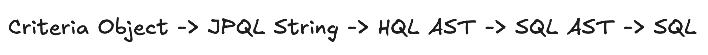
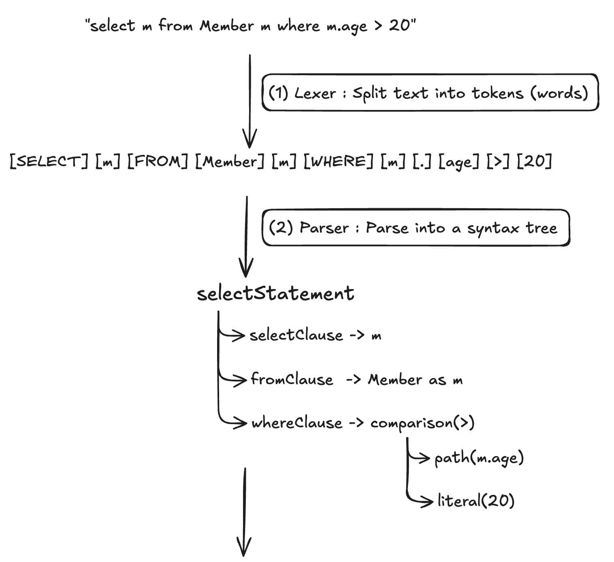
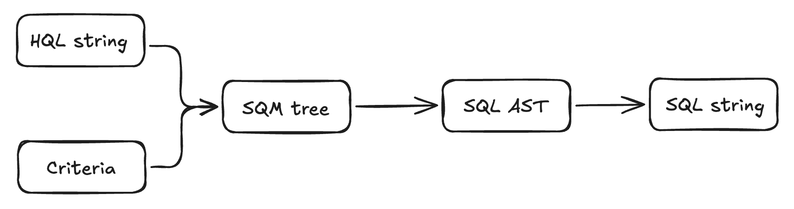
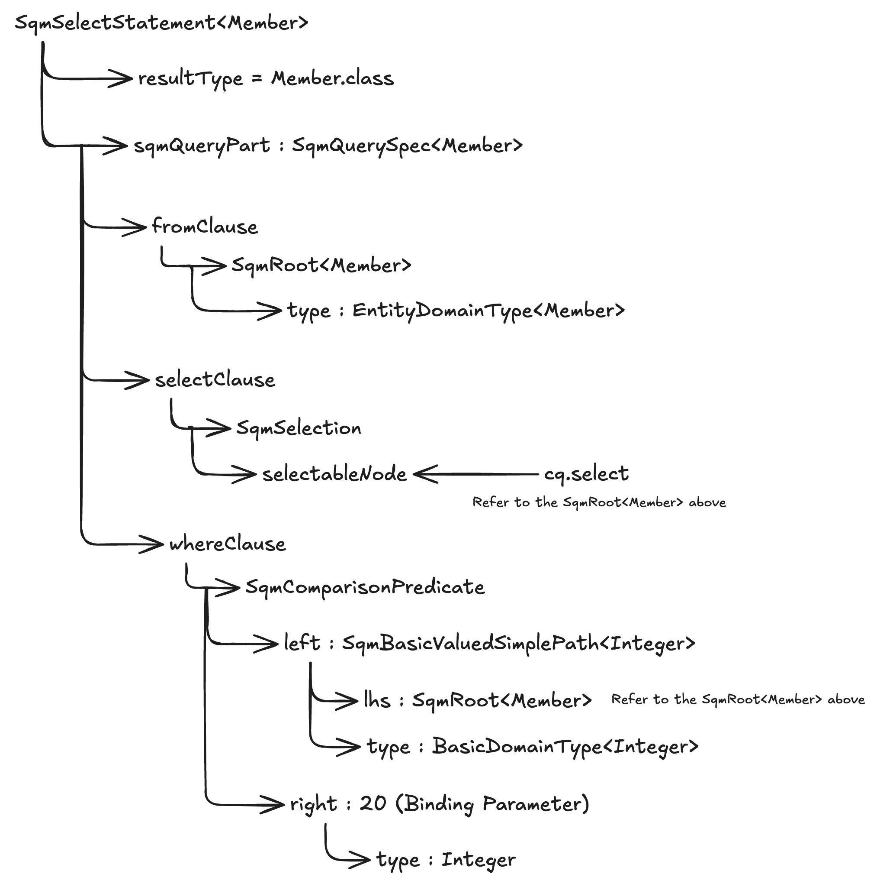
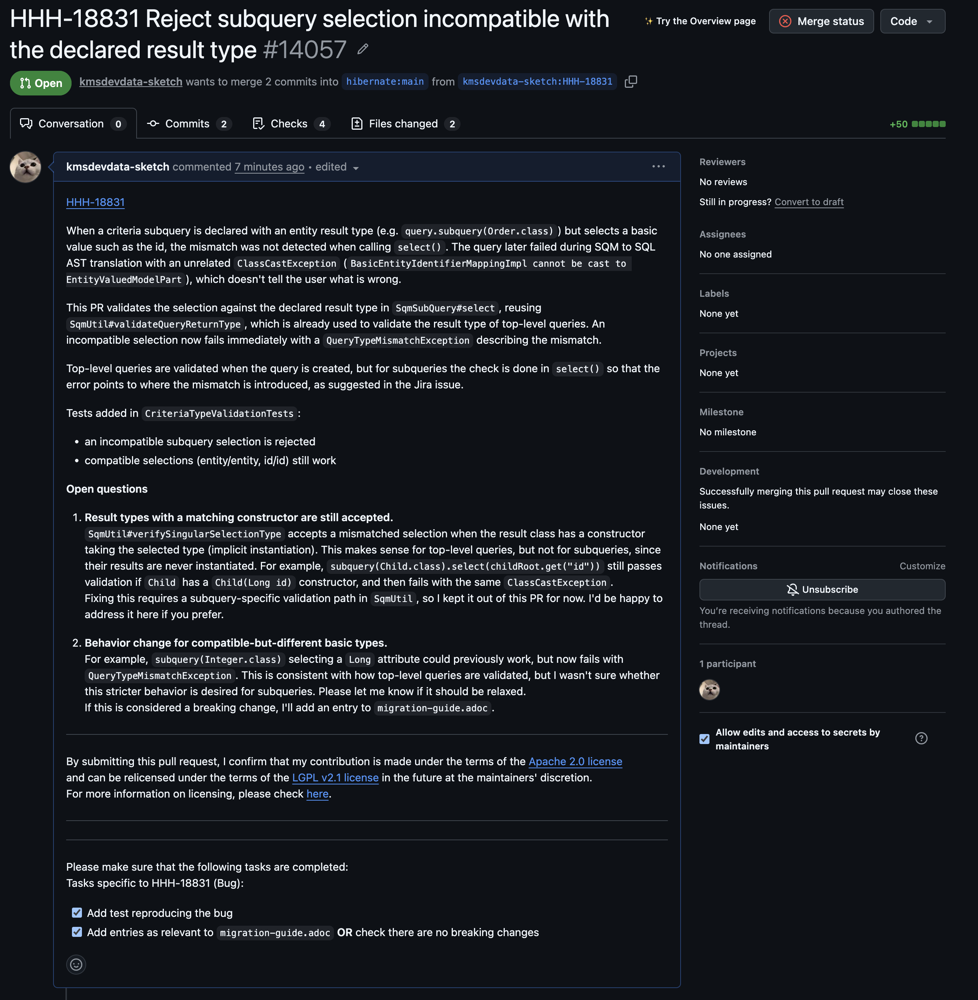

import GitHubRepoCard from "@/components/GitHubRepoCard.astro";

이번에는 오픈소스중 Hibernate ORM에 기여하기 위해 이슈를 찾아봤다

원래도 DB쪽이 약하다고 느껴서 학습을 하고싶은 욕구가 있었는데 JUnit기여활동을 하면서(현재 PR 리뷰진행중) 기여를 하면서 해당 기술에 대한 이해가 확실히 학습이 되는걸 느끼고 Spring Data JPA,Hibernate ORM쪽에서 찾아보았는데 JPA는 할당가능한 이슈가 없고 하이버네이트는 몇가지 있어서 시작하게 되었다.

<GitHubRepoCard
  repo="hibernate/hibernate-orm"
  title="Hibernate ORM"
  description="자바 진영의 대표적인 JPA 구현체이자 ORM 프레임워크"
  previewImage="https://opengraph.githubassets.com/1/hibernate/hibernate-orm"
/>

> [!info] Hibernate ORM 오픈소스 기여 시리즈
>
> **1편 · Criteria 서브쿼리 타입 불일치로 터지는 ClassCastException 분석하고 PR 올리기**

---

## Jira에서 이슈 고르기: HHH-18831

오픈소스들을 찾아보니 깃헙에서 진행하는 오픈소스들도 많이 있지만 별도로 이슈관리 도구를 활용하는곳들이 몇번 보였는데 Hibernate는 Jira를 사용한다 !

이슈를 할당받기위해 Jira에 가입하여 기존에 봤던 몇가지 선택지 에서

1. HHH-18831 : Criteria 서브쿼리 카운트에서 ClassCastException
2. HHH-20056 : TiDB버전에 따라 casecade 지원감지
3. HHH-13846 : PatternRenderer 생성자에서 인덱스를 검증하지 않음

18831을 선택하였다 그 이유는 메인테이너가 `good-first-review`를 붙였고 재현코드와 해결 방향까지 안내가 되어있었다.





> "Issues in "Awaiting Contribution" are not planned for development by the core team, but we welcome community PRs to move them forward."

사실 이슈가 `Awaiting contribution` 상태여서 댓글로 꼭 허락을 맡을 필요는 없었지만 초기방향 확인 + 중복 작업 방지 를 위해서 댓글을 남겨두었다.

---

## 문제 파악하기

JPA의 구현체로 Hibernate가 사용되는거는 알고있었지만 실제 세부동작을 뜯어본적은 없어서 이번 이슈의 문제를 정확하게 파악하기 위해서는 이론학습이 꽤나 필요했다

### 문제의 핵심: 선언 타입과 실제 select 타입의 불일치

핵심사항은 사용자가 서브쿼리를 "엔티티를 반환한다"고 선언해 놓고 실제로는 id(기본 타입)를 select하면 발생하는 문제다 => Hibernate 5 때는 Criteria를 JPQL 문자열로 바꿔 처리하여 우연히 동작하였는데 Hibernate 6 이후 `select()` 시점에 타입을 검증하지 않고 SQL 변환 단계에서 타입이 맞는다고 가정한 채 캐스팅하다가 원인과 무관한 지점에서 `ClassCastException`으로 터진다

내용을 봤을때는 "그냥 사용자가 실수한거잖아?" 라고 생각이 들수도 있지만 문제는 발생한 예외가 실제 원인을 전혀 설명해주지 못한다는 점이다 `ClassCastException` + Hibernate 내부 클래스 이름만 보았을때 사용자는 무엇이 잘못된건지 전혀 파악할수가 없다.

### 재현 조건

다음으로는 문제의 재현과정을 확인해보는데 몇가지 복잡한 조건과 특수성이 있었다.

1. Criteria API를 직접 사용하여야 한다. 대부분의 경우 Spring Data 메서드 이름 쿼리, `@Query` JPQL , QueryDSL등을 사용하다 보니 Criteria를 직접 쓰는 건 동적 검색같은 특수한 경우 밖에 없다.

<details>
<summary>`Criteria API`란</summary>

`Criteria API`란 JPA표준에 들어있는 쿼리를 문자열 대신 Java코드로 조립하는 API이다

```java
// JPQL: 문자열로 작성
em.createQuery("select m from Member m where m.age > 20", Member.class);

// Criteria API: 객체로 조립
CriteriaBuilder cb = em.getCriteriaBuilder();
CriteriaQuery<Member> cq = cb.createQuery(Member.class);
Root<Member> m = cq.from(Member.class);          // from Member m
cq.select(m).where(cb.gt(m.get("age"), 20));     // select m where m.age > 20
em.createQuery(cq);
```

보이는 것처럼 코드가 길고 읽기 어려운데 보통은 동적 쿼리(검색 조건이 있을때만 where절 붙이기),문법 오류를 컴파일 시점에 잡기 와 같은 이유로 사용한다

보통은 감싸서 사용하는 경우가 많은데

- Spring Data JPA의 `Specification` : 사용해본 사람은 위에 내용만 보고도 아 내부구현은 이거였구나 싶었을수 있다 `Specification`는 내부적으로는 `Criteria API`를 사용한다
- QueryDSL : 비슷한 목적인데 더 읽기 쉬운 문법을 제공하는 별도 라이브러리다

</details>

2. 세가지 조건이 동시에 맞아야 한다
    - 서브쿼리를 엔티티 타입으로 선언
    - 실제로는 id를 select해야함
    - 그 결과를 엔티티와 비교

<details>
<summary>서브쿼리를 엔티티 타입으로 선언?</summary>

JPQL만 사용하다 보니 엔티티 타입으로 선언한다는거 자체가 무슨 이야기인지 이해가 필요했는데

예를들어 SQL/JPQL에서는 아래처럼 서브쿼리의 결과 타입이 select에 쓴 내용으로 자동으로 정해진다.

```sql
-- 엔티티를 반환하는 서브쿼리
select m from Member m where m in (select m2 from Member m2 where ...)

-- id를 반환하는 서브쿼리
select m from Member m where m.id in (select m2.id from Member m2 where ...)
```

하지만 Criteria 에서는 위에 설명처럼 Java코드로 조립을 하기 때문에 Java컴파일러를 위해 미리 "해당 서브쿼리는 이런 타입이다"라고 적어줘야 하는데 아래를 보면 알수있다

```java
Subquery<Member> sub = query.subquery(Member.class);
Subquery<Long>   sub = query.subquery(Long.class);  
```

이 뒤에 `select()`로 실제 내용을 정하다보니 선언과 실제 내용이 따로 지정이 가능한 구조여서 둘이 어긋날수가 있는것이다

</details>

3. JPQL에는 이런 "거짓 선언" 이 없다. JPQL은 애초에 문자열처럼 사용을 하다 보니 서브쿼리 타입을 따로 선언하지 않고 실제 select내용에서 타입을 정한다.

### 문제가 되는 코드

```java
this.subQuery = query.subquery(TaskResource.class);   // ① 결과 타입: TaskResource (엔티티)
subQuery.select(subRoot.get("id")).distinct(true);     // ② 실제 select: id (UUID/Long 같은 기본 타입)
builder.in(root).value(subQuery);                      // ③ root(엔티티) IN (서브쿼리)
```

---

## Hibernate 5에서는 동작하고 그 이후는 왜 안될까

이를 파악하기 위해서 Hibernate의 쿼리 처리구조를 알아봤다

### Hibernate 5의 쿼리 처리 구조



<details>
<summary>Hibernate 5 쿼리 처리 단계 자세히 보기</summary>

#### 1. Criteria 객체를 JPQL 문자열로 렌더링

Criteria로 만든 객체들은 메모리 안에서 트리모양으로 연결이 되어있다.

```text
CriteriaQuery
 ├ select: Root(Member, alias=m)
 └ where:  GreaterThan
            ├ Path(m.age)
            └ Literal(20)
```

Hibernate 5는 쿼리를 실행할 때 이 트리의 노드마다 -> 해당 노드를 JPQL로 표현해주는 `render()` 메서드를 호출하여 문자열을 이어 붙였다

```text
"select m from Member m where m.age > :param0"
```

이미 동작하는 HQL파서를 활용하기 위해 Criteria를 문자열로 바꿔 파이프라인 재사용을 한것이다

> 구현은 간단햇지만 객체 -> 문자열 -> 다시 파싱이라는 왕복이 생겨 비효율적  
> +이러한 구조때문에(문자열에) Java타입 정보를 담을 곳이 없었다 => Hibernate5에서 위에 버그가 터지지 않은 이유

#### 2. HQL 파서를 거쳐 HQL AST로 변환

문자열을 받아서 문법 구조를 가진 트리로 바꾸는 프로그램

<details>
<summary>HQL 이란</summary>

**HQL** (Hibernate Query Language).  
: Hibernate의 객체지향 쿼리 언어이다 SQL과 비슷해보이지만 테이블,컬럼이 아닌 엔티티와 필드를 대상으로 작성된다

```sql
-- SQL: 테이블과 컬럼
select * from member where age > 20

-- HQL/JPQL: 엔티티와 필드
select m from Member m where m.age > 20
```

JPQL과 무슨관계?

- HQL이 먼저 있었다
- JPA 표준을 만들 때 HQL을 바탕으로 표준 부분만 뽑아서 -> JPQL로 선정
- HQL 은 JPQL의 상위 집합이다 => 모든 JPQL은 유효한 HQL이며 Hibernate전용 기능이 더있다

Hibernate 안에서는 JPQL을 받아도 HQL로 취급하여 같은 파서로 처리

</details>

##### 파싱 단계



- (2) 까지는 문법만 확인한다 => 중간 오타가 있어도 문법적으로만 맞다면 모두 통과

#### 3. HqlSqlWalker를 거쳐 SQL AST로 변환

파서가 만든 HQL AST는 아직 엔티티와 필드 기준이다.  
`HqlSqlWalker`가 해당 트리를 순회하면서 두가지 일을 동시에 수행하는데

1. **의미 분석** : `Member`가 실제 엔티티 인지 , `age` 필드가 실제로 있는지 => 엔티티가 없으면 여기서 에러 발생
2. **SQL 구조로 분석** : 엔티티 -> 테이블 , 필드 -> 컬럼

#### 4. SqlGenerator를 거쳐 SQL 문자열로 생성

완성된 SQL AST를 순회하며 DB에 보낼 실제 SQL 문자열로 출력한다

</details>

여기까지는 Hibernate5 의 동작이고 이제 6이후를 확인해보자

### Hibernate 6의 쿼리 처리 구조



<details>
<summary>Hibernate 6 쿼리 처리 단계 자세히 보기</summary>

#### 1. 입구가 두개: HQL 문자열, Criteria

- HQL/JPQL 문자열 : HQL파서가 문법 트리를 만들고 `SemanticQueryBuilder`가 의미 분석을 하여 **SQM트리로 만든다**
- Criteria : 별도 변환이 없다(Hibernate6 에서는 Criteria 객체가 그자체로 SQM 노드임)

#### 2. SQM 트리

HQL 로 들어오든 Criteria로 들어오든 모두 같은 SQM 트리로 모인다

```text
SqmSelectStatement
 └ SqmQuerySpec
    ├ SqmSelectClause → SqmRoot(Member, alias=m)
    ├ SqmFromClause   → SqmRoot(Member)
    └ SqmWhereClause  → SqmComparisonPredicate(>)
                         ├ SqmBasicValuedSimplePath(m.age)  타입: Integer
                         └ SqmLiteral(20)                    타입: Integer
```

- 해당 단계에서 타입검사를 거친다

<details>
<summary>SQM 이란</summary>

SQM(Semantic Query Model)  
Hibernate6에서 도입된 쿼리의 의미를 도메인 용어로 표현한 트리다(아직 SQL X)  
"어떤 엔티티의 어떤 필드를 어떤 조건으로"만 표현

- 각 노드가 자신의 타입정보를 들고 있다.(`SqmBindableType`)
- HQL과 Criteria가 같은 SQM으로 모이기 때문에 이후 검증,변환,캐싱 로직을 하나로 공유한다

</details>

#### 3. BaseSqmToSqlAstConverter를 거쳐 SQL AST로 변환

완성된 SQL AST를 DB에 맞는 SQL 문자열로 출력한다(같은 SQL이여도 DB에 맞춰(Ex.MySQL,PostgreSQL)출력된다)

</details>

### Hibernate 5 vs 6 한눈에 보기

| 단계 | Hibernate 5 | Hibernate 6 이후 |
|---|---|---|
| Criteria 처리 | JPQL 문자열로 렌더링 후 재파싱 | 그 자체가 SQM 노드 |
| 의미 분석 | `HqlSqlWalker` (SQL 변환과 함께) | SQM 생성 시 (`SemanticQueryBuilder`, `TypecheckUtil`) |
| SQL 트리 변환 | `HqlSqlWalker` | `BaseSqmToSqlAstConverter` |
| SQL 문자열 생성 | `SqlGenerator` | `SqlAstTranslator` (Dialect별) |
| Java 타입 정보 | 렌더링 시 사라짐 | 끝까지 유지 |

### 결론적으로 6이후에 문제가 발생한 이유

정리하면 Hibernate 5는 Criteria를 JPQL 문자열로 바꾼 뒤 다시 파싱해서 SQL을 만들었기 때문에 문자열로 바뀌는 순간 Java 타입 정보가 사라졌다 그래서 선언 타입과 실제 select 타입의 불일치도 함께 지워져서 문제가 드러나지 않았고

반면 Hibernate 6 이후는 Criteria 객체가 그대로 SQM 노드가 되고, 각 노드가 자신의 타입 정보를 끝까지 들고 가는데 이때 서브쿼리에는 선언 타입과 실제 select 타입(id)이 함께 남아, 타입 검사 단계에서는 선언 타입을 보고 통과시키고 SQL AST 변환 단계에서는 실제 select 타입을 보고 캐스팅하다가 `ClassCastException`이 발생한다

---

## 재현 테스트 작성

작업을 시작하기전 실제로 테스트를 통해 선언타입과 실제 select타입이 다를시 `ClassCastException`이 발생하는지를 먼저 확인했다

```java
public class CriteriaTypeValidationTests {

	//...

	@Test // 수정 후 기대 동작 테스트 
	@JiraKey("HHH-18831")
	public void testSubquerySelectionIncompatibleWithResultType(SessionFactoryScope scope) {
		scope.inTransaction(
				session -> {
					final HibernateCriteriaBuilder cb = session.getCriteriaBuilder();
					final CriteriaQuery<Parent> cq = cb.createQuery( Parent.class );

					// subquery declared to return the entity, but selecting its id
					final Subquery<Parent> subquery = cq.subquery( Parent.class );
					final Root<Parent> subRoot = subquery.from( Parent.class );
					assertThrows(
							IllegalArgumentException.class,
							() -> subquery.select( subRoot.get( "id" ) )
					);
				}
		);
	}

	@Test // 타입을 올바르게 맞춘 두 가지 사용법 
	@JiraKey("HHH-18831")
	public void testSubquerySelectionCompatibleWithResultType(SessionFactoryScope scope) {
		scope.inTransaction(
				session -> {
					final HibernateCriteriaBuilder cb = session.getCriteriaBuilder();

					// entity compared to a subquery selecting the entity
					final CriteriaQuery<Parent> entityQuery = cb.createQuery( Parent.class );
					final Root<Parent> entityRoot = entityQuery.from( Parent.class );
					final Subquery<Parent> entitySubquery = entityQuery.subquery( Parent.class );
					entitySubquery.select( entitySubquery.from( Parent.class ) );
					entityQuery.where( cb.in( entityRoot ).value( entitySubquery ) );
					session.createQuery( entityQuery ).getResultList();

					// id compared to a subquery selecting the id
					final CriteriaQuery<Parent> idQuery = cb.createQuery( Parent.class );
					final Root<Parent> idRoot = idQuery.from( Parent.class );
					final Subquery<Long> idSubquery = idQuery.subquery( Long.class );
					idSubquery.select( idSubquery.from( Parent.class ).get( "id" ) );
					idQuery.where( cb.in( idRoot.<Long>get( "id" ) ).value( idSubquery ) );
					session.createQuery( idQuery ).getResultList();
				}
		);
	}

	@Entity(name = "Parent")
	public static class Parent {
		@Id
		private Long id;

		private String name;
		private Double price;

		@OneToMany(mappedBy = "parent", fetch = FetchType.EAGER, cascade = CascadeType.ALL, orphanRemoval = true)
		private Set<Child> children = new HashSet<>();
	}

	@Entity(name = "Child")
	public static class Child {
		@Id
		private Long id;

		@ManyToOne
		private Parent parent;

		public Child() {
		}

		public Child(Long id) {
			this.id = id;
		}
	}
}
```

이미 `CriteriaTypeValidationTests` 라는 테스트파일과 그안에 엔티티까지 준비가 되어있어서 그대로 활용하였고 내가 만든 테스트는 커스텀 어노테이션인 `@JiraKey`를 활용하였다

전체적인 테스트는 Criteria 사용법은 나에게 익숙하지 않아서 클로드코드를 활용하였다

<details>
<summary>테스트코드 확인하기 위한 선수지식</summary>

**SessionFactoryScope** : Hibernate의 테스트 전용 도구로 클래스에 붙은 `@DomainModel`과 `@SessionFactory`를 확인하여 해당 엔티티들을 `SessionFactory`에 넣어준다

**HibernateCriteriaBuilder** : JPA표준 `CriteriaBuilder`를 Hibernate가 확장한 인터페이스로 표준 기능에 Hibernate 전용 함수가 더 들어가있다

**CriteriaQuery\<Parent>** : 쿼리 설계도를 만드는것으로 `<Parent>` 는 쿼리의 결과가 Parent라는 뜻이다(내부적으로는 SQM트리의 꼭대기인 `SqmSelectStatement`이다(Hibernate 6 쿼리 처리 단계 자세히 보기 - SQM트리 참고))

**subquery()** : 아래 내용 괄호속 들어갈 쿼리를 만든다

```sql
select p from Parent p where p in ( select p2 from Parent p2 )
                                    ------- 이부분 --------
```

**Root** : `FROM`절의 엔티티이다 ex. `from parent p`의 `p`

</details>

---

## 개선 지점 찾기

실제 코드를 개선할곳은 적었지만 정확한 위치파악을 위해서는 다른건 몰라도 SQM구조는 정확하게 알고있어야했다 Hibernate 6 이후 모든 쿼리가 거치는 중심구조이니 학습도 겸해서 좀더 딥다이브 해보았다.

<details>
<summary>SQM 딥다이브</summary>



#### 1. SQM 이란

SQM(Semantic Query Model)  
: Hibernate 6에서 도입된 쿼리의 의미를 엔티티와 필드 기준으로 표현한 트리

#### 2. 전체 구조

```text
① 쿼리 층        SqmSelectStatement / SqmSubQuery          쿼리 하나 + 선언된 결과 타입
      │
② 쿼리 파트 층    SqmQuerySpec / SqmQueryGroup              select-from-where 한 덩어리 (union이면 Group)
      │
③ 절 층          SqmSelectClause / SqmFromClause / SqmWhereClause
      │
④ 노드 층        SqmRoot, SqmPath, SqmLiteral, SqmPredicate ...
      │
⑥ 타입 정보      SqmBindableType → JavaType → Class      (모든 노드에 붙어 있음)
      │
      ▼         BaseSqmToSqlAstConverter
⑤ SQL AST       TableGroup, ColumnReference, ComparisonPredicate ...
      ▼         SqlAstTranslator (Dialect별)
   SQL 문자열
```

예시 : 나이가 20보다 많은 회원 조회

```java
CriteriaBuilder cb = em.getCriteriaBuilder();
CriteriaQuery<Member> cq = cb.createQuery( Member.class );  
Root<Member> m = cq.from( Member.class );                   
Path<Integer> age = m.get( "age" );                         
cq.select( m )                                              
  .where( cb.gt( age, 20 ) );                               
em.createQuery( cq ).getResultList();  
```

##### `cb.createQuery( Member.class )`

```text
SqmSelectStatement<Member>
 ├ resultType = Member.class          ← 선언된 결과 타입 (라벨)
 └ sqmQueryPart: SqmQuerySpec         ← 아직 비어 있음
     ├ fromClause:   (비어 있음)
     ├ selectClause: (비어 있음)
     └ whereClause:  null
```

**쿼리 층** 과 **쿼리 파트 층** 을 생성한다

- 쿼리 층 : 쿼리 전체를 대표하고 결과가 어떤 타입이어야 하는지를 기억
- 쿼리 파트 층 : select , from , where 와 같은 절을 담는 그릇

##### `cq.from ( Member.class )`

```text
fromClause
 └ SqmRoot<Member>  (alias m)
     └ 타입: EntityDomainType<Member>   ← "이건 엔티티 Member다"
```

from 절에 루트 노드를 추가한다

- SqmRoot : from절 엔티티이자 `m.age`, `m.team` 과 같은 모든 경로의 출발점
- 이때 `Member` 실제 엔티티인지 바로 확인하며 없으면 에러 발생

##### `m.get( "age" )`

```text
SqmBasicValuedSimplePath<Integer>  (m.age)
 ├ lhs: SqmRoot<Member>               ← 어디서 출발한 경로인지
 └ 타입: BasicDomainType<Integer>     ← "이건 Integer 기본 값이다"
```

경로노드는 엔티티의 속성을 가르키며 속성 종류에 따라 노드 종류가 달라진다

- 기본 값(`m.age` , `m.id`) -> `SqmBasicValuedSimplePath`
- 엔티티(`m.team`) -> `SqmEntityValuedSimplePath`

> 제너릭 상관없이 노드의 실제 속성 타입을 알고있다

##### `cq.select( m )`

```text
selectClause
 └ SqmSelection
     └ selectableNode: SqmRoot<Member>   ← 실제로 select한 것 (내용물)
```

select 절은 무엇을 결과로 내보낼지 담으며 쿼리층의 `resultType`과 select 절의 내용물이 따로 저장되는 특징이 있다

##### `cb.gt( age,20 )`

```text
whereClause
 └ SqmComparisonPredicate (>)
     ├ left:  SqmBasicValuedSimplePath<Integer>  (m.age)
     └ right: 20  (기본 설정에서는 바인딩 파라미터로 처리)
```

조건 노드는 비교연산을 포함하고 있는다

> 생성될 때 양쪽 타입이 비교 가능한지 검사한다

##### `em.createQuery( cq )`

결과 타입을 검증한다

- 라벨 (`Member.class`) 과 내용물 (`SqmRoot<Member>`타입)을 비교한다

> 최상위 쿼리에는 해당 검증이 있지만 서브쿼리에는 해당 검증이 없는것이 이번 이슈의 핵심

이후에는 컨버트를 통하여 SQL AST로 변환한뒤 해당 SQL AST를 DB에 맞게 문자열로 출력한다

</details>

### 문제 상황 다시 정리

문세상황을 다시한번 정리하자면  
Criteria는 최상위 쿼리와 서브쿼리 모두 결과 타입을 선언하지만 선언 타입과 select 내용을 비교하는 검증(`validateQueryReturnType`)은 최상위 쿼리에만 적용되어 있었다

서브쿼리는 결과가 Java로 반환되지 않아 검증이 빠져 있었지만 Hibernate 6부터는 서브쿼리의 선언 타입이 바깥 쿼리의 타입 검사와 SQL 변환에 사용되기 때문에 선언이 틀리면 엉뚱한 곳에서 `ClassCastException`이 발생한다 => 따라서 서브쿼리의 `select()` 시점에 최상위 쿼리와 같은 검증을 적용해서 선언 타입과 select 내용이 다르면 즉시`QueryTypeMismatchException`을 발생시킨다.

### SqmSubQuery.select() 코드 확인

```java
public class SqmSubQuery<T> extends AbstractSqmSelectQuery<T>{
    // ...
    @Nonnull
	@Override
	public SqmSubQuery<T> select(@Nonnull Expression<T> expression) {
		//noinspection unchecked
		getQuerySpec().setSelection( (JpaSelection<T>) expression );
       // applyInferableType( (Class<T>) querySpec.getSelection().getJavaType() );
		return this;
	}
    // ...
}
```

- `getQuerySpec()` : from,where,group by를 모두 가진 덩어리라고 볼수있다
- `.setSelection()` : 해당 덩어리중 select절에 넣는 것으로 인자로 받은 노드를 넣는다
- `expression?` :  사용자가 `select()`에 넘긴 내용물(SQM 노드)타입은 해당 노드 안에 들어 있다

현재 쿼리의 select 시점을 확인해보면 단순히 값을 받아서 넣기만 하고 검증과정은 거치지 않고 있다 => 사용자가 엔티티라고 타입 선언후 실제로는 id를 select하게 되면 이후 쿼리를 실행할 때 SQM을 SQL AST로 변환하면서 실제 내용물을 엔티티 매핑으로 캐스팅할때 터지게 된다

> 반대경우(id선언 - 엔티티 select)는 안터지나? : 이 부분은 약간 애매한데 기존에 문제상황도 기본값이 엔티티일때 실행되던 분기여서 id가 들어가게되면 터지지않을 확률이 높을 뿐더러 재사용할 검증로직도 엔티티를 select후 해당 엔티티의 id로 선언하는 경우는 허용한다는 규칙이 있어 추후 PR에서 확인할 부분

### 수정 방법: 어느 시점에 예외를 던질까

해당 문제를 해결하기 위해서는 두가지 방법이 있었다

1. `select()`시점에 예외를 발생시킨다 - 메인테이너 제안 사항
2. `createQuery()` 시점에 예외를 발생시킨다 - 최상위 쿼리 검증흐름에서 같이 검증한다 일관성은 좋지만 모든 서브쿼리를 다찾아서 순회해야된다 => 보류

### 기존 유틸 메서드 재사용: validateQueryReturnType

```java
	/**
	 * Used to validate that the specified query return type is valid (i.e. the user
	 * did not pass {@code Integer.class} when the selection is an entity)
	 */
	public static void validateQueryReturnType(SqmQueryPart<?> queryPart, @Nullable Class<?> expectedResultType) {
		if ( expectedResultType != null && !isResultTypeAlwaysAllowed( expectedResultType ) ) {
			// the result-class is always safe to use (Object, ...)
			checkQueryReturnType( queryPart, expectedResultType );
		}
	}
```

확인해보니 `SqmUtil`에 이미 **지정한 쿼리 반환 타입이 실제 select 내용과 맞는지 확인하는 유틸 메서드** 가 있었다  
최상위 쿼리는 `createQuery()` 시점에 이 메서드로 결과 타입을 검증하고 있으므로 서브쿼리에서도 같은 메서드를 재사용하자!

---

## PR 올리기



사실 변경부분은 많지 않아서 바로 PR을 올렸다 예외사항이 몇가지 있어서 이것은 PR에 올려 메인테이너의 의견을 물었다

1. 결과 타입에 맞는 생성자가 있으면 여전히 통과된다: 사용한 유틸 메서드가 결과 클래스에 선택된 타입을 받는 생성자가 있으면 타입이 맞지 않아도 select를 허용하기 때문

   > 최상위 쿼리는 결과를 Java 객체로 반환하므로 생성자가 있다면 `new 결과타입(값)`으로 객체를 만들 수 있어 문제가 없다 하지만 서브쿼리는 결과를 객체로 만들지 않고 SQL 안에서 바깥 쿼리의 조건 값으로만 쓰는것이 목적이기에 이 규칙이 맞지 않는다

2. 호환되지만 서로 다른 기본 타입에서의 동작 변화 : Long속성을 Select하는 `subquery(Integer.class)`는 이전에는 동작하였는데 이제는 실패하도록 변경되었다 최상위 쿼리 검증방식과는 동일하지만 서브쿼리도 이정도로 엄격하게 동작해도 되는지는 의문

이제 리뷰를 기다려보자!

- PR: [hibernate-orm#14057](https://github.com/hibernate/hibernate-orm/pull/14057): HHH-18831 Reject subquery selection incompatible with the declared result type
- 이슈: [HHH-18831](https://hibernate.atlassian.net/browse/HHH-18831): Criteria for retrieving count results in "class org.hibernate.metamodel.mapping.internal.BasicEntityIdentifierMappingImpl cannot be cast to class org.hibernate.metamodel.mapping.EntityValuedModelPart" exception
