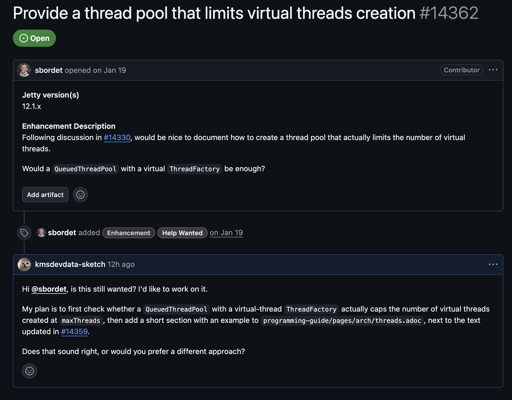
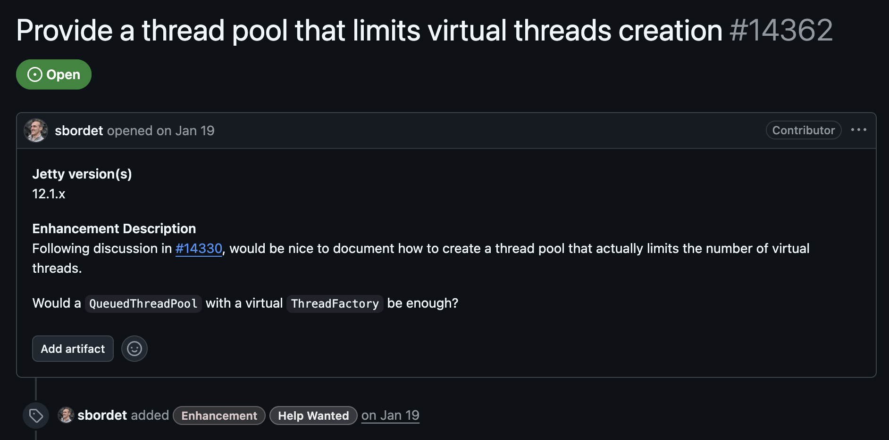
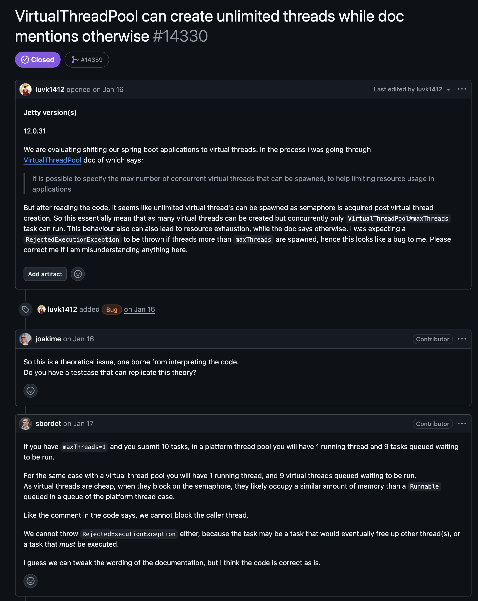
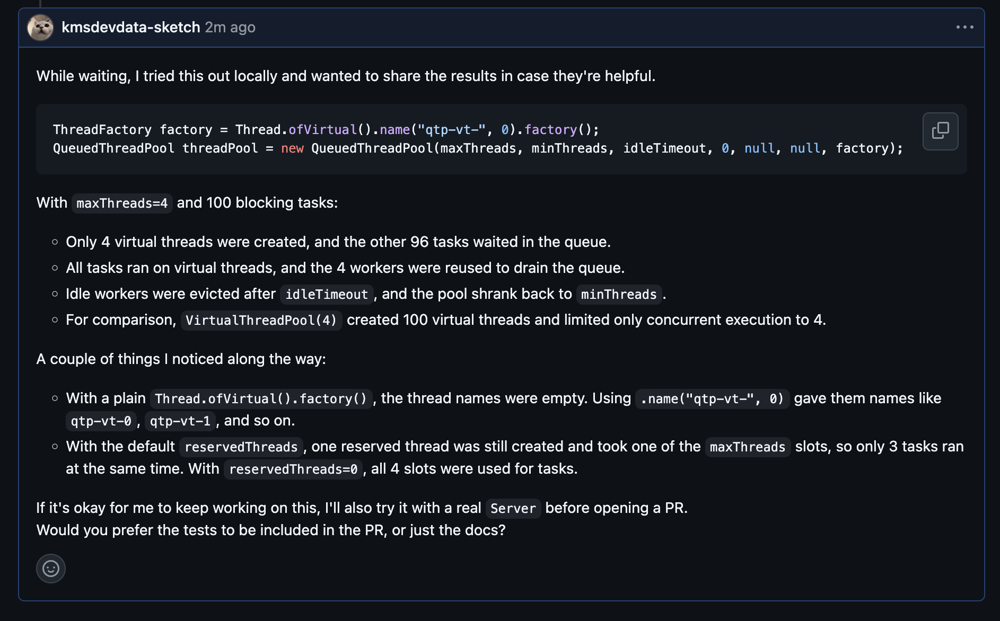

import GitHubRepoCard from "@/components/GitHubRepoCard.astro";

이번에 오픈소스 기여에 도전해보고 싶어서 오픈소스 기여를 위한 여정기를 남긴다.

우선적으로 내가 사용하던 오픈소스중에서 불편함 혹은 개선점을 느끼고 기여를 하는것도 좋겠지만 나는 오픈소스 기여를 해보고 싶다는 비교적 개인적인 ~~욕망?~~ 에서 시작되었다


<GitHubRepoCard
  repo="jetty/jetty.project"
  title="Eclipse Jetty"
  description="자바 기반 웹 서버이자 서블릿 컨테이너"
  previewImage="https://opengraph.githubassets.com/1/jetty/jetty.project"
/>

> [!info] Jetty 오픈소스 기여 시리즈
>
> **1편 · 가상 스레드 생성 수 제한 이슈 탐색과 검증**
>
> **2편 · 서버 테스트와 PR (예정)**

---

## 찾아보기

우선 출발점을 탐색해야하는데 세상엔 너무 많은 오픈소스가 있으니 몇가지 제약사항을 두고 찾았다.

1. 이슈항목에 올라와있는걸 탐색 : 내가 코드탐색 혹은 테스트를 거쳐 문제점을 잡아내는것은 너무 힘들다고 판단
2. 주 사용 언어,프레임워크와 교집합 : GitHub에 올라와있는 오픈소스가 5억개가 넘어간다고 한다(ㄷㄷ) 그중에서 아무거나 찾는건 불가능이라고 생각하고 자바,스프링부트와 연관성이 있는 항목으로 제한한다.
3. 너무 크지않은 이슈 : 오타/사소한 문서 ~ 대규모 리팩토링을 5단계 정도로 나눴을때 2단계정도 까지만 탐색하였다 처음이니 욕심내지 않고 찾아보기

> 이번에 알게되었는데 오픈소스에서 보통 이슈에 라벨로 `good first issue` 를 달아줘서 처음 기여하는 사람이 맡기 좋을만한 이슈도 안내된다(아마도 위에 단계를 나눈것중 1~3단계정도?)

분량 조절을 하자면 위에 사항들을 바탕으로 클로드를 통해 탐색하여 적절한 이슈를 찾아냈다!

[jetty - 가상 스레드 제한 스레드풀 이슈](https://github.com/jetty/jetty.project/issues/14362)  
대략적으로 살펴보았을때 "가상 스레드를 쓰면서도 스레드가 무한정 만들어지지 않게 하는 방법을 문서로 정리해달라" 라는 이슈로 확인되었고 내가 생각한 난이도에도 알맞아 보였다.

> **jetty란?** : Tomcat과 같이 자바 웹 서버이고 스프링 부트에서 내장 서버로 골라 사용가능하다. Tomcat = Spring Boot 기본값, Jetty는 더 가볍고 모듈식이며 임베딩 용도로 활용하기 좋다.

---

## 오픈소스 문화 알아보기

최근에 봤던 유튜브 영상들에서 AI를 사용하여 무분별한 오픈소스 PR이 올라오는 문제점에 대해서 본적이 있다.  
AI사용자체는 문제가 아닌것 같지만 오픈소스 문화에 대한 이해를 한뒤에 해당 규약들을 지켜가며 기여를 하는것이 좋은 방향으로 보여 오픈소스 문화에 대해서 좀더 찾아보았다.

- [kshired님의 오픈소스에 초보 개발자가 기여하는 방법](https://velog.io/@kshired/%EC%98%A4%ED%94%88%EC%86%8C%EC%8A%A4%EC%97%90-%EC%B4%88%EB%B3%B4-%EA%B0%9C%EB%B0%9C%EC%9E%90%EA%B0%80-%EA%B8%B0%EC%97%AC%ED%95%98%EB%8A%94-%EB%B0%A9%EB%B2%95)
- [GitHub Docs 가이드](https://docs.github.com/ko/enterprise-server@3.17/get-started/exploring-projects-on-github/contributing-to-open-source)
- [이번에 참여 희망하는 jetty의 가이드](https://jetty.org/docs/contribution-guide/index.html)

> 3번과 같이 기여하는 프로젝트의 공식적인 가이드가 있는 경우가 많다!



> 이슈를 맡아도 되는지 물어보는것이 매너라고 한다!

---

## 이슈 파헤치기



> 개선 사항 설명  
> #14330에서 논의된 바와 같이, 가상 스레드 수를 실제로 제한하는 스레드풀  을 생성하는 방법을 문서에 명시하면 좋을 것 같습니다.  
> 가상 ThreadFactory를 사용하는 QueuedThreadPool만으로 충분할까요?

위에 내용을 보면 문제의 시작점은 #14330으로 보인다! 그쪽으로 가서 정확히 어떠한 문제였는지 파악해보려했다.



[이슈 #14330](https://github.com/jetty/jetty.project/issues/14330)

### 시작점 이슈 파악

내용을 요약해서 확인해보자면

**문제 제기**

luvk1412 님 : 스프링 부트 앱을 가상 스레드로 옮기려 하였는데 문서상에는 최대 갯수를 제한 가능하다고 적혀있는데 코드를 보니 스레드를 먼저 만들고 나서 -> 세마포어를 잡는다 그러면 스레드가 무한히 생기니 버그아닐까? 그러면 최대 스레드 갯수 넘기면 예외던져야 하지 않을까?

> **세마포어(Semaphore)** : 동시 실행되는 개수를 N개로 제한하는 도구

즉 동시 실행 수는 제한되지만 생성 수 자체는 제한이 안되는것 아니냐?

**첫 반응**

joakime 님(메인테이너) : 재현 테스트가 있나?  
sbordet 님(메인테이너) : 대기 중인 가상 스레드 하나는 큐에 쌓인 Runnable 하나와 메모리가 비슷해서 사실상 같다 -> 호출한 스레드를 막을 수도 작업을 거절할 수도 없으니 코드는 맞고 문서를 고치겠다

**재현 테스트**

maxThreads=200 에 작업 10,000개 넣으니 가상 스레드 10,000개 생성되고 동시 실행은 200개였다. => 메모리 터짐  
회사에서는 기존에 QueueThreadPool에 크기 제한 있는 큐를 줘서 과부하 걸리면 요청을 fast fail해서 서버가 회복했는데 가상스레드에서는 그게 안되는게 고민

**핵심**

- 스레드풀큐를 제한 하는건 틀린방식이다.
- 작업 1개 = HTTP 요청1개 라는 생각은 단순하다
- 예시 : 요청 헤더는 왔는데 본문 안와서 스레드 대기 -> 본문 도착 -> 스레드 꺠우는 작업을 큐에 넣어야 하는데 -> 큐가 꽉차서 거절 -> 서버 전체 멈춤
- 올바른 방법 : 스레드풀은 넉넉하게 두고 큐는 무제한 + 요청 동시 실행 수는 QoSHandler로 따로 제한하기 

**마무리**

문제 제기자가 납득하고 이슈닫음 -> 그래도 생성 수를 제한하는 방법은 문서화 하자! => [지금 이슈](https://github.com/jetty/jetty.project/issues/14362)

#### 이를 통해 알수있는 참고할점

- 큐는 무제한으로 두는 예제여야 한다
- 요청을 제한하고 싶다면 `QoSHandler`사용 안내하기 
- 재현 코드 준비하기 : 메인테이너가 이슈제기에 바로 재현을 물어봄

---

## 시작하기

### 준비

- ECA 서명하기

> **ECA (Eclipse Contributor Agreement)** 는 "내가 보내는 코드는 내가 직접 작성했고, 프로젝트가 오픈소스 라이선스로 써도 된다"고 동의하는 온라인 서약서이다.

### 목표 정리

QueuedThreadPool에 가상 스레드 ThreadFactory를 넣는 방법 찾기 (생성자나 setter)

현재 상황을 조금더 정리를 해보자면

1. 가상 스레드의 생성 수 자체를 제한하고 싶은 사용자가 있다.
2. `VirtualThreadPool` 로는 안된다 ㅠㅠ (스레드 먼저 생성후 세미포어로 막는 구조)
3. 그런데 생성 수 제한은 `QueueThreadPool`이 이미 하고 있다.
4. `QueueThreadPool`이 일반 쓰레드를 쓰는 이유는 딱 한 군데 뿐인데 스레드를 만드는 부분에서 일반 스레드를 만들기 때문이다 => 근데 그부분이 `ThreadFactory`로 갈아끼울 수 있게 열려있다.
5. 그렇다면! 팩토리만 가상 스레드용으로 바꾸면 그릇(`QueueThreadPool`)은 그대로 두고 그 안의 작업자만 가상 스레드로 바꿀수 있지 않을까? 

위에 내용을 토대로 진행이된다.

그리고 나의 목표는 위에사항을 검증하고 되는지 안되는지 된다면 주의할점 안된다면 그 이유등을 문서화해서 정리하는것!

### 코드 확인하기

```java

    public QueuedThreadPool(@Name("maxThreads") int maxThreads, @Name("minThreads") int minThreads,
                            @Name("idleTimeout") int idleTimeout, @Name("reservedThreads") int reservedThreads,
                            @Name("queue") BlockingQueue<Runnable> queue, @Name("threadGroup") ThreadGroup threadGroup,
                            @Name("threadFactory") ThreadFactory threadFactory)
    {
        if (maxThreads < minThreads)
            throw new IllegalArgumentException("max threads (" + maxThreads + ") less than min threads (" + minThreads + ")");
        setMinThreads(minThreads);
        setMaxThreads(maxThreads);
        setIdleTimeout(idleTimeout);
        setStopTimeout(5000);
        setReservedThreads(reservedThreads);
        if (queue == null)
        {
            int capacity = Math.max(_minThreads, 8) * 1024;
            queue = BlockingArrayQueue.newInstance(capacity, Integer.MAX_VALUE);
        }
        if (queue.remainingCapacity() != Integer.MAX_VALUE)
        {
            LOG.warn("Detected thread pool queue {} bounded at {} entries, which can lead to unexpected behavior. Use an unbounded queue instead.", queue.getClass(), queue.remainingCapacity());
            _capacity = queue.remainingCapacity();
        }
        else
        {
            _capacity = -1;
        }
        _jobs = queue;
        _threadGroup = threadGroup;
        setThreadPoolBudget(new ThreadPoolBudget(this));
        _threadFactory = threadFactory == null ? this : threadFactory;
    }
```

**집중확인할 부분**

```java
_threadFactory = threadFactory == null ? this : threadFactory;
```
자신(QueuedThreadPool)이 어차피 스레드팩토리 구현체이기 때문에 생성시 넘겨받은 스레드 풀이 있다면 그걸 사용하고 없다면 자신이 들어간다

```java
protected void startThread()
    {
        boolean started = false;
        try
        {
            Thread thread = _threadFactory.newThread(_runnable);
            if (LOG.isDebugEnabled())
                LOG.debug("Starting {}", thread);
            _threads.add(thread);
            // Update the evict threshold to prevent thrashing of newly started threads.
            _evictThreshold.set(NanoTime.now() + TimeUnit.MILLISECONDS.toNanos(_idleTimeout));
            thread.start();
            started = true;
        }
        finally
        {
            if (!started)
                addCounts(-1, -1); // threads, idle
        }
    }
```
실제로 활용되는건 위에 보이는것과 같이 스레드를 생성할때 확인 가능하다

### 테스트 범위 정하기

테스트는 우선적으로 3개 범위군으로 좁혔다.

1. 핵심 (필수)
    - A1.생성 수 제한 
    - A2.진짜 가상 스레드인지 판별
    - A3.유실없이 전부 실행되는지
    - A4.비교군
2. 주의사항(문서에 참고 기재용도)
    - B1.스레드 이름
    - B2.idle 정리 
    - B3.reserved threads
3. 실제 서버동작확인(메인테이너와 상의 후 결정)
    - C1.서버 동작
    - C2.커넥터 상시 점유
    - C3.planning

#### 테스트 작성하기 

##### A1.생성 수 제한

```java

    @Test
    public void testThreadCreationIsCappedAtMaxThreads() throws Exception
    {
        // maxThreads=4, minThreads=1, idleTimeout=60s, reservedThreads=0, queue=null(default unbounded), threadGroup=null
        QueuedThreadPool qtp = new QueuedThreadPool(MAX_THREADS, 1, 60_000, 0, null, null, virtualThreadFactory());
        qtp.start();

        // Latch that keeps every task blocked until it is released
        CountDownLatch release = new CountDownLatch(1);

        try
        {
            for (int i = 0; i < TASKS; i++)
            {
                qtp.execute(() ->
                {
                    try
                    {
                        release.await();
                    }
                    catch (InterruptedException e)
                    {
                        Thread.currentThread().interrupt();
                    }
                });
            }

            // Wait until all 4 workers are busy.
            await().atMost(5, TimeUnit.SECONDS).until(qtp::getBusyThreads,is(MAX_THREADS));

            // No more than 4 threads must have been created.
            assertThat("created threads", qtp.getThreads(), is(MAX_THREADS));

            // The remaining 96 tasks must be queued, not rejected.
            assertThat("queued tasks", qtp.getQueueSize(), is(TASKS - MAX_THREADS));
        }
        finally
        {
            // Release blocked tasks before stopping the pool, otherwise stop() hangs until its timeout.
            release.countDown();
            qtp.stop();
        }
    }
```
: 작업 100개를 래치로 붙잡아 두고 그 순간에 "만들어진 스레드 4개 / 큐 96개" 가 맞는지 셌다 - 결과는 통과

##### A2.진짜 가상 스레드인지 판별

```java
// Tasks actually run on virtual threads, i.e. the ThreadFactory is really used.
    @Test
    public void testTasksRunOnVirtualThreads() throws Exception
    {
        QueuedThreadPool qtp = new QueuedThreadPool(MAX_THREADS, 1, 60_000, 0, null, null, virtualThreadFactory());
        qtp.start();

        // Latch counting down once per finished task, to wait for all of them.
        CountDownLatch completed = new CountDownLatch(TASKS);

        // Number of tasks that ran on a non-virtual thread.
        AtomicInteger nonVirtual = new AtomicInteger();

        try
        {
            for (int i = 0; i < TASKS; i++)
            {
                qtp.execute(() ->
                {
                    // Check whether the thread running this task is virtual.
                    if (!VirtualThreads.isVirtualThread())
                        nonVirtual.incrementAndGet();
                    completed.countDown();
                });
            }

            // Wait up to 10 seconds for all 100 tasks to finish.
            assertTrue(completed.await(10, TimeUnit.SECONDS), "not all tasks completed");

            // No task may have run on a non-virtual thread.
            assertThat("tasks run on non-virtual threads", nonVirtual.get(), is(0));
        }
        finally
        {
            qtp.stop();
        }
    }
```
: 각 작업 안에서 `VirtualThreads.isVirtualThread()` 로 "지금 나를 실행하는 스레드가 가상 스레드인가?"를 묻고, 아닌 경우를 셌다. 결과는 0개 = 통과

+ A1은 개수만 세었으니 팩토리가 무시되고 일반 스레드로 만들어졌어도 통과하였을수 있어 확인

##### A3,A4

분량조절을 위해 간추리자면 A3는 유실없이 실행되는지,A4는 기존의 `VirtualThreadPool` 과 비교하여(최대 생성 스레드 갯수 제한 x) 생성된 스레드 수 와 동시실행 수 비교하여 모두 의도한대로 테스트 통과하여 가설 검증을 완료하였다!

##### B1,2,3

핵심(필수)테스트는 모두 끝나서 다음으로는 추가테스트를 하는데

 - B1.스레드 이름 : 원래는 `QueueTreadPool`의 기본 팩토리를 사용하면 스레드에 이름이 붙는데 가상팩토리로 변경하면 이름이 빈 문자열이 될수 있다 => 스레드 덤프나 로그에서 Jetty스레드인지 알아보기 어려워서 이름이 비는지 + 빌더 메서드 사용하면 의도한대로 이름이 붙는지 확인해본다
 - B2.idle 정리 : `QueueTreadPool`은 원래 `idleTimeout`동안 놀고있는 스레드를 정리해서 최소값으로 맞춰주는데 이게 가상스레드에서도 정상 동작 하는지 확인해본다
 - B3.reserved threads : 앞선 테스트에서는 숫자를 정확히 파악하기 위해 0으로 두었는데 실제로는 디폴트값을 사용하는(-1,자동)으로 쓰는사람이 많을테니 예약스레드로 인한 예외동작이 없는지 확인한다.

> **예약스레드** : Jetty만의 최적화로 셀렉터 스레드를 바로 넘겨받을 스레드를 대기시킨다

결과적으로 모두 성공하였으며 조금 쓸만한 발견을 한것은 B3 테스트를 하면서 발견한것인데 예약 스레드 기본값이 -1 이 되는것은`setVirtualThreadsExecutor` 을 사용했을때 뿐이여서 현재 위에 방식으로 생성하면 예약스레드가 1개가 켜진다   
=> 최대 스레드중 1개를 차지하여서 일반 작업은 동시에 3개만 돌아간다   
=> 가상 팩토리 사용시에는 예약스레드를 0으로 명시하라는 당위성!

---

### 정리 + 내용 공유

아직 메인테이너에게 답변이 오지 않아서 테스트 결과를 공유하고 이어서 작업을 하여도 되는지 여쭤보았다!



이제 답변이 오길 기다리고 맡아도 된다면 서버테스트까지 이어서 작업한뒤에 PR만 올리면된다!(허락해주세요ㅠㅠ 😂)
