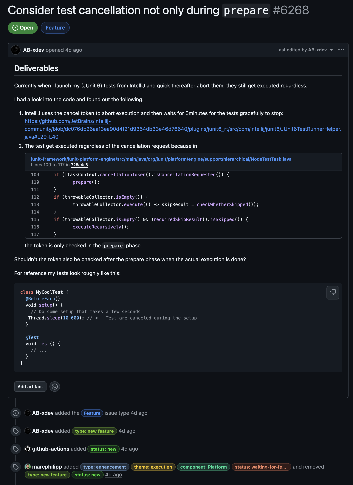
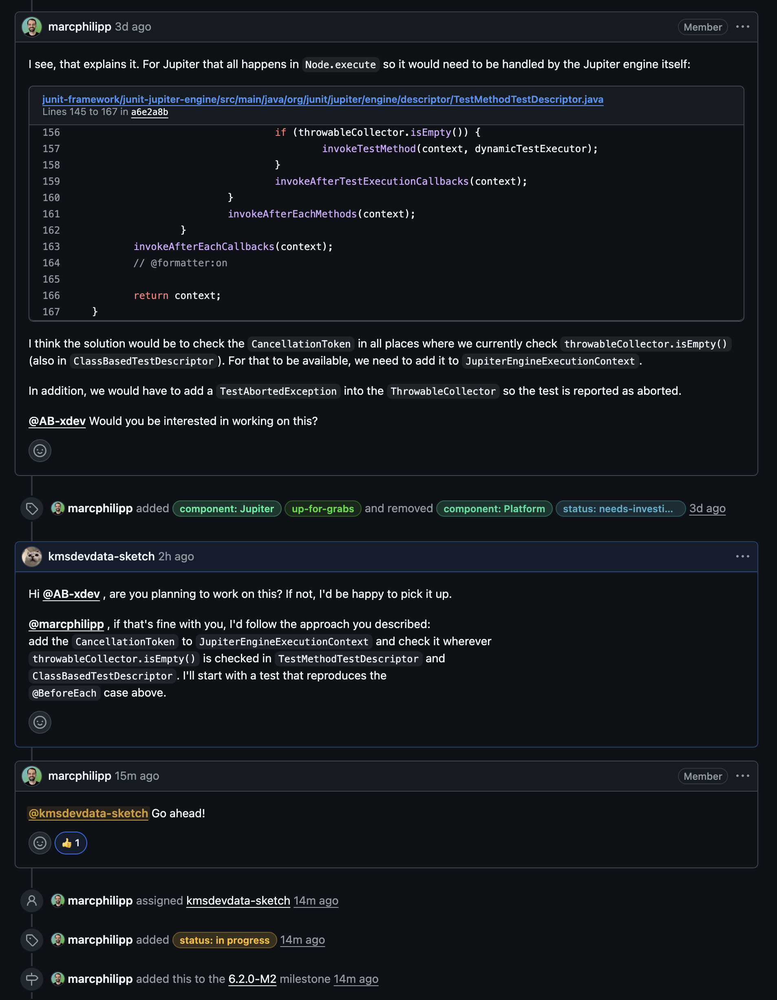

import GitHubRepoCard from "@/components/GitHubRepoCard.astro";

오픈소스 기여 여정기 ! 이번에는 JUnit이다

이전 Jetty기여를 위해 초안 및 중간 결과를 공유하고 메인테이너의 답변을 기다리면서 이번에는 JUnit쪽을 살펴보았다

> **JUnit이란?** : 자바(Java) 언어로 작성된 프로그램의 단위 테스트(Unit Test)를 지원하는 대표적인 테스팅 프레임워크

<GitHubRepoCard
  repo="junit-team/junit-framework"
  title="JUnit"
  description="자바 단위 테스트를 위한 대표적인 테스팅 프레임워크"
  previewImage="https://opengraph.githubassets.com/1/junit-team/junit-framework"
/>

> [!info] JUnit 오픈소스 기여 시리즈
>
> **1편 · @BeforeEach 실행 중 테스트 취소가 무시되는 이슈 분석**
>
> **2편 · 구현과 후기 (예정)**

---

## up-for-grabs 이슈 발견과 담당 요청

그러던 중 JUnit에서 `up-for-grabs` 라벨이 붙은 이슈를 발견! 하였다.

- [junit-framework#6268](https://github.com/junit-team/junit-framework/issues/6268): Consider test cancellation not only during `prepare`



대략내용을 살펴보자면 IntelliJ에서 테스트를 실행하다가 정지 버튼을 눌러도 `@BeforEach`가 실행 중이면 바로 멈추지 않고 `@BeforEach`가 끝난 뒤 테스트까지 마저 실행된다는 내용이였다.  

마침 친절히 메인테이너(marcphilipp)분이 해당 문제의 해결방법까지 공유를 해두신뒤 이슈제기자(AB-xdev)님에게 맡을 의향이 있는지 여쭤본 상태였다.

나는 확인을 하고 그대로 맡으실수도 있으니 하루정도를 더기다렸고 제의3일차에도 답변이 없으신것 같길래 정중히 내가 맡아도 될지를 여쭤보고 허락을 맡은뒤 작업을 시작하기로 하였다!



---

## 문제 상황 분석

### 제보된 재현 결과

무슨일이 있었는지 좀더 자세히 제보자의 공유정보를 바탕으로 정확히 파악해보자.

상황은 즉 인텔리제이에서 테스트를 실행하고 곧바로 정지 버튼을 눌렀는데(BeforeEach 실행 중) 테스트가 멈추지 않고 끝까지 실행이 되었다는것

아래는 제보자 예제의 출력의 시간 순이다

```text
BeforeEach START  <- @BeforEach 시작 
**SHUTDOWN**      <- 여기서 정지 버튼 -> 취소 요청
BeforeEach DONE   <- sleep이 끝까지 다돌고 
Test              <- 취소됐는데 테스트 까지 실행됨 <- 문제
```

기대하는 결과는 `BeforeEach DONE` 다음으로 TEST가 실행되지 않고 중단됨(aborted)로 끝나는 것이다

### 취소는 강제 종료가 아니다: 협력적 취소

테스트를 취소하게 되면 `강제종료` 를 시킬것 같지만 실제 동작은 그렇지 않다.  
JUnit6에는 실행을 취소하는 `CancellationToken`이 있는데 인텔리제이는 정지 버튼을 누르면 이 토큰에 취소를 요청하고 테스트가 스스로 멈출때까지 기다린다  
핵심 = 실행중인 코드 강제종료 x 

- 그냥 "취소 요청됨" 을 기록해둔다
- 실행하는 쪽 코드가 중간중간 "취소 요청됬나?"를 확인하는 지점(체크포인트)이 있어야 멈춘다
- 그래서 @BeforEach 도 중간에 끊기지 않음

> 이러한 방식을 **협력적 취소** 라 한다

**인터페이스**

```java
@API(status = EXPERIMENTAL, since = "6.0")
public sealed interface CancellationToken permits DisabledCancellationToken, RegularCancellationToken {

	/**
	 * Create a new, uncancelled cancellation token.
	 */
	static CancellationToken create() {
		return new RegularCancellationToken();
	}

	/**
	 * Get a new cancellation token that cannot be cancelled.
	 *
	 * <p>This is only useful for cases when a cancellation token is required
	 * but is not supported or irrelevant, for example, in tests.
	 */
	static CancellationToken disabled() {
		return DisabledCancellationToken.INSTANCE;
	}

	/**
	 * {@return whether cancellation has been requested}
	 *
	 * <p>Once this method returns {@code true}, it will never return
	 * {@code false} in a subsequent call.
	 */
	boolean isCancellationRequested();

	/**
	 * Request cancellation.
	 *
	 * <p>This will call subsequent calls to {@link #isCancellationRequested()}
	 * to return {@code true}.
	 */
	void cancel();

}
```

**구현체**

```java
/**
 * @since 6.0
 */
final class RegularCancellationToken implements CancellationToken {

	private final AtomicBoolean cancelled = new AtomicBoolean();

	@Override
	public boolean isCancellationRequested() {
		return cancelled.get();
	}

	@Override
	public void cancel() {
		cancelled.set(true);
	}
}
```

위에 보이는 `AtomicBoolean cancelled ` 이 "취소 요청됨" 을 기록해둔다 

### JUnit의 실행 구조와 취소 체크포인트

JUnit은 테스트를 트리로 만들어서 위에서 부터 실행한다.

```text
JUnit Platform (Launcher)
 └ JupiterTestEngine
    └ JupiterEngineDescriptor (루트)
       └ ClassTestDescriptor (클래스 노드)
          └ TestMethodTestDescriptor (메서드 노드)
```

각 Descriptor가 Node 인터페이스를 구현한다.(prepare,before,execute,after,cleanUp 같은 메서드)

각 노드는 `NodeTestTask`가 실행하는데 체크포인트를 확인해보자

`NodeTestTask`: prepare -> 스킵 여부 확인 -> before -> execute -> 자식 실행 -> after -> cleanUp 순서를 고정해 둔 "실행기"

여기서 실제로 무엇을 하는지는 노드 구현체가 결정한다(다형성)

- 클래스 노드 : before에서 @BeforeAll , after에서 @AfterAll 을 실행
- 메서드 노드 : execute() 안에서 `@BeforeEach -> 테스트 -> @AfterEach`를 전부 처리한다

<details>
<summary>JUnit 실제 트리구조 생성 자세히</summary>

아래 테스트 클래스를 바탕으로 실제 생성 구조를 알아보면

```java
class UserTest {
    @BeforeEach void setUp() { ... }
    @Test void create() { ... }
    @Test void delete() { ... }
}
```

**1단계 · 트리 만들기**

```text
JupiterEngineDescriptor   [engine:junit-jupiter]
 └ ClassTestDescriptor    [class:com.x.UserTest]
    ├ TestMethodTestDescriptor  [method:create()]
    └ TestMethodTestDescriptor  [method:delete()]
```

- `ClassSelectorResolver`가 UserTest를 보고 ClassTestDescriptor를 만든다 : 안에는 Class\<?> testClass = UserTest.class 가 들어있다
- `MethodSelectorResolver`가 `@Test`가 붙은 메서드마다 TestMethodTestDescriptor를 만든다 : 안에는 testClass 와 Method testMethod가 들어 있다
- `@BeforeEach` 인 `setup()`은 노드가 되지않고 클래스 정보 수집후에 메서드 노드가 실행 될 때 호출된다

**2단계 · 실행, 노드마다 NodeTestTask**

- 클래스 노드 : `before()`에서 `@BeforeAll`을 실행 -> `after()`에서 `@AfterAll`을 실행
- 메서드 노드 :
    - `prepare()`에서 UserTest 인스턴스를 새로 만든다 
    - `execute()`에서 리플랙션으로 `setUp()` -> `create()` -> `@AfterEach` 순서로 호출한다

> **리플렉션으로?** : 메서드 이름을 코드에 직접 쓰지 않고 실행 중에 클래스 정보를 읽어 메서드를 찾아 호출

</details>

```java
class NodeTestTask<C extends EngineExecutionContext> implements TestTask {
    // 생략
	@Override
	public void execute() {
		try {
			throwableCollector = taskContext.throwableCollectorFactory().create();
			if (!taskContext.cancellationToken().isCancellationRequested()) { //  여기서 확인
				prepare();
			}
			if (throwableCollector.isEmpty()) {
				throwableCollector.execute(() -> skipResult = checkWhetherSkipped());
			}
			if (throwableCollector.isEmpty() && !requiredSkipResult().isSkipped()) {
				executeRecursively(); // 실제 메서드 노드 실행부
			}
			if (context != null) {
				cleanUp();
			}
			reportCompletion();
		}
		finally {
			// Ensure that the 'interrupted status' flag for the current thread
			// is cleared for reuse of the thread in subsequent task executions.
			// See https://github.com/junit-team/junit-framework/issues/1688
			if (Thread.interrupted()) {
				logger.debug(() -> """
						Execution of TestDescriptor with display name [%s] \
						and unique ID [%s] failed to clear the 'interrupted status' flag for the \
						current thread. JUnit has cleared the flag, but you may wish to investigate \
						why the flag was not cleared by user code.""".formatted(this.testDescriptor.getDisplayName(),
					this.testDescriptor.getUniqueId()));
			}
			finalizer.run();
		}

		// Clear reference to context to allow it to be garbage collected.
		// See https://github.com/junit-team/junit-framework/issues/1578
		context = null;
	}
    // 생략
    private SkipResult checkWhetherSkipped() throws Exception { // 여기서 취소확인되면 CANCELLED_SKIP_RESULT 반환
		return taskContext.cancellationToken().isCancellationRequested() //
				? CANCELLED_SKIP_RESULT //
				: node.shouldBeSkipped(requiredContext());
	}
    // 생략
}
```

위에 주석으로 확인할수 있듯이 체크포인트는 총 두군데이며 모두 노드를 시작하기 전으로 확인된다.

### 문제 지점: TestMethodTestDescriptor.execute()

```java
public class TestMethodTestDescriptor extends MethodBasedTestDescriptor {
    // 생략
    @Override
	public JupiterEngineExecutionContext execute(JupiterEngineExecutionContext context,
			DynamicTestExecutor dynamicTestExecutor) {
		ThrowableCollector throwableCollector = context.getThrowableCollector();

		// @formatter:off
		invokeBeforeEachCallbacks(context);
			if (throwableCollector.isEmpty()) {
				invokeBeforeEachMethods(context);
				if (throwableCollector.isEmpty()) {
					invokeBeforeTestExecutionCallbacks(context);
					if (throwableCollector.isEmpty()) {
						invokeTestMethod(context, dynamicTestExecutor);
					}
					invokeAfterTestExecutionCallbacks(context);
				}
				invokeAfterEachMethods(context);
			}
		invokeAfterEachCallbacks(context);
		// @formatter:on

		return context;
	}
    // 생략
}
```

이번 작업의 목표는 위에 `throwableCollector.isEmpty()` 여기에 취소체크를 추가하는것이다!

> **throwableCollector란?** : 테스트 실행하면서 생긴 예외를 바로 던지지않고 모아두는 수집기 

---

## 해결 방향

### CancellationToken을 Jupiter 컨텍스트로 전달해야 하는 이유

위에서 알아봤듯 JUnit에서는 플랫폼 층과 Jupiter층이 나뉘는데 현재 토큰이 전달되는 경로를 확인하면   

1. IDE같은 실행 도구가 CancellationToken을 만들어서 Launcher에 넘긴다
2. Launcher가 엔진을 실행할 때 ExecutionRequest에 토큰을 담아준다 -> `request.getCancellationToken()` 으로 꺼내쓰기 가능
3. 플랫폼의 HierarchicalTestExecutor 가 이 토큰을 NodeTestTask쪽에 넘기고 -> 노드 입구에서 확인 

글에서 알수있듯 전부 플랫폼 계층에서만 이루어진다 그래서 JupiterEngineExecutionContext에 넣어야하는데 해당 이유는 

> 구조: `Node<JupiterEngineExecutionContext>` (인터페이스)  
>   ← `JupiterTestDescriptor` (implements)  
>   ← `MethodBasedTestDescriptor` (extends)  
>   ← `TestMethodTestDescriptor` (extends)

- Jupiter 노드의 `execute()`같은 메서드는 인자로 `JupiterEngineExecutionContext` 만 받는다(위에 문제지점 참고)
- `TestMethodTestDescriptor.execute()` 안에서는 ExecutionRequest에도 접근 불가 - 토큰은 플랫폼에 있는데 실행 로직은 Jupiter 노드 안에 있는 상황 
- => 노드가 원래 받는 컨텍스트에 토큰을 실어주는게 자연스러운 방식 

### 작업 계획

#### 0. 재현

- [ ] `@BeforeEach` 실행 중 취소 시 테스트가 실행되는 것을 재현하는 테스트 작성 (실패 확인)

#### 1. CancellationToken 전달

- [ ] `JupiterEngineExecutionContext`(내부 `State`)에 `CancellationToken` 필드 추가
- [ ] getter 추가 및 `extend()` 시 자식 context로 복사되는지 확인
- [ ] `JupiterTestEngine.createExecutionContext()`에서 `ExecutionRequest`의 토큰을 루트 context에 주입

#### 2. 취소 시 abort 처리

- [ ] 취소 확인 후 `ThrowableCollector`에 `TestAbortedException`을 추가하는 헬퍼 작성

#### 3. 체크 지점 추가

- [ ] `TestMethodTestDescriptor.execute()`의 `isEmpty()` 체크 지점마다 헬퍼 호출
- [ ] `ClassBasedTestDescriptor`의 `isEmpty()` 체크 지점마다 헬퍼 호출 (`@BeforeAll` 이후 등)
- [ ] 그 외 `throwableCollector.isEmpty()` 사용처 검색 후 누락 확인

#### 4. 검증 테스트

- [ ] 0번 재현 테스트 통과 (결과가 aborted로 보고됨)
- [ ] 취소돼도 `@AfterEach` / `@AfterAll`은 실행되는지 확인
- [ ] `@BeforeAll` 중 취소 케이스
- [ ] `@ParameterizedTest`, `@Nested` 케이스
- [ ] 기존 테스트 전체 통과 (`./gradlew build`)

---

> 이제 다음 포스트에서 실제 작업과 후기를 남기겠습니다!
