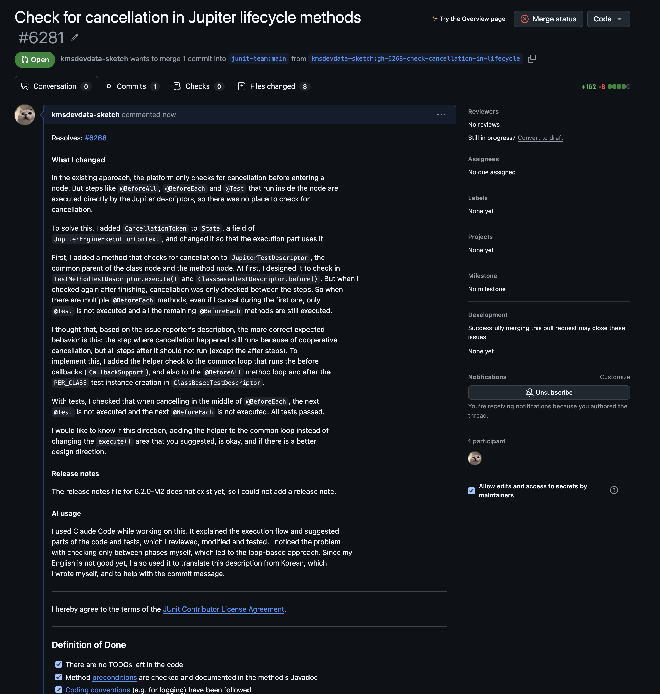

import GitHubRepoCard from "@/components/GitHubRepoCard.astro";

지난편에서는 실제 문제상황과 해결방법에 대해서 알아보았고 이번에는 실제 해결과정! 

<GitHubRepoCard
  repo="junit-team/junit-framework"
  title="JUnit"
  description="자바 단위 테스트를 위한 대표적인 테스팅 프레임워크"
  previewImage="https://opengraph.githubassets.com/1/junit-team/junit-framework"
/>

> [!info] JUnit 오픈소스 기여 시리즈
>
> **[1편 · @BeforeEach 실행 중 테스트 취소가 무시되는 이슈 분석](/posts/oss/junit-contribution-1/)**
>
> **2편 · Jupiter 생명주기에 취소 체크를 추가하고 PR 올리기**
>
> **[3편 · 첫 리뷰 반영과 shouldContinue로 취소 체크 구조화하기](/posts/oss/junit-contribution-3/)**

<details>
<summary>테스크 목록</summary>

**0. 재현**

- [ ] `@BeforeEach` 실행 중 취소 시 테스트가 실행되는 것을 재현하는 테스트 작성 (실패 확인)

**1. CancellationToken 전달**

- [ ] `JupiterEngineExecutionContext`(내부 `State`)에 `CancellationToken` 필드 추가
- [ ] getter 추가 및 `extend()` 시 자식 context로 복사되는지 확인
- [ ] `JupiterTestEngine.createExecutionContext()`에서 `ExecutionRequest`의 토큰을 루트 context에 주입

**2. 취소 시 abort 처리**

- [ ] 취소 확인 후 `ThrowableCollector`에 `TestAbortedException`을 추가하는 헬퍼 작성

**3. 체크 지점 추가**

- [ ] `TestMethodTestDescriptor.execute()`의 `isEmpty()` 체크 지점마다 헬퍼 호출
- [ ] `ClassBasedTestDescriptor`의 `isEmpty()` 체크 지점마다 헬퍼 호출 (`@BeforeAll` 이후 등)
- [ ] 그 외 `throwableCollector.isEmpty()` 사용처 검색 후 누락 확인

</details>

---

## 0. 재현 테스트 작성

우선 `@BeforeEach`과정에서 실패하는것을 재현하는 테스트를 작성한다!  
기존에 이미 `ExecutionCancellationTests` 가 있어서 덧붙여 작성을 하였다

```java
	// 안쪽 엔진이 실행하는 테스트 클래스 (클래스 노드 1개 + 메서드 노드 1개)
	static class CancelledInBeforeEachTestCase extends TestCase {

		// 메서드 노드 안에서 @Test 직전에 실행됨 → 여기서 취소 요청
		@BeforeEach
		void beforeEach() {
			requiredCancellationToken().cancel();
		}

		// 취소됐으므로 실행되면 안 됨 실행되면 fail로 실패 처리
		@Test
		void testMethod() {
			fail("should not be called");
		}

		// 취소돼도 정리 단계는 실행돼야 함 실행 여부를 reportEntry로 남긴다
		@AfterEach
		void afterEach(TestReporter reporter) {
			reporter.publishEntry("afterEach", "called");
		}
	}
```

> **reporter?** : JUnit이 파라미터로 넣어주는 객체로 `publishEntry()` 를 호출하면 해당 테스트에서 이런 기록이 나왔다는 이벤트를 발생 -> 바깥 테스트는 안쪽 메서드가 실행됬는지 확인이 불가하여 이런식으로 기록을 남겨 기록이 있다 = "`@AfterEach`가 실행됬구나!" 판단

```java
	// 재현 테스트: @BeforeEach 실행 중 취소되면
	// @Test 본문은 실행되지 않고, @AfterEach는 실행되고, 결과는 aborted여야 한다
	@Test
	void abortsTestWhenCancelledDuringBeforeEachMethod() {
		// 안쪽 엔진이 실행할 테스트 클래스
		var testClass = CancelledInBeforeEachTestCase.class;

		// 테스트 안에서 Jupiter 엔진을 하나 더 실행한다 (IDE 역할을 흉내)
		var results = jupiterTestEngine() //
				.selectors(selectClass(testClass)) // 실행 대상: 이 클래스
				.cancellationToken(TestCase.requiredCancellationToken()) // 취소 토큰 전달
				.execute(); // 실행하고 이벤트 기록을 받는다

		// 테스트 노드 이벤트 개수 검증: 시작 1, aborted 1, 실패 0
		results.testEvents().assertStatistics(stats -> stats.started(1).aborted(1).failed(0));

		// 전체 이벤트가 정확히 이 순서로 일어났는지 검증
		results.allEvents().assertEventsMatchExactly( //
			event(engine(), started()), // 엔진 시작
			event(container(testClass), started()), // 클래스 노드 시작
			event(test("testMethod"), started()), // 메서드 노드 시작
			event(test("testMethod"), reportEntry(Map.of("afterEach", "called"))), // @AfterEach 실행됨
			event(test("testMethod"), abortedWithReason(instanceOf(TestAbortedException.class))), // aborted로 종료
			event(container(testClass), finishedSuccessfully()), // 클래스 노드 정상 종료
			event(engine(), finishedSuccessfully())); // 엔진 정상 종료
	}
```

기존 가설대로 해당 테스트는 실패하였다 = `@Test` 가 실행되었다(실행되면 안됌)

---

## 1. CancellationToken 전달

### JupiterEngineExecutionContext에 CancellationToken 싣기

```java
@API(status = INTERNAL, since = "5.0")
public class JupiterEngineExecutionContext implements EngineExecutionContext {

	private final State state; // <- 수정
    
    // ... 

	public JupiterEngineExecutionContext(EngineExecutionListener executionListener, JupiterConfiguration configuration,
			LauncherStoreFacade launcherStoreFacade,CancellationToken cancellationToken) { // 파라미터 추가
		this(new State(executionListener, configuration, launcherStoreFacade,cancellationToken));
	}

    // ... 

	public CancellationToken getCancellationToken() { // 게터 추가
		return this.state.cancellationToken;
	}

    // ... 

	private static final class State implements Cloneable {

		final EngineExecutionListener executionListener;
		final JupiterConfiguration configuration;
		final LauncherStoreFacade launcherStoreFacade;
		final CancellationToken cancellationToken; // 추가 

}
```

`JupiterEngineExecutionContext` 는 실행에 필요한 값들은 내부 클래스 State에 담아둔다.  
-> 자식 노드로 내려갈때는 `extend()`를 복사하여 필요한 값만 바꿔 새 context를 만든다 

### 자식 context로 토큰이 전달되는지 테스트

```java

class JupiterEngineExecutionContextTests {
    // ... 
    @Test
	void cancellationTokenIsHandedOnWhenContextIsExtended() {
		assertSame(cancellationToken, originalContext.getCancellationToken());
		JupiterEngineExecutionContext newContext = originalContext.extend()
				.withExtensionContext(mock())
				.build();
		assertSame(cancellationToken, newContext.getCancellationToken());
	}
    // ... 
}
```

위처럼 테스트를 만들어 자식 context가 새로 만들어질 때도 CancellationToken이 그대로 전달되는지 확인한다

---

## 2. 취소 시 abort 처리하는 헬퍼 추가

```java
public abstract class JupiterTestDescriptor extends AbstractTestDescriptor
		implements Node<JupiterEngineExecutionContext> {
    // ... 

    /**
	 * Abort the current execution if cancellation has been requested and no
	 * exception has been colledted so far.
	 *
	 * @since 6.2
	 */
	static void abortIfCancellationRequested(JupiterEngineExecutionContext context) {
		ThrowableCollector throwableCollector = context.getThrowableCollector();
		if (throwableCollector.isEmpty() && context.getCancellationToken().isCancellationRequested()) {
			throwableCollector.execute(() -> {
				throw new TestAbortedException("Execution cancelled");
			});
		}
	}

    // ... 
}
```

이전 포스트에서도 설명하였지만 리마인드겸 다시 구조를 설명하면  
현재 방식은 플랫폼(NodeTestTask)는 노드에 들어가기 전에만 취소 여부를 확인한다 노드 안에서 실행되는 `@BeforeAll` , `@BeforeEach` , `@Test`같은 단계는 Jupiter 의 Descriptor가 직접 실행하기 때문에 그사이에는 취소를 확인하는 곳이 없다!  
그래서 클래스 노드와 메서드 노드의 공통 부모인 `JupiterTestDescriptor`애 취소를 확인하는 메서드를 추가하였고 해당 메서드는 아직 수집된 예외가 없고 && 취소된 상태라면 `ThrowableCollector`(예외 수집기)에 TestAbortedException를 넣는다 

> throwableCollector.isEmpty()를 먼저 확인하는 이유: 이미 다른예외가 있다면 그게 더 중요한 원인이다 그렇기에 비어있는 경우만 확인 

---

## 3. 체크 지점 추가

### TestMethodTestDescriptor.execute()에 체크 추가

```java
@API(status = INTERNAL, since = "5.0")
public class TestMethodTestDescriptor extends MethodBasedTestDescriptor {
    // ... 
    @Override
	public JupiterEngineExecutionContext execute(JupiterEngineExecutionContext context,
			DynamicTestExecutor dynamicTestExecutor) {
		ThrowableCollector throwableCollector = context.getThrowableCollector();

		// @formatter:off
		invokeBeforeEachCallbacks(context);
		abortIfCancellationRequested(context);
			if (throwableCollector.isEmpty()) {
				invokeBeforeEachMethods(context);
				abortIfCancellationRequested(context);
				if (throwableCollector.isEmpty()) {
					invokeBeforeTestExecutionCallbacks(context);
					abortIfCancellationRequested(context);
					if (throwableCollector.isEmpty()) {
						invokeTestMethod(context, dynamicTestExecutor);
					}
					invokeAfterTestExecutionCallbacks(context);
				}
				invokeAfterEachMethods(context);
			}
		invokeAfterEachCallbacks(context);
		// @formatter:on

		return context;
	}
    // ... 
}
```

동작원리 : 취소가 된 상태라면 헬퍼가 컬렉터에 TestAbortedException를 넣게되고 그러면 다음 `isEmpty()`가 false가 되기 때문에 다음단계를 건너 뛰게 된다 + after호출은 if바깥에 있으니 그대로 실행된다

> after호출은 실행되야 하는 이유 : BeforeEach는 보통 DB연결,임시파일 등등 을 열거나 만들기 때문에 정리를 해줘야함 + 메인테이너도 cleanUp은 실행되어야 한다고 피드백

### ClassBasedTestDescriptor.before()에 체크 추가

#### @BeforeAll 콜백 중 취소 테스트

```java
class ExecutionCancellationTests extends AbstractJupiterTestEngineTests {
    // ... 
    @Test
	void abortsClassWhenCancelledDuringBeforeAllCallback() {
		var testClass = CancelledInBeforeAllCallbackTestCase.class;

		var results = jupiterTestEngine() //
				.selectors(selectClass(testClass)) //
				.cancellationToken(TestCase.requiredCancellationToken()) //
				.execute();

		results.testEvents().assertStatistics(stats -> stats.started(0));

		results.allEvents().assertEventsMatchExactly( //
				event(engine(),started()), //
				event(container(testClass), started()), //
				event(container(testClass),
						abortedWithReason(instanceOf(TestAbortedException.class))), //
				event(engine(),finishedSuccessfully())
		);
	}
    // ... 
    @ExtendWith(CancellingBeforeAllCallback.class)
	static class CancelledInBeforeAllCallbackTestCase extends TestCase {

		@BeforeAll
		static void beforeAll() {
			fail("should not be called");
		}

		@Test
		void testMethod() {
			fail("should not be called");
		}
	}

	static class CancellingBeforeAllCallback implements BeforeAllCallback {

		@Override
		public void beforeAll(ExtensionContext context) throws Exception {
			TestCase.requiredCancellationToken().cancel();
		}
	}
}
```

BeforeAllCallback은 `@BeforeAll`단계에서 끼어들수 있는 훅이다 해당 인터페이스를 구현한 확장을 등록하면 Jupiter가 클래스 노드의 `before()`에서 `@BeforeAll` 메서드보다 먼저 해당 확장의 `beforeAll()` 을 먼저 호출한다.

#### 체크 추가

```java
@API(status = INTERNAL, since = "5.5")
public abstract class ClassBasedTestDescriptor extends JupiterTestDescriptor
		implements ResourceLockAware, TestClassAware, Validatable {
    // ... 
	@Override
	public final JupiterEngineExecutionContext before(JupiterEngineExecutionContext context) {
		    // ... 

		abortIfCancellationRequested(context); // <- 여기 추가 : 클래스 준비중 취소됐으면 콜백부터 실행 안함
		if (throwableCollector.isEmpty()) {
			context.beforeAllCallbacksExecuted(true);
			invokeBeforeAllCallbacks(context); // 확장 콜백 실행

			abortIfCancellationRequested(context); // <- 여기 추가 : 콜백 실행 중 취소 => 사용자 @BeforeAll 실행 안함
			if (throwableCollector.isEmpty()) {
				context.beforeAllMethodsExecuted(true);
				invokeBeforeAllMethods(context);
			}
		}

		throwableCollector.assertEmpty();

		return context;
	}
    // ... 
}
```

---

## 놓친 부분: 단계 사이에서만 확인하는 문제

모두 끝났나?! 싶었는데 조금 더 살펴보니 현재 방식의 문제점이 보였다  
취소 여부를 단계 사이에서만 확인하여 `@BeforeEach` 메서드가 여러 개일 때 첫번째 메서드 실행 중에 취소해도 `@Test`만 실행되지 않을 뿐 남은 `@BeforeEach` 메서드는 모두 실행되는 기대와 다른 동작이 이루어졌다

현재 찾아본 코드베이스는 `isEmpty()`로 단계별 검사만 찾아봐 놓친거였고 콜백을 실행하는 루프를 찾아봐야했다 

### 다시 수정 !! 공통 루프에 체크 추가

```java
class CallbackSupport {
    static <T extends Extension> void invokeBeforeCallbacks(Class<T> type, JupiterEngineExecutionContext context,
			CallbackInvoker<T> callbackInvoker) {

		ExtensionRegistry registry = context.getExtensionRegistry();
		ExtensionContext extensionContext = context.getExtensionContext();
		ThrowableCollector throwableCollector = context.getThrowableCollector();

		for (T callback : registry.getExtensions(type)) {
			throwableCollector.execute(() -> callbackInvoker.invoke(callback, extensionContext));
            abortIfCancellationRequested(context); // <- 추가 
			if (throwableCollector.isNotEmpty()) {
				break;
			}
		}
	}
    // ... 
}
```

모든 before계열 콜백을 실행하는 공통루프에 추가해준다

```java
@API(status = INTERNAL, since = "5.5")
public abstract class ClassBasedTestDescriptor extends JupiterTestDescriptor
		implements ResourceLockAware, TestClassAware, Validatable {
    // ... 
	private void invokeBeforeAllMethods(JupiterEngineExecutionContext context) {
		ExtensionRegistry registry = context.getExtensionRegistry();
		ExtensionContext extensionContext = context.getExtensionContext();
		ThrowableCollector throwableCollector = context.getThrowableCollector();
		Object testInstance = extensionContext.getTestInstance().orElse(null);

		for (Method method : requireLifecycleMethods().beforeAll) {
			throwableCollector.execute(() -> {
				try {
					executableInvoker.invokeVoid(method, testInstance, extensionContext, registry,
						InvocationInterceptor::interceptBeforeAllMethod);
				}
				catch (Throwable throwable) {
					invokeBeforeAllMethodExecutionExceptionHandlers(registry, extensionContext, throwable);
				}
			});
			abortIfCancellationRequested(context); // <- 여기 추가해준다
			if (throwableCollector.isNotEmpty()) {
				break;
			}
		}
	}
    // ... 
}
```

@BeforeAll 메서드를 하나씩 실행하는 루프에 추가해준다 

### 기존 단계별 체크 정리

이전보다 나은구조인 단계별 체크가 아닌 공통루프에 헬퍼를 추가해주었으니 기존 단계별 체크는 지워준다

#### ClassBasedTestDescriptor

```java
@API(status = INTERNAL, since = "5.5")
public abstract class ClassBasedTestDescriptor extends JupiterTestDescriptor
		implements ResourceLockAware, TestClassAware, Validatable {
    // ... 
	@Override
	public final JupiterEngineExecutionContext before(JupiterEngineExecutionContext context) {
		if (isPerClassLifecycle(context)) {
			// Eagerly load test instance for BeforeAllCallbacks, if necessary,
			// and store the instance in the ExtensionContext.
			ClassExtensionContext extensionContext = (ClassExtensionContext) context.getExtensionContext();
			throwableCollector.execute(() -> {
				TestInstances testInstances = context.getTestInstancesProvider().getTestInstances(context);
				extensionContext.setTestInstances(testInstances);
			});
		}

		abortIfCancellationRequested(context); // <- 여기는 남겨두기 
		if (throwableCollector.isEmpty()) {
			context.beforeAllCallbacksExecuted(true);
			invokeBeforeAllCallbacks(context); // 확장 콜백 실행

			abortIfCancellationRequested(context); // <- 여기는 삭제해줌
			if (throwableCollector.isEmpty()) {
				context.beforeAllMethodsExecuted(true);
				invokeBeforeAllMethods(context);
			}
		}

		throwableCollector.assertEmpty();

		return context;
	}
    // ... 
}
```

> 첫번째는 인스턴스 생성과정이기 에 루프가 아니라서 뒤에 체크가 일어나지 않으니 저부분만 넣어준다 

### 남은 콜백이 실행되지 않는지 테스트 추가

```java
class ExecutionCancellationTests extends AbstractJupiterTestEngineTests {
    // ... 
    @Test
	void doesNotInvokeRemainingBeforeEachCallbacksWhenCancelled() {
		var testClass = CancelledInFirstOfTwoBeforeEachCallbacksTestCase.class;

		var results = jupiterTestEngine() //
				.selectors(selectClass(testClass)) //
				.cancellationToken(TestCase.requiredCancellationToken()) //
				.execute();

		results.testEvents().assertStatistics(stats ->
				stats.started(1).aborted(1).failed(0));
	}
    // ... 
    @ExtendWith({ CancellingBeforeEachCallback.class, FailingBeforeEachCallback.class })
	static class CancelledInFirstOfTwoBeforeEachCallbacksTestCase extends TestCase {

		@Test
		void testMethod() {
			fail("should not be called");
		}
	}

	static class CancellingBeforeEachCallback implements BeforeEachCallback {

		@Override
		public void beforeEach(ExtensionContext context) throws Exception {
			TestCase.requiredCancellationToken().cancel();
		}
	}

	static class FailingBeforeEachCallback implements BeforeEachCallback {

		@Override
		public void beforeEach(ExtensionContext context) throws Exception {
			fail("should not be called");
		}
	}
}
```

기존테스트만 있어도 통과자체는 되지만 기존테스트는 단계별 검증이 목표였기에 루프형으로 다음 BeforeEach가 실행이 되지 않는지는 검증이 안되어 `CancellingBeforeEachCallback`에서 취소 `FailingBeforeEachCallback` 에서는 실행이 안되는지 검증하여 통과하였다

> `CallbackSupport` 에서 체크로직을 빼면 실패 넣으면 통과 

---

## 다른 설계 방향은 없었을까

전체적인 수정사항은 모두 끝났다!  
조금 정리해볼 사항은 다른 방식은 없었나 인거같은데 우선 메인테이너의 권장안대로 수정을 한것이기도 하지만 조금더 나은방식이 없는지 고민을 해보면  

1. 토큰을 전역으로 두기 : 같은 JVM에서 실행이 여러개 돌수가 있는데 다른테스트에 영향이 가기때문에 불가 (애초에 플랫폼 설계 자체가 토큰은 실행 요청 마다 하나임)
2. ThrowableCollector가 직접 토큰 확인 : 그럴듯해 보이기는 하는데 현재 수집기의 책임인 "예외수집" 에서 "취소 판단"이 추가되니 이것도 불가
3. 조건문을 if(isEmpty() && !cancelled)로 바꾸기 : 예외를 던지지 않으니 이거는 성공으로 보고가 되버림 이것도 불가
4. 플랫폼의 Node 인터페이스에 토큰을 넘기기 : 시그니처를 바꾸면 모든 외부 엔진 API를 수정해야하니 너무 과하다 이것도 불가 

일단 내 머릿속에서 더나은 설계방향은 보이지 않는다 ! 수정도 제대로 된거같고 막판에 기대동작 오류도 발견을 하였으니 남은건 테스트,빌드테스트,포맷팅만 해주고 PR올리기!(왠지 모르게 떨려서 전체 테스트랑 포맷팅 점검을 10번도 넘게돌렸다 ㅋㅋ)

---

## PR 올리기



이제 리뷰를 기다리고 몇차례 수정만이 남았다!

- PR: [junit-framework#6281](https://github.com/junit-team/junit-framework/pull/6281): Check for cancellation in Jupiter lifecycle methods
- 이슈: [junit-framework#6268](https://github.com/junit-team/junit-framework/issues/6268): Consider test cancellation not only during `prepare`
