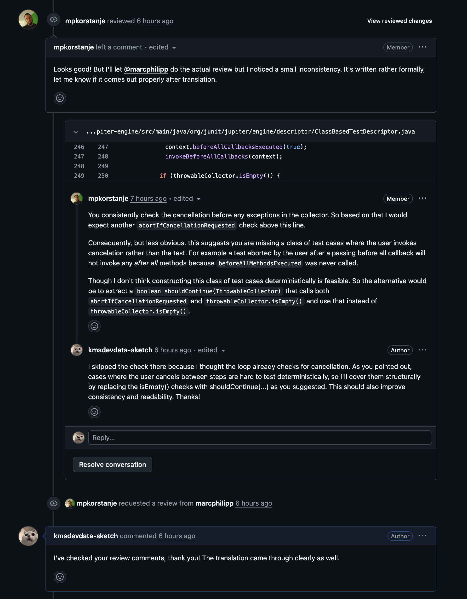
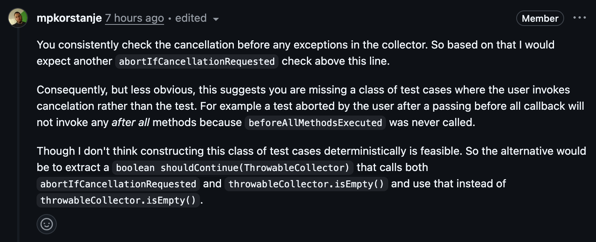
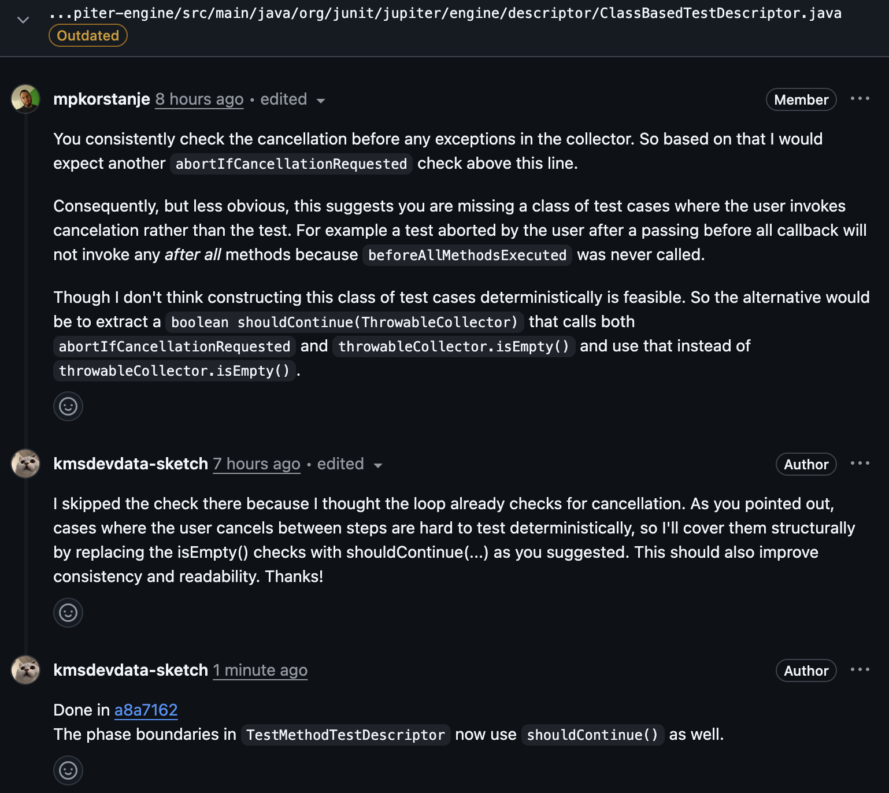
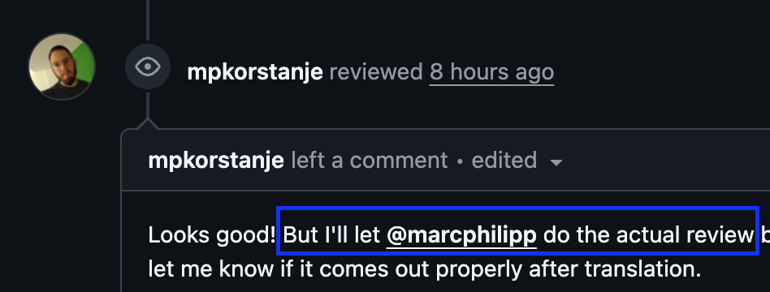

import GitHubRepoCard from "@/components/GitHubRepoCard.astro";

지난편은 PR을 올리기까지 였고 이번편에는 PR을 올린뒤 라운드를 거쳐 수정하는 과정을 담는다

<GitHubRepoCard
  repo="junit-team/junit-framework"
  title="JUnit"
  description="자바 단위 테스트를 위한 대표적인 테스팅 프레임워크"
  previewImage="https://opengraph.githubassets.com/1/junit-team/junit-framework"
/>

> [!info] JUnit 오픈소스 기여 시리즈
>
> **[1편 · @BeforeEach 실행 중 테스트 취소가 무시되는 이슈 분석](/posts/oss/junit-contribution-1/)**
>
> **[2편 · Jupiter 생명주기에 취소 체크를 추가하고 PR 올리기](/posts/oss/junit-contribution-2/)**
>
> **3편 · 첫 리뷰 반영과 shouldContinue로 취소 체크 구조화하기**

---

## 한 시간 만에 달린 첫 리뷰

지난번에 PR을 올리고 약 한시간만에 리뷰가 달렸다 !



전반적으로 괜찮아 보이고 약간의 코드 일관성 부족과 빠트린 예외상황에 대한 리뷰가 들어왔다

---

## 리뷰 지적사항

### 1번 지적: @BeforeAll 메서드 실행 전 취소 체크 누락

```java
public abstract class ClassBasedTestDescriptor extends JupiterTestDescriptor
		implements ResourceLockAware, TestClassAware, Validatable {
    // ...
	@Override
	public final JupiterEngineExecutionContext before(JupiterEngineExecutionContext context) {
		ThrowableCollector throwableCollector = context.getThrowableCollector();

		if (isPerClassLifecycle(context)) {
			// Eagerly load test instance for BeforeAllCallbacks, if necessary,
			// and store the instance in the ExtensionContext.
			ClassExtensionContext extensionContext = (ClassExtensionContext) context.getExtensionContext();
			throwableCollector.execute(() -> {
				TestInstances testInstances = context.getTestInstancesProvider().getTestInstances(context);
				extensionContext.setTestInstances(testInstances);
			});
		}

		abortIfCancellationRequested(context); // 추가한곳
		if (throwableCollector.isEmpty()) {
			context.beforeAllCallbacksExecuted(true);
			invokeBeforeAllCallbacks(context);
            
            // ----------------이 부분---------------------
            // 이쪽에도 abortIfCancellationRequested() 체크가 들어와야 하는것 아닌가?

			if (throwableCollector.isEmpty()) {
				context.beforeAllMethodsExecuted(true);
				invokeBeforeAllMethods(context);
			}
		}

		throwableCollector.assertEmpty();

		return context;
	}
    // ...
}
```

기존에 단계별 체크로 구현하였을떄는(이전 2편 참고) 해당 부분에서 체크를 해주었는데 루프에서 체크하는것으로 변경후에 삭제하였다 그 이유는 당시 나의 판단으로는 `BeforeAll`콜백루프가 끝난뒤 어차피 취소하였는지 체크가 되기때문에 해당 부분에서 체크를 하는것이 코드 중복이라고 판단을 하였다.

지적사항을 조금더 쪼개서 보자면

1. 해당부분에 추가를 하면 `@BeforeAll` 콜백 끝나고 체크 -> `@BeforeAll` 메서드 실행하기 직전 체크 -> 메서드 실행마다 마지막부분에서 체크  
   추가하지 않으면 `@BeforeAll` 콜백 끝나고 체크 -> 메서드 실행마다 마지막부분에서 체크  
   사실상 차이는 없다고 봐도 무방할정도 라고 생각이된다
2. 해당 부분에 체크를 안넣어도 안전한건 다른 파일(루프에서 체크하는 부분)에 의존하고 있기 때문에 **암묵적 의존** 이 생기게 된다 그래서 읽는 사람은 누락처럼 보이기도 하며, 루프의 구조가 바뀌면 깨질수도 있다

2번의 암묵적 의존을 지적사항으로 생각을 하시지 않았을까?와 더불어 1번은 다음 지적사항과 연계된다

### 2번 지적: 사용자가 단계 사이에 취소하는 경우

지금 테스트 코드가 모두 테스트코드 내부에서 `cancel()`을 의도적으로 불러 확인을 하는데 이 떄문에 테스트코드안에서 취소시점은 모두 어떠한 콜백 혹은 메서드가 실행중 취소가 된다 = 루프에서 체크하는 취소체크에 무조건 걸린다

하지만 실제로는 사용자가 바깥에서 아무때나 취소를 할수 있는걸 염두에 두어야 한다 그에 대한 예시 시나리오까지 상세히 첨부해주셨다 !



```text
BeforeAll 콜백 전부 통과 (루프 마지막 체크: 취소 아님)
        ↓
   사용자가 이 틈에 취소
        ↓
  BeforeAll메서드 실행부 
```

하지만 이부분은 위에 메인테이너분도 말씀하셨지만 **"Though I don't think constructing this class of test cases deterministically is feasible."** 타이밍 문제가 있기 때문에 해당 테스트를 완벽히 재현하는건 불가능하며 이를 막기 위해 구조적으로 막자고 하셨다

이를 구조적으로 해결하는 방법조차도 친절하게 설명해주셨는데 바로 취소체크를 진입 조건 앞에 두어 빠트리는곳이 애초에 안생기도록 `shouldContinue`메서드를 만들어서 진입조건과 체크를 아예 묶어서 체크없는 진입조건이 존재할수 없도록 만들자는것이였다

> 갑자기 좀 딴소리긴 한데 어떻게 PR올린지 한시간도 안되서 바로 문제상황을 캐치하고 이렇게 디테일하고 좋은 해결책까지 얘기해주시는지 정말 놀라울따름..😯

---

## 해결 과정: 진입 조건과 취소 체크를 shouldContinue로 묶기

### abortIfCancellationRequested를 shouldContinue로 합치기

우선 기존에 `abortIfCancellationRequested()`는 아예 삭제하고 `shouldContinue` 안에 해당 동작과정을 넣었다  
이유는 어차피 합치고 나면 abortIfCancellationRequested 호출부가 shouldContinue 밖에 없을테고 굳이 설명을 두군데서 할필요는 없다고 판단

```java
	/**
	 * Determine whether execution should continue with the next step.
	 *
	 * <p>If cancellation has been requested and no exception has been
	 * collected so far, a {@link TestAbortedException} is added to the
	 * {@link ThrowableCollector} of the supplied context.
	 *
	 * @return {@code true} if no exception has been collected
	 * @since 6.2
	 */
	static boolean shouldContinue(JupiterEngineExecutionContext context) {
		ThrowableCollector throwableCollector = context.getThrowableCollector();
		if (throwableCollector.isEmpty() && context.getCancellationToken().isCancellationRequested()) {
			throwableCollector.execute(() -> {
				throw new TestAbortedException("Execution cancelled");
			});
		}
		return throwableCollector.isEmpty();
	}
```

### 기존 체크 지점을 shouldContinue로 교체

위에처럼 메서드를 생성하여 기존에 체크를 하였던곳을 모두 아래와 같이 변경해줬다

```java
    // CallbackSupport
	throwableCollector.execute(() -> callbackInvoker.invoke(callback, extensionContext));
	if (!shouldContinue(context)) { // 이부분 원래는 앞에서 abortIfCancellationRequested 체크하고 isNotEmpty체크하엿음
		break;	
    }

    // ClassBasedTestDescriptor
	if (shouldContinue(context)) {
		context.beforeAllCallbacksExecuted(true);
		invokeBeforeAllCallbacks(context);

	if (shouldContinue(context)) {
		context.beforeAllMethodsExecuted(true);
		invokeBeforeAllMethods(context);
	}
}
        //...
	});
	if (!shouldContinue(context)) {
		break;
	}

    // TestMethodTestDescriptor
	invokeBeforeEachCallbacks(context);
		if (shouldContinue(context)) {
			invokeBeforeEachMethods(context);
			if (shouldContinue(context)) {
				invokeBeforeTestExecutionCallbacks(context);
				if (shouldContinue(context)) {
					invokeTestMethod(context, dynamicTestExecutor);
				}
				invokeAfterTestExecutionCallbacks(context);
			}
			invokeAfterEachMethods(context);
		}
	invokeAfterEachCallbacks(context);
```

---

## 수정 보고



수정을 완료하고 다시 결과 공유를 하였다  
조금 놀라운점은 아직 리뷰를 시작도 안한것이라는것...



가벼운 리뷰에서도 이렇게 날카로운 리뷰가 날라오는데 과연 본격적인 리뷰에서는 어떤사항이 나올까?!  
예상하기로는 네이밍 컨벤션이나 약간의 테스트보강(확인해보니 JUnit은 테스트항목을 여러개를 쌓아두기보다 테스트가 적더라도 그 한개의 테스트가 하나의 동작을 끝까지 검증하는 방식을 선호하는것 같다) 혹은 릴리즈 노트이지 않을까?!

---

## 이번 리뷰에서 느낀 점

다음 리뷰에서는 또 무엇을 배울지 기대된다 이번 리뷰에서 느낀 몇가지 사항은

1. 우선 리뷰가 너무 빨랐다! 물론 PR이긴 했지만 Jetty에서는 이슈에 달아둔 중간과정 보고가 3일째 무응답이여서 약간 슬펐는데 빠른 피드백에 뿌듯한 마음이 들었다
2. 읽는이의 관점에서(백퍼센트 의도한건진 모르겠지만) 보강사항이 있었다는것이 놀라웠다 코드가 일관적이지 않고 어떠한 플로우에 맞춰서 작성이 되니 읽는이는 해당 부분을 누락으로 생각할수도 있다는점
3. 사실 암묵적의존을 하면 안된다는걸 알고는 있었지만 코드를 작성하며 의식하지는 못하였는데 앞으로는 좀더 의식할수 있을듯 하다
4. 단순히 테스트수를 늘리지 않는다 : 이번 피드백의 특수성일수도 있지만 혹시모르니 테스트를 좀더 보강하자 가 아닌 애초에 완벽한 보장이 안되니 구조적으로 보강한다는점이 배울점으로 느껴졌다

이제 메인테이너의 본격리뷰는 다음편에서!

- PR: [junit-framework#6281](https://github.com/junit-team/junit-framework/pull/6281): Check for cancellation in Jupiter lifecycle methods
- 이슈: [junit-framework#6268](https://github.com/junit-team/junit-framework/issues/6268): Consider test cancellation not only during `prepare`
