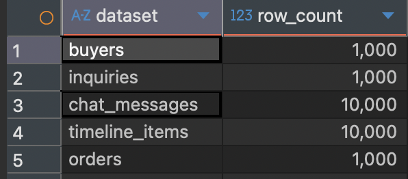

이번에 포트폴리오 강화 + 쿼리 분석 및 최적화 프로세스를 경험하기 위해 기존 프로젝트를 개선하기로 계획했다.  
프로젝트는 이전에 진행했던 위하다 프로젝트(주문제작 케이크 매장의 상담·주문·결제를 한 흐름으로 관리하는 서비스)를 대상으로 선정했다.
[위하다 프로젝트](https://github.com/kmsdevdata-sketch/wihada-api)

> 해당 포스트에서 테스트 및 개선은 배포환경이 아닌 로컬 어플리케이션 기준으로 실시되었습니다!

## 분석 대상 선정하기 
우선 테스트&개선 대상 API를 선정하여야 하는데 이때 대상은 아래 기준으로 탐색하였다.
- DB 조회가 발생하는 주요 API목록을 파악
- -> 조회 빈도,쿼리 복잡도,데이터 증가 가능성을 기준으로 후보 분류 
- -> 그중에 대상 API 2~3개 선정 
위하다 프로젝트는 동일 어플리케이션에서 구매자,판매자,관리자 API를 모두 처리하는데 이때 비교적 관리 데이터가 더 많을것으로 판단되는 판매자 API를 대상으로 초기분류하였다.

API목록 파악및 분류는 Codex를 사용하였고 아래와 같이 API목록이 추려졌다.

|영역|API|
|---|---|
|대시보드 집계|`GET /seller/dashboard`, `GET /seller/dashboard/revenue`, `GET /seller/dashboard/revenue/transactions`|
|주문 목록·캘린더|`GET /seller/orders`, `GET /seller/orders/calendar/today`, `GET /seller/orders/calendar/week`, `GET /seller/orders/calendar/month`|
|문의·채팅 목록|`GET /seller/inquiries`, `GET /seller/inquiries/{inquiryId}/events`|
|문의별 이력|`GET /seller/inquiries/{inquiryId}/order-form-submissions`, `GET /seller/inquiries/{inquiryId}/confirmations`|
|스토어 종합 상태|`GET /seller/store/management-status`|
|여러 설정·공지 관리|`GET /seller/store/settings`, `PUT /seller/store/settings`, `GET /seller/notices`, `PUT /seller/notices`|
|이미지·갤러리 목록|`GET /seller/gallery-items`, `GET /seller/representative-images`|

이때 단일항목 API는 제외하였는데 목록·집계 API 같이 조회건수가 증가함에 따라 쿼리비용이 높아질수 있는 항목만 우선적으로 추렸다.

이중에서 조회빈도 같은 경우에는 실 사용자 데이터가 없어서 추측성으로 밖에 선정할수 없어 선정기준에서 제외하였고 데이터가 늘어나면서 비용이 커지는 코드  + 반복 조회 발생을 기준으로 판단을 하여 개선 항목을 선정하였다.

1. `GET /seller/inquiries` :  스토어의 모든 문의를 모두 가져오고,각 문의의 읽지 않은 항목수도 개별 조회
2. `GET /seller/dashboard` : 여러 집계와 문의별 읽지 않은 항목 수를 조회
3. `GET /seller/orders` : 누적 주문 목록 모두 조회

## 로컬 테스트 환경 구성 
### 테스트 환경
로컬 테스트 환경구성은 Spring Boot 어플리케이션은 로컬에서 `local-scenario` 프로필을 실행하고 `localhost:5432`의 PostgreSQL에 연결하도록 구성하였다.
기존에는 어플리케이션 인증을 Cognito를 사용하였지만 로컬테스트 토큰 사용하도록 하였으며,자산 저장은 S3대신 로컬 파일시스템을 사용한다.

### 테스트 데이터 준비 

| 단계     | 한 스토어의 문의 | 문의당 이벤트 | 한 스토어의 주문 |
| ------ | --------- | ------- | --------- |
| 데이터 규모 | 1,000건    | 10건     | 1,000건    |



구매자 : 1000명  
채팅방 : 1000개   
채팅 메시지: 1만개  
채팅 타임라인 이벤트(ex.주문서 발행,결제 요청 등등) : 1만개  
주문 : 1000개 

## Baseline 측정 
### 테스트 도구 
테스트 도구로는 k6를 사용하였다. k6를 사용한 가장 큰이유는 이미 사용해본 경험이 있었으며 설치 - 코드작성 - 실행 까지의 프로세스가 다른 도구들에 비해 간편하여 애용하게 되었다.

### 테스트 시나리오 
#### 목적
이번 테스트의 목적은 "최대 몇 명이 접속 가능한지","부하를 어느정도까지 견딜수 있는지"보다 현재 데이터에서 각 API가 얼마나 걸리고,요청량이 늘어날때 어떻게 변하는지 기준값을 얻는 것이 목표이다.(쿼리 개선하여 다시 측정 후 비교)
#### 요청량 
| 순서  | 요청량    | 시간     | 목적           |
| --- | ------ | ------ | ------------ |
| 예열  | 낮은 요청량 | 30~60초 | 초기 실행 영향 줄이기 |
| 1단계 | 1회/초   | 2분     | 기준 응답 시간     |
| 2단계 | 3회/초   | 2분     | 요청 증가 시 변화   |
| 3단계 | 5회/초   | 2분     | 추가 증가 시 변화   |
> 예열을 하는 이유 : 처음 몇 요청에는 JVM실행 상태, DB 연결 준비,디스크 캐시 등의 영향이 섞일 수 있어 이를 구분하여 측정 가능하도록 합니다.
#### 기대 산출물 및 확인할 지표 
| 지표                               | 이번 테스트에서 확인할 것               |
| -------------------------------- | ---------------------------- |
| **요청 1건당 SQL 실행 횟수**             | 문의·대시보드에서 문의 수만큼 조회가 반복되는가   |
| **SQL별 실행 시간과 총 DB 처리 시간**       | 시간이 많이 드는 쿼리가 무엇인가           |
| **API 응답 시간 p50·p95**            | DB 작업이 실제 응답 시간에 얼마나 영향을 주는가 |
| **반환 건수·응답 크기**                  | 같은 양의 데이터를 반환한 결과끼리 비교하고 있는가 |
| **오류율**                          | 느려지는 과정에서 요청이 실패하는가          |
| **실제 요청 수·`dropped_iterations`** | 계획한 부하가 실제로 들어갔는가            |
### 테스트 코드 
```javascript
import http from 'k6/http';  
import { check } from 'k6';  
  
// 테스트 API목록  
const paths = {  
    inquiries: '/seller/inquiries',  
    dashboard: '/seller/dashboard',  
    orders: '/seller/orders',  
};  
  
// 실행시 주입값  
const target = __ENV.TARGET;  
const rate = Number(__ENV.RATE);  
const minItems = Number(__ENV.MIN_ITEMS || 1000);  
const baseUrl = __ENV.BASE_URL || 'http://localhost:8080';  
const token = __ENV.SELLER_TOKEN || 'local-seller-token';  
  
export const options = {  
    scenarios: {  
        seller_query: {  
            executor: 'constant-arrival-rate',  
            rate,  
            timeUnit: '1s',  
            duration: __ENV.DURATION || '2m',  
            preAllocatedVUs: 20,  
            maxVUs: 100,  
        },  
    },  
    thresholds: {  
        checks: ['rate==1'],  
    },  
};  
  
export default function () {  
    const response = http.get(`${baseUrl}${paths[target]}`, {  
        headers: {  
            Authorization: `Bearer ${token}`,  
        },  
    });  
  
    let body = null;  
    if (response.status === 200) {  
        try {  
            body = response.json();  
        } catch (_) {  
            // JSON이 아니면 아래 응답 검증에서 실패  
        }  
    }  
  
    const validData =  
        body !== null &&  
        body.success === true &&  
        (target === 'dashboard'  
            ? body.data !== null &&  
            typeof body.data === 'object' &&  
            !Array.isArray(body.data)  
            : Array.isArray(body.data) && body.data.length >= minItems);  
  
    check(response, {  
        'HTTP 200': (r) => r.status === 200,  
        'expected response data': () => validData,  
    });  
}
```

### 테스트 결과
#### 채팅방 조회 종합정리 
| 주요 항목     | 초당 1회    | 초당 3회    | 초당 5회    |
| --------- | -------- | -------- | -------- |
| 실제 요청     | 120회     | 361회     | 601회     |
| 평균 응답 시간  | 302.90ms | 255.51ms | 267.35ms |
| p50 응답 시간 | 299.22ms | 241.77ms | 244.66ms |
| p95 응답 시간 | 336.84ms | 328.44ms | 384.94ms |
| 최대 응답 시간  | 527.22ms | 491.86ms | 1.04초    |
| HTTP 실패   | 0건       | 0건       | 0건       |
| 응답 검증     | 모두 통과    | 모두 통과    | 모두 통과    |
| 수신 데이터    | 93MB     | 280MB    | 467MB    |
#### 대시보드 조회 종합정리 

|주요 항목|초당 1회|초당 3회|초당 5회|
|---|---|---|---|
|실제 요청|120회|361회|601회|
|평균 응답 시간|275.00ms|226.00ms|223.36ms|
|p50 응답 시간|269.80ms|218.27ms|212.23ms|
|p95 응답 시간|322.66ms|271.25ms|289.64ms|
|최대 응답 시간|379.30ms|572.89ms|588.90ms|
|HTTP 실패|0건|0건|0건|
|응답 검증|모두 통과|모두 통과|모두 통과|
|수신 데이터|1.4MB|4.3MB|7.1MB|
#### 주문 목록 조회 종합정리 
| 주요 항목     | 초당 1회   | 초당 3회    | 초당 5회   |
| --------- | ------- | -------- | ------- |
| 실제 요청     | 121회    | 361회     | 600회    |
| 평균 응답 시간  | 37.04ms | 31.52ms  | 31.79ms |
| p50 응답 시간 | 37.90ms | 31.31ms  | 32.38ms |
| p95 응답 시간 | 45.19ms | 41.84ms  | 41.41ms |
| 최대 응답 시간  | 51.07ms | 117.52ms | 78.19ms |
| HTTP 실패   | 0건      | 0건       | 0건      |
| 응답 검증     | 모두 통과   | 모두 통과    | 모두 통과   |
| 수신 데이터    | 71MB    | 213MB    | 353MB   |

API 테스트에서는 별도로 추가 테스트를 할 이유는 없다고 판단된다.
	