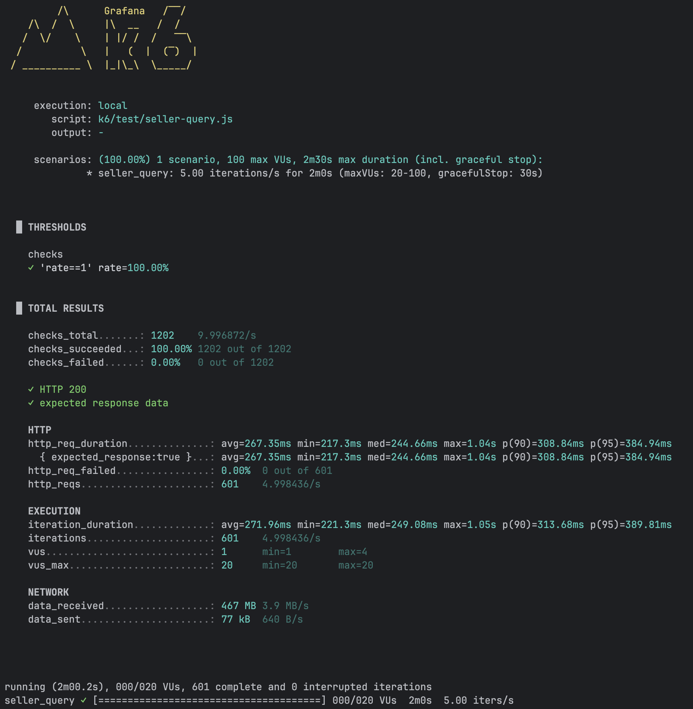
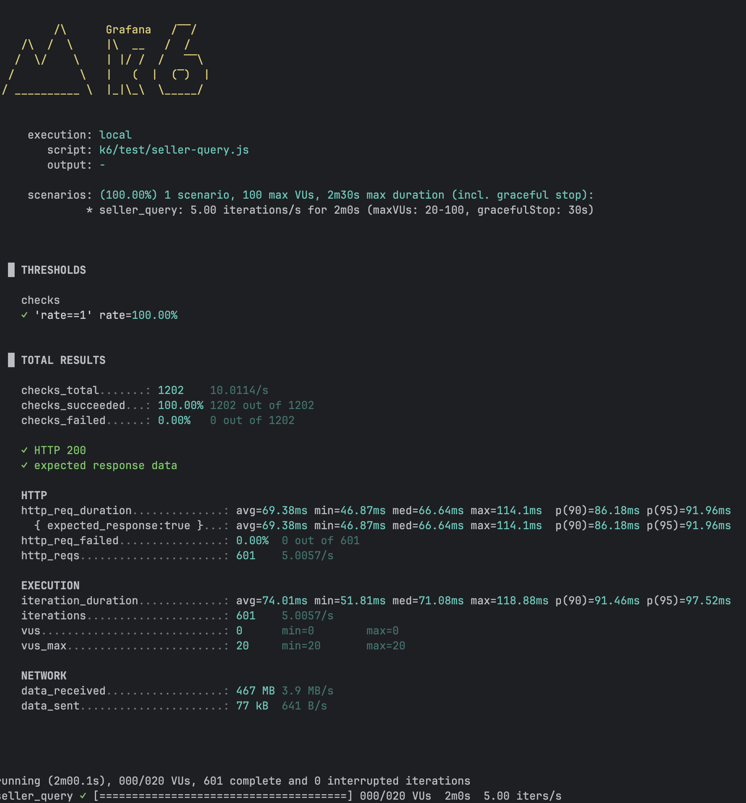
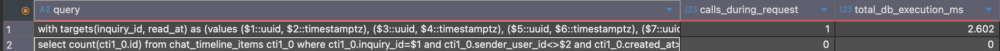

import GitHubRepoCard from "@/components/GitHubRepoCard.astro";

이전 포트폴리오 강화 + 쿼리 분석 및 최적화 프로세스를 경험하기 위한 기존 프로젝트를 개선 계획의 3편입니다.
[위하다 프로젝트](https://github.com/kmsdevdata-sketch/wihada-api)

<GitHubRepoCard
  repo="kmsdevdata-sketch/wihada-api"
  title="위하다 API"
  description="주문제작 케이크 매장의 상담·주문·결제 과정을 하나의 흐름으로 관리하는 백엔드 서비스"
  previewImage="https://opengraph.githubassets.com/36f383c6d65701da09b0d3232d6d309021d2c7699d9e48818247aeaf6904a4a2/kmsdevdata-sketch/wihada-api"
/>

> [!info] 쿼리 최적화 시리즈
>
> [1편 · 대상 API 선정과 성능 베이스라인 측정 →](/posts/query-optimization/query-optimization-1/)
>
> [2편 · SQL 및 실행 계획 분석 →](/posts/query-optimization/query-optimization-2/)
>
> **3편 · 애플리케이션 코드 분석과 성능 개선**

> 해당 포스트에서 테스트 및 개선은 배포환경이 아닌 로컬 어플리케이션 기준으로 실시되었습니다!

이전 포스트에서는 SQL 및 실행계획을 분석하였다.
분석후 결론은 SQL 혹은 실행계획 개선보다는 애플리케이션 레벨에서의 분석과 개선이 더 필요하다고 느껴 이번 포스트에서는 애플리케이션 코드 분석 -> 개선안 설계 -> 구현 -> 재검증 과정으로 진행하게 되었다.

## 애플리케이션 코드 분석 
### 컨트롤러 
이전 포스트에서 분석을 수행후 개선 대상으로 선정된 
`GET /seller/inquiries` 의 실제 구현을 컨트롤러 부터 살펴보면 아래와 같이 구현되어있다.
```java
 @GetMapping("/seller/inquiries")
  public ApiResponse<List<InquiryListItemResponse>> getSellerInquiries(
      @CurrentStoreId UUID storeId,
      @Authenticated CurrentUser currentUser,
      @RequestParam(required = false) InquiryStatus status,
      @RequestParam(defaultValue = "false") boolean unreadOnly) {
    return ApiResponse.ok(
        inquiryListUseCase
            .getSellerInquiries(storeId, currentUser.userId(), status, unreadOnly)
            .stream()
            .map(InquiryListItemResponse::from)
            .toList());
  }
```
`@CurrentStoreID`는 자체구현한 어노테이션으로 `StoreContextFilter`가 인증된 사용자를 DB에서 조회한 뒤,해당 판매자의 스토어 ID를 찾아  `StoreContext`에 넣어두며 인자 처리기가 해당 값을 꺼내 컨트롤러 파라미터에 전달한다.

`@Authenticated` 는 `currentUserRender` 컴포넌트를 통해 사용자를 다시 조회하고,현재 사용자 정보를 담은 `CurrentUser`객체를 컨트롤러 파라미터에 전달한다.
#### 문제 1 : 같은 판매자를 3회 조회 
이전 포스트에서 확인된 문제 3가지중 첫번째인 `같은 판매자 조회를 3회 실행함` 문제를 여기서 발견하였다.

위에  살펴본 `StoreContextFilter`와 `@Authenticated`에서 2번의 현재 유저 조회가 일어나고 조금더 확인해본 결과 현재 요청한 유저(seller)의 스토어가 온보딩 승인 상태를 확인하는`SellerOnboardingApprovalFilter`에서도 유저 조회가 일어나고 있었다. 결국 하나의 요청에서 같은 판매자를 3회 조회하고 있는 것이다.

개선 방법을 고려해보았는데 이번에는 이 부분의 코드 수정은 보류하기로 했다.
1. 유즈케이스 구현체에서 사용자 ID를 받아 스토어를 조회하는 방식으로 바꿀 수 있다.하지만 다른 구현체에서도 같은 처리가 필요해지면 중복 코드가 늘어날 수 있어,현재 구조를 바꾸는 근거로는 부족하다고 판단 
2. `CurentUser`를 역할에 따라 Seller·Buyer·Operator용 객체로 분리하는 방법도 생각했다.설계 측면에서는 검토해볼만 하다고 생각했지만,이것만으로 사용자 조회 3회가 모두 해결되는 것은 아닌것에 비해 변경 범위가 커서 이번 작업에서 진행하고 싶지는 않았다.
3. 현재 사용자를 확인하는 구조에서 중복조회가 발생하는 것은 사실이지만 각 단계의 역할자체는 필요하다고 판단하였음
무엇보다 이전 판매자 조회 SQL의 1회 DB실행시간이 약 **0.330ms**로 측정되어 중복 조회가 있다는 사실은 확인했지만 현재 측정 결과를 고려했을때 우선 개선해야 할 만큼의 성능문제로 보기는 어렵다고 판단했다.
따라서 이번 작업에서는 문제를 기록해두고 다음 문제를 분석하기로 했다.

### 실행 로직 
유즈케이스 실 구현체에서 확인해보면 아래와 같이 구현되어있다.
```java
@Override  
@Transactional(readOnly = true)  
public List<InquiryListItem> getSellerInquiries(  
    UUID storeId, UUID sellerUserId, InquiryStatus status, boolean unreadOnly) { 
    
    //status와 판매자에게 보이는지 여부 필터링 
	List<Inquiry> inquiries =    inquiryPersistencePort.findAllByStoreId(storeId).stream()  
      .filter(inquiry -> isSellerListTarget(inquiry, status))  
      .toList();  
      
	// 요청 파라미터에 맞는 스토어 객체를 찾는다 
	Store store = inquiries.isEmpty() ? null : findStore(storeId);  
	
	// 구매자의 ID와 해당 구매자의 User객체를 담은 Map생성  
	Map<UUID, User> buyersById = buyersById(inquiries);  
  
	// 구매자의ID 와 프로필 DeliveryUrl을 담은 Map생성
	Map<UUID, String> profileImageDeliveryUrlByUserId =  profileImageDeliveryService.resolveByUserId(buyersById.values().stream().toList());  
	// 각 채팅방의 ID와 마지막 이벤트(메시지,CTA등)를 담은 Map생성
	  Map<UUID, InquiryListItem.LatestEvent> latestEventByInquiryId =  
      latestEventByInquiryId(inquiries);  
      
	// 각 채팅방의 ID와 최근 주문서를 담은 Map생성(현재 채팅방의 컨텍스트 주문서를 파악하기 위해 필요)
	Map<UUID, InquiryListItem.LatestOrderFormSubmission> latestSubmissionByInquiryId =  
      latestSubmissionByInquiryId(inquiries);  
  
  return inquiries.stream()  
      .map(inquiry -> toSellerItem(  
          inquiry,  
          sellerUserId,  
          store,  
          buyersById,  
          profileImageDeliveryUrlByUserId,  
          latestEventByInquiryId,  
          latestSubmissionByInquiryId))  
      .filter(item -> !unreadOnly || item.unreadCount() > 0)  
      .sorted(byLatestEvent())  
      .toList();  
}
```

#### 문제 2 : 같은 스토어를 2회 조회함
이전 포스트에서 확인한 세 가지 문제 중 두 번째인 `같은 스토어를 2회 조회함`의 발생 지점을 여기서 찾았다.
`Store store = inquiries.isEmpty() ? null : findStore(storeId);` 부분이며 이는 두번째이고 
첫번째는 앞서 살펴본 `StoreContextFilter`에서 판매자의 스토어를 조회해 ID를 저장하는 과정에서 실행되며 이후 이 코드의 `findStore()`가 해당 ID로 스토어 객체를 다시 조회한다. 따라서 같은 스토어에 대한 중복 조회는 맞다.

다만 필터는 요청에서 사용할 스토어 ID를 결정하고, 문의 목록을 만드는 로직은 스토어 객체를 사용한다. 두 단계가 각각 필요한 정보를 얻는 과정에서 조회가 발생한 것이라고 판단되고 앞서 확인한 단일 스토어 조회의 DB 실행 시간도 짧았기 때문에, 이번에도 이 부분의 개선을 보류하고 다음 문제를 분석하기로 했다.

#### 문제 3 : 문의별 읽지 않은 항목 수 1,002회 반복 조회   
정확히는 1,002회보다 아래가 정확하다.
`{해당 스토어에서 조회한 문의 중,판매자 목록의 표시 조건과 요청한 status 조건을 통과한 문의 수}`
발생 위치는 아래와 같다.
```java
public List<InquiryListItem> getSellerInquiries(...) {     
    .
    .
    .
  return inquiries.stream()  
      .map(inquiry -> toSellerItem(  // <- 해당 메서드 
          inquiry,  
          sellerUserId,  
          store,  
          buyersById,  
          profileImageDeliveryUrlByUserId,  
          latestEventByInquiryId,  
          latestSubmissionByInquiryId))  
      .filter(item -> !unreadOnly || item.unreadCount() > 0)  
      .sorted(byLatestEvent())  
      .toList();  
}
// ============================================================================
private InquiryListItem toSellerItem(...) {  
  User buyer = findBuyer(inquiry, buyersById);  
  .
  .
  .
  return toItem(  // <- 해당 메서드 
      inquiry,  
      sellerUserId,  
      inquiry.getSellerLastReadAt(),  
      detail,  
      inquiry.statusForSeller(),  
      latestEvent,  
      latestSubmissionByInquiryId.get(inquiry.getId()));  
}
// ============================================================================
private InquiryListItem toItem(...) {       // ⬇️⬇️⬇️
    long unreadCount = chatTimelineItemPort.countUnread(inquiry.getId(), readerUserId, readAt);
    Instant latestEventAt = latestEvent == null ? null : latestEvent.createdAt();
    return InquiryListItem.from(
        inquiry,
        detail,
        status,
        unreadCount,
        latestEventAt,
        latestEvent,
        latestOrderFormSubmission);
  }
```
정리해보자면 문의목록을 조회하였을 때 `InquiryListItem` 으로 매핑하는 과정에서 
각 문의에 읽지않은 갯수를 개별 조회하면서 발생하였다.조회 대상 문의가 1,002건이어서 집계 SQL도 1,002회 실행된 것으로 전체 목록을 한번에 처리하는 점과 집계 SQL을 호출하는 점이 함께 작용했다.

1.  UI는 처음에 모바일 약 5건, 데스크톱 약 15~20건을 보여주고 무한 스크롤로 추가 목록을 제공한다. 하지만 현재 API는 대상 문의 전체를 조회·매핑·반환하므로, 데이터가 늘수록 한 요청의 처리량도 늘어난다.
2. 각 문의방의 읽지 않은 항목 수를 구하기 위해 문의마다 SQL을 한 번씩 실행한다. 따라서 대상 문의가 늘수록 **SQL 호출 횟수도 같은 비율로 증가한다.**
전체 목록 처리 , 문의별 SQL 반복 호출 두가지 문제가 개선사항으로 뚜렷하기에 해당 부분은 개선하기로 결정하였다.
## 개선안 설계 
### 해결 포인트 : 읽지 않은 항목 수를 문의별로 일괄 조회
지금은 문의 1건을 매핑할 때마다 `countUnread()` SQL을 한 번 실행하는데 이를 현재 페이지의 문의 ID 목록을 전달해 한 번에 조회 하고,결과를 `문의 ID -> 읽지 않은 항목 수` 형태로 받아 각 항목에 넣는 방식으로 변경한다.
> 페이지 문의가 20건이면 집계 SQL 20회 대신에 문의별 개수를 반환하는 SQL 1회로 처리 

### 변경 포인트 
```
기존 방식 
문의 1건 -> countUnread(문의 ID,판매자 ID,읽은 시각) -> 결과 1개
```
```
변경 방식 
문의 목록 -> countUnread(문의별 조회 조건 목록,판매자 ID) 
		-> 문의 ID별 개수 Map -> 각 문의에 매핑
```
> 읽었는지 판단은 해당 채팅방의 모든 타임라인 항목 중에서 판매자가 보낸 항목은 제외하고,판매자의 마지막 읽은 시각 보다 발행 시각이 늦은 항목의 개수를 세며,마지막 읽은 시각이 없다면 상대가 보낸 항목을 모두 카운팅합니다.

## 개선안 반영 
### 조회 조건과 포트 추가 

```java
public record UnreadCountTarget(UUID inquiryId, Instant readAt) {}
```
변경 방식을 구현하기 위해선 SQL 한 번에 여러 문의를 보내야했는데 그걸 위해 각 문의 ID와 해당 문의의 읽은 시각을 짝지어 전달하기 위해 추가 

```java
long countUnread(UUID inquiryId, UUID readerUserId, Instant readAt); // 기존

Map<UUID, Long> countUnread( // 변경
    List<UnreadCountTarget> targets,
    UUID readerUserId); 
```
기존 단건 메서드에서 목록 메서드로 변경(단건 메서드는 다른곳에서 사용중이여서 삭제하지 않고 유지)

### 문의별 개수를 반환하는 SQL 추가
```sql
with targets(inquiry_id, read_at) as (values ...)
select targets.inquiry_id, count(item.id) as unread_count
from targets
left join chat_timeline_items item
  on item.inquiry_id = targets.inquiry_id
 and item.sender_user_id <> ?
 and (targets.read_at is null or item.created_at > targets.read_at)
group by targets.inquiry_id
```
전달한 문의별 `inquiry_id`와 `read_at`을 `targets`라는 임시 목록으로 만든뒤,이 목록의 문의를 하나씩 기준으로 삼아 `chat_timeline_items`에서 같은 문의방에 속한 항목으로 연결

이때 판매자가 보낸 항목은 제외.각 문의의 마지막 읽은 시각이 기록돼 있다면 그 시각 이후에 생성된 항목만 연결하고,기록이 없다면 상대가 보낸 항목을 모두 연결한다.

그렇게 연결된 결과를 문의ID별로 묶은뒤 각 문의에 연결된 타임라인 항목의 수를 센다.마지막으로 문의 ID와 읽지 않은 항목 수를 한 쌍씩 반환

### 목록 조회에서 집계 결과를 미리 가져오도록 변경
```java
Map<UUID, Long> unreadCountsByInquiryId = chatTimelineItemPort.countUnread(
    inquiries.stream()
        .map(inquiry -> new UnreadCountTarget(inquiry.getId(), inquiry.getSellerLastReadAt()))
        .toList(),
    sellerUserId);
```
기존에는 `inquiries.stream().map(...)`이 문의를 한 건 처리할 때마다 `countUnread()`를 호출 하였지만 변경후에는 `map(...)`을 시작하기 전에 모든 문의의 읽지 않은 수를 SQL 한 번으로 조회하도록 변경 

## 개선후 테스트 
### 개선 전 HTTP 3단계 테스트


### 개선 후 HTTP 3단계 테스트 


> 실제 테스트 스크린샷 첨부는 분량상 3단계만 첨부합니다!
### HTTP 테스트 종합 정리 
#### 개선 후 종합 정리 

| **주요 항목** | **초당 1회** | **초당 3회** | **초당 5회** |
| --------- | --------- | --------- | --------- |
| 실제 요청     | 121회      | 361회      | 601회      |
| 평균 응답 시간  | 102.81ms  | 76.97ms   | 69.38ms   |
| p50 응답 시간 | 105.18ms  | 71.69ms   | 66.64ms   |
| p95 응답 시간 | 119.62ms  | 106.67ms  | 91.96ms   |
| 최대 응답 시간  | 157.62ms  | 195.84ms  | 114.10ms  |
| HTTP 실패   | 0건        | 0건        | 0건        |
| 응답 검증     | 모두 통과     | 모두 통과     | 모두 통과     |
| 수신 데이터    | 94MB      | 280MB     | 467MB     |
#### 개선 전후 비교 
|**지표**|**초당 1회**|**초당 3회**|**초당 5회**|
|---|---|---|---|
|평균: 변경 전 → 후|302.90 → 102.81ms|255.51 → 76.97ms|267.35 → 69.38ms|
|평균 응답 속도|약 **2.9배**|약 **3.3배**|약 **3.9배**|
|p95: 변경 전 → 후|336.84 → 119.62ms|328.44 → 106.67ms|384.94 → 91.96ms|

평균 응답 시간 기준 약 2.9~3.9배 빨라진 놀라운 성과를 보였다!🎉

### SQL 실행 횟수 및 DB 실행 시간 재측정



#### 개선 전 
|항목|결과|의미|
|---|---|---|
|호출 횟수|1,002회|문의 하나당 한 번씩 실행된 것이 확인됨|
|DB 누적 실행 시간|6.500ms|1,002회 SQL의 **DB 내부 실행 시간 합계**|
|평균 DB 실행 시간|0.0065ms|SQL 한 번의 평균 DB 실행 시간|
## 개선 후 

| **항목**              | **결과**  | **의미**                         |
| ------------------- | ------- | ------------------------------ |
| 일괄 조회 SQL 호출 횟수     | 1회      | 1,002개 문의의 읽지 않은 항목 수를 한 번에 집계 |
| DB 누적 실행 시간         | 2.602ms | 해당 SQL 1회의 **DB 내부 실행 시간**     |
| 문의별 개별 조회 SQL 호출 횟수 | 0회      | 기존 반복 조회가 사라짐                  |

기존 반복 조회가 사라진것과 더불어 DB누적 실행시간이 약 2.5배 개선되었다🎉

## 직접 분석후 개선해보며 느낀 점

이전 프로젝트에서는 실제로 측정하기보다 코드를 훑어보며 비효율적으로 보이는 부분을 개선하는 데 머물렀다. 하지만 이번에는 HTTP 응답 시간과 SQL 로그, SQL 실행 횟수와 실행 시간, 실행계획까지 직접 확인해보았다. 처음 접하는 분석 방법도 많았지만, 눈에 보이는 결과를 바탕으로 개선 여부를 판단해본 경험이 값지게 느껴졌다.

특히 단순히 “안 좋아 보인다”, “중복 조회가 일어날 것 같다”는 추측에서 그치지 않고, 실제 수치를 근거로 개선 대상을 정할 수 있었다. 문제상황을 개선후에 재측정한것과 더불어 API 응답 시간 역시 같은 조건에서 변경 전후를 비교하며 개선 효과를 확인할 수 있었다.

이번 경험을 통해 코드를 보고 문제를 예상하는 것과, **측정으로 문제를 확인한 뒤 개선 결과까지 검증하는 것**은 다르다는 걸 느꼈다. 실제 기간이 정해져있는 상황,리소스가 한정적인 상황에서 성능을 개선할 때는 우선순위와 당위성을 고려해야 할것으로 생각되는데 이번 경험을 통해 해당 프로세스를 직간접적으로 경험할수 있어 좋았다.
