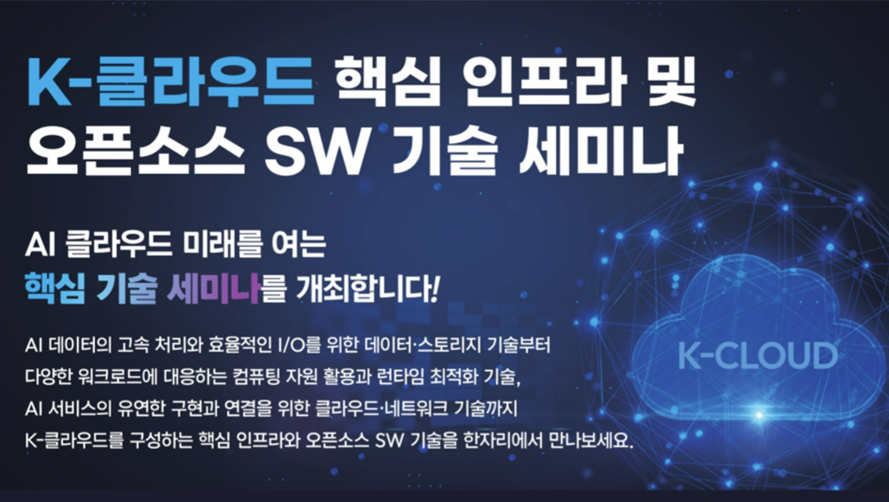
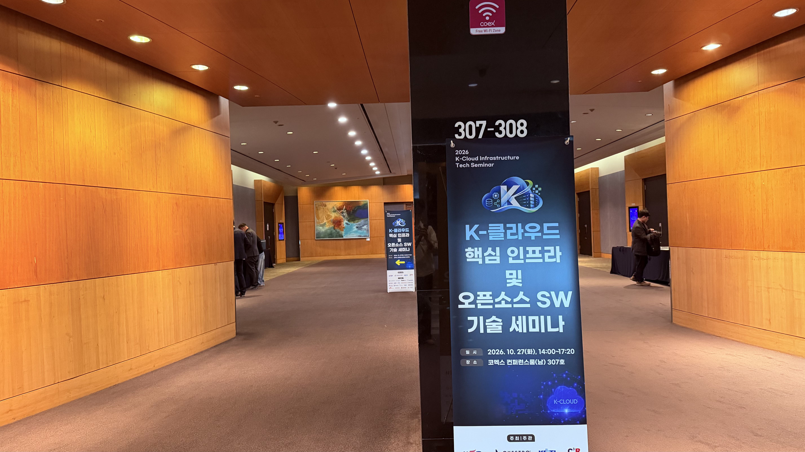
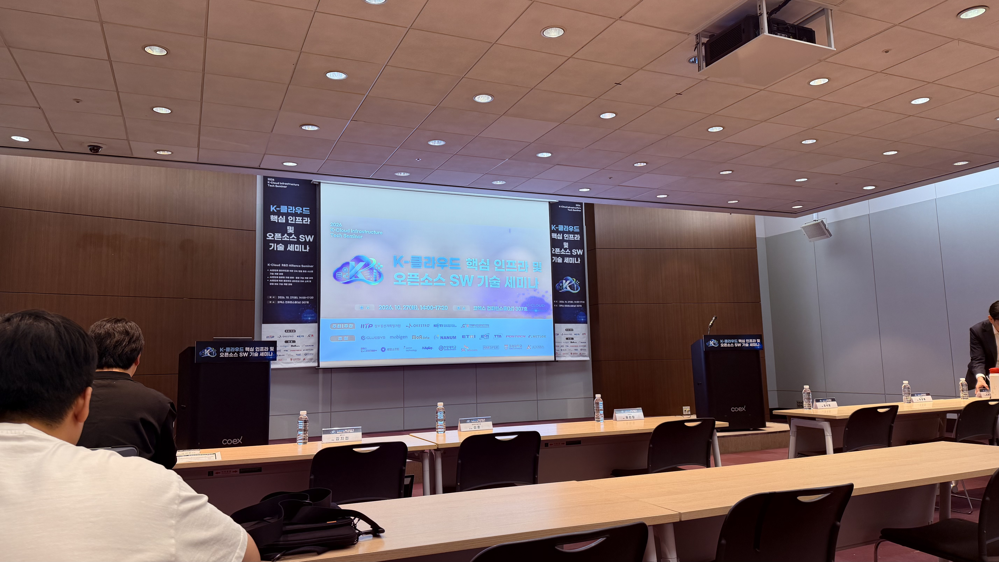

import ResponsiveTable from "@/components/ResponsiveTable.astro";

곧 있으면 시작될 소프트뱅크 해커톤 본선을 위해 색다른 시각을 얻어보고 싶어 이번에 K-클라우드 핵심 인프라 및 오픈소스 SW 기술 세미나에 참여해 보았다!

> 아직 배움이 얕아 발표 내용에 대한 온전한 이해가 되지 않았을 수 있습니다 ㅠㅠ 감안해서 확인해 주시고 혹시 틀린 내용 혹은 문제가 될 내용이 있다면 즉시 수정하도록 하겠습니다!

<ResponsiveTable wide>

| 시간           | 발표 제목                                                    | 연사            |
| ------------ | -------------------------------------------------------- | ------------- |
| 13:30\~14:00 | 등록 및 네트워킹                                                | -             |
| 14:00\~14:30 | 고속병렬 파일시스템 기반 멀티모달 데이터 플랫폼 아키텍처와 기술 소개                   | 박세종 팀장 (모비젠)  |
| 14:30\~15:00 | GPU에서 오브젝트 스토리지까지: ROCm/S3/DAOS로 잇는 I/O 경로               | 김지현 책임 (글루시스) |
| 15:00\~15:30 | 누구나 쉽게 개발할 수 있는 In-Storage Computing 기술                  | 심훈 연구원 (KETI) |
| 15:30\~15:50 | Coffee Break                                             | -             |
| 15:50\~16:20 | Elastic Resource Management in Cloud-Native Environments | 유현창 교수 (고려대)  |
| 16:20\~16:50 | 스팟 인스턴스 기반 AI 인프라를 위한 오픈소스 쿠버네티스 프로비저닝 및 LLM 서빙 시스템      | 이경용 교수 (한양대)  |
| 16:50\~17:20 | 모두의 AI 추론을 위한 오픈소스 네트워크 게이트웨이, LoxiLB-IGW                | 공성환 대표 (넷록스)  |
| 17:20        | 폐회                                                       | -             |

</ResponsiveTable>

위와 같은 형태로 진행되었으며 제일 흥미가 갔던 건 
- Elastic Resource Management in Cloud-Native Environments

현재 `CKA`를 준비 중이어서 제일 관련성이 높은 해당 섹션이 제일 기대되었다.(분량 조절을 위해 해당 섹션만 서술합니다!)

---

## Elastic Resource Management in Cloud-Native Environments

발표자 : 고려대 유현창 교수님

전체적인 발표의 핵심은 K8s 환경에서 컨테이너의 CPU·메모리를 워크로드에 따라 동적으로 조정하면서, 자원 부족으로 인한 OOM과 컨테이너 재시작을 최소화하는 연구에 대한 내용이었다.

### 자원의 탄력적 관리 
클라우드 환경에서는 워크로드마다 필요한 CPU,메모리가 다르고 실행 중에도 자원 요구량은 계속 변화한다.

따라서 리소스 스케일링에서는 다음 두가지 질문이 중요하다고 하셨다.

1. 언제 자원을 확장하거나 축소할 것인가?
2. 얼마나 많은 자원을 할당/회수할 것인가?

Kubernetes의 자원 확장은 크게 두가지로 분류되는데 
- Horizontal Scaling : Pod개수를 늘리는 방식  
복제 단위로 자원을 확장하기 때문에 상대적으로 관리 용이
- Vertical Scailing : 기존 Pod에 할당할 CPU·메모리 크기를 변경하는 방식  
동일한 노드의 한정 자원을 여러 워크로드가 공유하므로 관리가 복잡

기존 학계에서의 대부분의 연구는 `Horizontal` 방식을 사용한다고 하셨고(아마도..?) 진행하고 계신 연구는 `Vertical` 방식으로 접근하였다고 하셨다.

내가 이해한건 총 3가지 문제를 해결하는것이 초점이였다.

1. 메모리 할당량 변경 시 서비스 중단 문제 
2. 메모리 부족 시 OOM 발생 문제 
3. 메모리 과잉 할당과 비효율적인 회수 문제 

발표에서는 `Vertical Scailing` 중에서도 OOM으로 인한 컨테이너 재시작을 줄이는것이 핵심 문제라고 하셨던거 같다.

결국에 제일 중요한것은 
> 컨테이너를 재시작하지 않고 제한된 노드 메모리를 워크로드의 필요에 따라 동적으로 재분배하면서 OOM과 성능 저하를 최소하 하기 위한! 

### 기존 방식의 한계 

기존에도 Kubernetes 는 VPA를 통해 Pod의 CPU/메모리 요구량을 조정할 수 있다고한다.

- Recreate : 새로운 자원을 적용하기 위해 Pod를 재생성 - 실행중인 작업 종료 가능
- In-place Resize : Pod를 재생성하지 않고 CPU/메모리 할당량을 변경 - Node자체에 충분한 메모리가 없으면 확장 어려움

### EVMMv1
[논문](https://pure.korea.ac.kr/en/publications/elastic-vertical-memory-management-for-container-based-stateful-a/?utm_source=chatgpt.com)  

컨테이너별 메모리 수요와 우선순위를 고려해 메모리를 동적으로 조절하고,부족한 자원을 재분배 하기 

### EVMMv2
[논문](https://www.sciencedirect.com/science/article/abs/pii/S0167739X26000415?utm_source=chatgpt.com)

>K8s 환경에서 컨테이너의 메모리 요구량을 모니터링하고,제한된 메모리를 효율적으로 재분배 하기 위한 연구 

발표에서는 크게 3가지를 다루셨다.
1. Priority-Based Memeory Allocation : 컨테이너별 메모리 수요와 작업 우선순위를 고려해 메모리 할당량 동적으로 조절
2. Priority-Aware Suspension & Removal : 노드의 메모리가 부족해 모든 컨테이너 요구량 충족 불가시 우선순위에 따라 실행 상태 제어  
    - Suspension: `cgroup.freeze`로 작업을 일시 중단하고,스케줄러를 이용해 자원 확보 시 재개하거나 체크포인트 기반으로 복구.
    - Removal : 필요하다면 컨테이너 제거하여 메모리 확보

3. State Preservation : 컨테이너를 제거할 때 실행 상태가 손실되는 문제 해결을 위해 체크포인트 사용 

핵심 : 메모리가 부족해졌을 때 단순히 OOM으로 종료되게 x -> 우선순위에 따라 작업을 중단/제거/복구 하는 방식

**한계**  
일시 중단된 작업의 체크포인트를 생성하기 위해 실행을 재개하는 과정에서 메모리 사용량이 증가하면 OOM 발생 가능  
Suspension과 Checkpoint/Recovery 과정에는 작업 중단 및 복구에 따른 오버헤드가 존재

### VASUM

`- 현재 심사중`

기존 메모리 부족 대응을 개선하기 위한 후속 연구

1. Swap-Aware Memory Management : 물리 메모리 부족시 일부 메모리 페이지 Swap영역 이동(작업 일시 중단 방식 의존 줄이기)
2. 메모리 보호 : 최소 메모리 보호
3. PvP Curve기반 Scailing Size 결정 : 단순히 고정된 크기로 증가/감소 x -> `PvP Curve`를 사용하여 적절한 메모리 할당량 결정

---

## 느낀점 

전체적으로 나에게는 난도가 꽤 높은 세미나였다ㅠㅠ😂

각 발표에서 **어떤 문제가 있었고, 이를 해결하기 위해 어떤 접근 방식을 선택했는지**까지는 이해할 수 있었지만, 구체적인 구현 방식이나 기술적인 세부 사항으로 들어가니 이해하기 어려운 부분이 많았다.

그럼에도 각 발표에서 다룬 문제와 해결 방식은 정말 흥미로웠다.

`[고속병렬 파일시스템 기반 멀티모달 데이터 플랫폼 아키텍처와 기술 소개]`  
비동기적으로 유입되는 수억 건의 기업 데이터를 처리하면서, 서로 다른 형태의 데이터 간 관계를 어떻게 추론하고 갱신하는지 알 수 있었다.

`[GPU에서 오브젝트 스토리지까지: ROCm/S3/DAOS로 잇는 I/O 경로]`  
AI 학습·추론 과정에서 CPU와 기존 스토리지 I/O의 병목으로 GPU가 유휴 상태에 빠지는 문제를 어떻게 해결하려는지도 인상 깊었다. 특히 처음 접한 `DAOS`, `RDMA` 같은 기술이 흥미로웠다. 기존의 일반적인 네트워크 데이터 전달 방식과 달리 원격 컴퓨터의 메모리에 직접 데이터를 쓰는 방식이라니!

또한 인상 깊었던 발표는 한양대학교 이경용 교수님의 **「스팟 인스턴스 기반 AI 인프라를 위한 오픈소스 쿠버네티스 프로비저닝 및 LLM 서빙 시스템」** 이었다.

평소 막연하게 상상만 해봤던 스팟 인스턴스의 가격과 인터럽트 이력, 가용성 등의 데이터를 활용해 최적의 노드를 배치하고 비용을 절감하는 접근을 실제 연구와 시스템으로 구현했다는 점이 놀라웠다

특히 EKS의 단일 리전 제약을 극복하기 위해 HyperunJob이라는 Custom Resource와 이를 처리하는 Operator, Driver Pod를 구현하고, Driver Pod가 다른 리전의 EC2 인스턴스를 프로비저닝하여 k3s 기반으로 워크로드를 실행하도록 설계했다는 점이 나로썬 상상하기도 힘들었다...(~~사실 어떻게 설계하신건지 이해하기도 오래걸림..~~)

단순히 클라우드 서비스를 사용하는 것을 넘어, 기존 플랫폼의 제약을 분석하고 필요한 기능을 직접 설계하고 구현한다는 점에서 많은 것을 느낄 수 있었다.

아직 세부적인 기술까지 모두 이해하기에는 부족한 부분이 많지만, 평소 공부하던 Kubernetes와 클라우드 인프라 기술이 실제 연구에서는 어떤 문제를 해결하기 위해 활용되는지 살펴볼 수 있었던 유익한 시간이었다!!🔥
